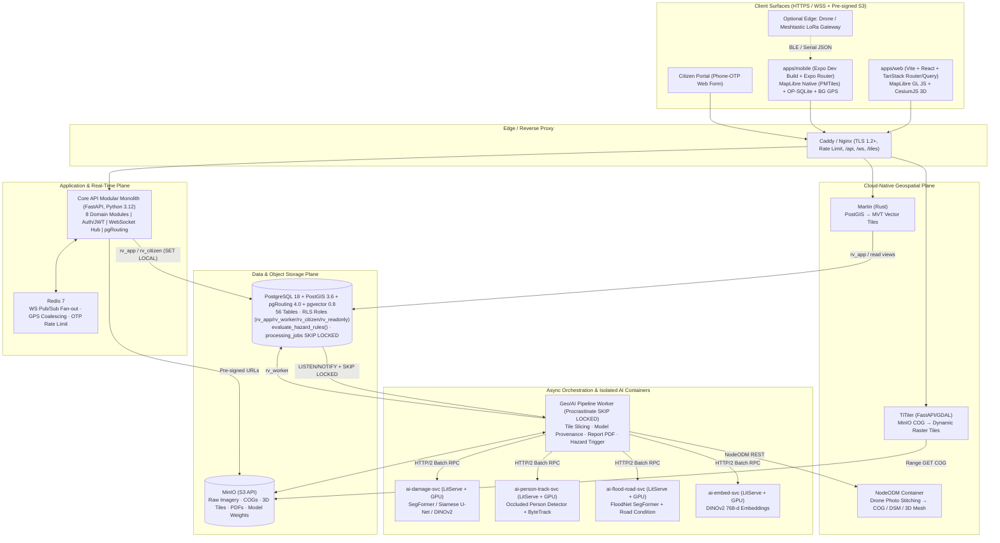

# RescueVision Platform Architecture Proposal — Architect A (Gemini 4 Hydrogen)

**Date:** 2026-11-25
**Author:** Architect A (Gemini 4 Hydrogen)
**Scope:** End-to-end software architecture for RescueVision (Phase 1 independent proposal)

---

## Executive Summary (10 Lines)

1. **Verdict on Microservices (Q1):** Reject granular domain microservices; adopt a **Domain-Modular Monolith Core + Isolated Runtime-Boundary Services** ("5-deployable core + stateless AI inference containers") to match a 6-student team and protect ACID/RLS transactions across the 56-table PostgreSQL 18 schema.
2. **AI Model Serving (Q2):** Replace in-process synchronous FastAPI inference with **LitServe (`Lightning-AI/LitServe`) containers per model family** behind internal HTTP/2/gRPC APIs, orchestrated asynchronously by **Geospatial Pipeline Workers** and **OpenDroneMap (`NodeODM`)**—never called directly by web or mobile clients.
3. **Backend & Messaging (Q3):** Standardize on **FastAPI (Python 3.12+)** as the Core API Modular Monolith (`psycopg3`/`asyncpg` with `SET LOCAL` RLS transactions), paired with **Rust-based `Martin`** for MVT vector tiles and **`TiTiler`** for Cloud-Optimized GeoTIFF (COG) raster tiles.
4. **Queues & Realtime (Q3):** Use **PostgreSQL `SKIP LOCKED` + `LISTEN/NOTIFY` (via `Procrastinate`)** on `processing_jobs` as the single durable job queue (zero dual-write loss), and add **Redis Pub/Sub + Streams** strictly for ephemeral WebSocket fan-out, GPS throttling, and OTP rate limits.
5. **Web Frontend (Q4):** Keep **Vite + React SPA** and upgrade `apps/web` from plain React Router to **TanStack Router + TanStack Query**, gaining Zod-validated URL search params for map state while avoiding Next.js RSC friction on WebGL/CesiumJS canvases.
6. **Mobile Frontend (Q4):** Confirm **Expo (React Native) + Expo Router**, strictly requiring **Expo Development Builds (CNG/EAS)**—never Expo Go—to run native **MapLibre (`pmtiles://`)**, offline SQLite (`OP-SQLite`), and background GPS.
7. **Core Innovations (Q5):** Ship **Cloud-Native Geospatial (`TiTiler + Martin + PMTiles`)** and **PostgreSQL Event-Replay** in core; target **Offline SQLite/CRDT + Meshtastic LoRa Mesh Bridge**, **Tool-Using Commander Copilot (`pgvector` RAG)**, and **Edge YOLO (`ExecuTorch`/`ONNX`)** as staged differentiators.
8. **Concrete End-to-End Flows:** Both *Drone Upload → Damage Map* and *Flood Report → Electrified Water Alert* preserve full `inference_runs` provenance, `<60s` alert/re-route SLA, and transaction-scoped RLS isolation.
9. **Report Alignment (D-02 & D-03):** Fully validates **D-02** (modular application + small service set) and **D-03** (queued background jobs), while recommending targeted clarifications in `section_3_3.md` and `15_security.sql` to name isolated LitServe model containers and drop ambiguous Celery references.
10. **Bottom Line:** Every architectural boundary exists for a **runtime reason** (GPU/CUDA isolation, C++/Rust tile throughput, or offline resilience)—never for organizational ceremony.

---

## 1. Grounding in Current Repository & Constraints

Before evaluating alternatives, any viable architecture must respect what the team has already built and approved in the repository:

* **Approved Data & Security Backbone (`database/`):** 56 normalized tables across 8 domains (`D1`–`D5`) on **PostgreSQL 18.7** (`uuidv7()`), **PostGIS 3.6.4**, **pgRouting 4.0.2**, and **pgvector 0.8.7** (`database/README.md`). Every table has **Row-Level Security (RLS)** enabled (`database/schema/15_security.sql`) with 4 group roles (`rv_app`, `rv_worker`, `rv_citizen`, `rv_readonly`), column guards, `audit_log` triggers across 27 tables, and PL/pgSQL functions `evaluate_hazard_rules()` and `resolve_compound_alert()` (`database/schema/12_hazard_engine.sql`).
* **Current AI Prototype (`api/`, `configs/`):** `api/main.py` is a synchronous FastAPI prototype loading `DisasterPredictor` in-process at startup (`api/services/inference_service.py`) and blocking `POST /predict` until inference and PDF generation finish. Model configs under `configs/` span `SegFormer` (building, damage, FloodNet), `Siamese U-Net` / `ChangeFormer` (change detection), `DINOv2-base` / `EfficientNet-B3` (damage crop classification + 768-d retrieval embeddings), with `person_detections`/`ByteTrack` specified in the ERD and requirements (`docs/superpowers/specs/2026-11-23-rescuevision-database-erd-design.md`).
* **Frontend Turborepo Scaffold (`frontend/`):** A pnpm + Turborepo workspace separating `apps/web` (React + Vite SPA + MapLibre GL JS + TanStack Query + Zustand), `apps/mobile` (Expo + Expo Router), `packages/api` (`openapi-typescript` + `openapi-fetch` + Zod + TanStack Query hooks), and `packages/contracts` (shared enums, geo helpers, WebSocket Zod schemas). A legacy `dashboard/` Vite app and `mapping/` Folium prototypes also exist.
* **Report Decisions (`docs/documentation/chapter5/section_3_3.md`, Table 3-39):** Notably **D-01** (one shared incident), **D-02** (modular application + small number of services), **D-03** (queued background analysis jobs), **D-04** (database RLS), **D-08** (offline mobile sync), and **D-10** (persistent live-update push).
* **Greenfield Starting Baseline & Real Doc Tensions:** Because implementation starts tomorrow with AI coding agents, empty `src/` or scaffolded `frontend/` folders are expected. The real risk today is **architectural contradiction across existing documents** (e.g., synchronous `api/main.py` vs. `D-03`; `15_security.sql` Celery comment vs. `section_3_3.md` `SKIP LOCKED`; legacy `dashboard/` vs. `frontend/`; plain React Router vs. TanStack Router; direct Martin DB access vs. `rv_app` RLS; and a report-focused root `AGENTS.md` instead of an engineering contract). Section 5 and the companion blueprint folder unify these into one track.

---

## 2. Three Complete Alternative Architectures Compared

To answer Questions 1–4 rigorously, three complete end-to-end architectures are evaluated below.

### Option A: Pure Granular Microservices
* **Topology:** 10+ independent services (Auth, Incidents/Missions, Imagery, Buildings/Cost, Routing, Persons/Cases, Hazards, Reports, Citizens, Notifications) each with its own API, repo/build, and schema/bounded database, communicating over **Apache Kafka** + **gRPC**, with **NVIDIA Triton** for all AI models and **Kubernetes** orchestration.
* **Why it fails for RescueVision:**
  * Directly breaks the approved 56-table single-database relational + spatial integrity model. For example, `evaluate_hazard_rules()` (`database/schema/12_hazard_engine.sql`) joins `hazards`, `infrastructure_assets`, `road_segments`, `routes`, `route_segments`, `responder_last_positions`, and `notifications` in **one ACID transaction**. Splitting these into microservices forces distributed Sagas, eventual consistency bugs (e.g., routing through an electrified road during Saga lag), and duplicating RLS policies across 10 services.
  * Imposes Martin Fowler's *"Microservice Premium"* (network latency, schema registries, distributed debugging, Kubernetes ops) on 6 students.

### Option B: Classic Single-Container Monolith + Celery
* **Topology:** Expand `api/main.py` into one large FastAPI app plus one monolithic Celery worker container that imports PyTorch, CUDA, GDAL, OpenCV, `reportlab`, and all 6+ AI models directly into the worker Python environment, backed by Postgres + RabbitMQ/Redis + Nginx.
* **Why it falls short:**
  * **Dependency & VRAM collision:** Mixing web API dependencies, GDAL/rasterio, `transformers`/DINOv2, `ultralytics`/YOLO, and photogrammetry into one Python environment creates brittle builds and GPU OOM crashes.
  * **No model isolation:** Fails the owner's explicit requirement that all AI models be isolated from the backend, each in Docker, behind APIs. Upgrading one model checkpoint or Python/CUDA runtime forces redeploying the entire backend.
  * **Poor tile performance:** Serving raw raster/vector geo-layers through custom Python/FastAPI endpoints cannot match dedicated C++/Rust tile servers.

### Option C (Recommended): Domain-Modular Monolith Core + Isolated Runtime-Boundary Services
* **Topology:** Separate services strictly along **runtime, hardware, and protocol boundaries** rather than CRUD table boundaries:
  1. **Core API Modular Monolith** (FastAPI, Python 3.12+): 8 internal domain modules (`D1`–`D5`) sharing one strict boundary-enforced codebase, handling REST, auth/JWT, WebSockets, pgRouting orchestration, and transaction-scoped RLS (`rv_app` / `rv_citizen`).
  2. **Geospatial & Job Orchestration Worker(s)** (Python + `Procrastinate` / `psycopg3` + `rasterio`): Claims `processing_jobs` via `SKIP LOCKED` (`rv_worker`), slices COGs into tiles, batches requests to isolated AI model containers, writes spatial/provenance rows, triggers `evaluate_hazard_rules()`, and renders PDF/HTML reports.
  3. **Isolated AI Model Containers** (Docker, GPU-enabled, **LitServe**): One container per model-family runtime (`ai-damage-svc`, `ai-person-track-svc`, `ai-flood-road-svc`, `ai-embed-svc`), stateless, exposing uniform `/predict`, `/health`, `/metadata` endpoints over internal HTTP/2 (or gRPC).
  4. **Photogrammetry & Cloud-Native Geo Plane**: **NodeODM** (`OpenDroneMap/NodeODM`) for drone stitching, **TiTiler** (`developmentseed/titiler`) for COG raster tiles, and **Martin** (`maplibre/martin`, Rust) for PostGIS MVT vector tiles.
  5. **State & Infra Layer**: **PostgreSQL 18** (+ PostGIS/pgRouting/pgvector), **MinIO** (S3 object store), and **Redis** (ephemeral WebSocket Pub/Sub, live GPS coalescing, OTP rate limiting).

### Comparison Matrix

| Dimension | Option A: Granular Microservices | Option B: Single Monolith + In-Process AI | Option C: Modular Monolith + Isolated AI/Geo Plane (Recommended) |
|---|---|---|---|
| **Team Velocity (6 students)** | Low (high DevOps & boilerplate tax) | High initially, degrades with dependency conflicts | **High** (1 core API codebase + clean model containers) |
| **ACID & Spatial Rule Integrity** | Weak (requires Sagas across `hazards`/`routes`) | Strong (single Postgres ACID) | **Strong** (single Postgres ACID + `evaluate_hazard_rules()`) |
| **AI Isolation & GPU Scaling** | Strong (Triton) | None (coupled to backend Python env) | **Strong** (each model family in its own Docker container) |
| **RLS Security Enforcement** | Duplicated across 10 services | Centralized in Postgres | **Centralized in Postgres** (`SET LOCAL` per transaction) |
| **Map Tile Latency** | Medium–High | Slow (Python PNG/GeoJSON endpoints) | **Sub-20ms vector (Martin Rust) + dynamic COG (TiTiler)** |
| **Failure Blast Radius** | Complex cascading retries | AI OOM crashes worker/API | **API stays online if any AI container crashes (NFR-RL-04)** |

---

## 3. Deep-Dive Answers to the Five Architectural Questions

### Q1: Should RescueVision Use a Microservice Architecture?

**Clear Answer: Hybrid — NO to domain-based microservices; YES to a Domain-Modular Monolith paired with isolated AI/geospatial runtime services.**

#### Research & Industry Validation
* **Martin Fowler's *Monolith First* & *Microservice Premium*:** Fowler documents that greenfield systems built as microservices from day one routinely suffer under distributed-systems overhead (network serialization, partial failures, eventual consistency, cross-service debugging) before domain boundaries are even stabilized (`martinfowler.com/bliki/MonolithFirst.html`).
* **Shopify Engineering's *Modular Monolith*:** Shopify scaled to hundreds of engineers using a **Modular Monolith** (strict internal module boundaries and public interfaces inside one deployable unit) specifically to avoid cross-service network latency and preserve relational ACID transactions (`shopify.engineering`).
* **Real-World Humanitarian & Disaster Platforms on GitHub:**
  * `ushahidi/platform` (Digital Public Good for crisis crowdsourcing), `sahana/eden` (humanitarian coordination RAD framework), and `kobotoolbox/kpi` (field crisis data collection) all run **modular monolithic backends** paired with asynchronous workers—not 15 CRUD microservices.
  * `OCHA-DAP/ds-geospatial-impact-estimates` (UN OCHA) separates **data ingestion/ML pipelines** from a **lightweight Vite + TypeScript + deck.gl SPA**, while `hotosm/fAIr` separates the web backend from isolated Geo-AI inference/training containers.

#### Why This Hybrid Wins for RescueVision
1. **Cross-Domain Spatial Joins Are Core Business Logic:** Computing a rescue route (`D4b`) checks `vehicles.max_water_depth_cm` (`D1`), `missions` (`D2`), `buildings` collapse proximity (`D4a`), and `alert_closed_segments` (`D4d`). Splitting `D1`–`D5` into microservices would turn a single 5ms PostGIS/pgRouting SQL query into 5 network hops and fragile eventual consistency.
2. **Row-Level Security (`D-04`) Lives in Postgres:** All 56 tables enforce agency isolation via `app.set_session_user()` and `incident_agencies`. Keeping one Core API guarantees every endpoint obeys one transaction wrapper.
3. **Where Separation *Is* Mandatory:** Heavy GPU models, C++ photogrammetry (`NodeODM`), and high-throughput tile servers (`Martin`/`TiTiler`) have completely different scaling profiles, crash modes, and dependencies from CRUD/auth APIs. Separating those—and only those—yields all the resilience benefits of microservices without the distributed-data tax.

---

### Q2: How Should Isolated Docker AI Models Be Served? (FastAPI vs. Alternatives)

**Clear Answer: Do NOT use raw FastAPI (`api/main.py`) for model serving. Use `LitServe` (`Lightning-AI/LitServe`) as the standard wrapper for each isolated Docker model container, invoked asynchronously by Geospatial Workers—and reserve `NVIDIA Triton` / `ONNX Runtime` as an optional optimization specifically for the high-FPS YOLO/ByteTrack or DINOv2 encoder.**

#### Why Bare FastAPI Is Weak for Model Serving
Raw FastAPI is a great web framework, but lacks ML-serving primitives:
* Every `POST /predict` processes **one request at a time** (no dynamic micro-batching across concurrent building crops or video frames), underutilizing GPU tensor cores.
* No built-in multi-worker GPU device pinning (`CUDA_VISIBLE_DEVICES` round-robin across replicas), request-level batch timeouts, or streaming tensor backpressure.
* Mixing heavy `torch`/`cuda` imports directly inside `api/main.py` (as the current prototype does) blocks the asyncio event loop unless carefully offloaded to thread/process pools.

#### Comparison of Model-Serving Frameworks for RescueVision's Actual Models

| Criterion | Bare FastAPI | **LitServe** (`Lightning-AI/LitServe`, ~3.8k★) | **BentoML** (`bentoml/BentoML`, ~13k★) | **Triton Inference Server** (`triton-inference-server/server`, ~11.2k★) | **Ray Serve** |
|---|---|---|---|---|---|
| **Dynamic Batching** | Manual (hard) | **Built-in (`max_batch_size`, `batch_timeout`)** | Built-in (`@bentoml.api` adaptive) | Best-in-class (C++ scheduler) | Built-in |
| **PyTorch + Custom Geo/CV Logic** | Trivial | **Trivial (pure Python `LitAPI` subclass)** | Moderate (`Runner`/Service abstractions) | Hard (requires TorchScript/ONNX/TRT or Python backend + `config.pbtxt`) | Moderate |
| **Multi-GPU / Worker Scaling** | Manual Uvicorn flags | **Automatic `workers_per_device`** | Good (multi-runner) | Native concurrent model execution | Multi-node cluster |
| **Container Build Simplicity** | Standard Dockerfile | **Standard Dockerfile (FastAPI-compatible)** | Managed (`bentoml build` / `bentofile.yaml`) | Heavy NVIDIA base images + model repo layout | Heavy Ray head/worker cluster |
| **Student Learning Curve** | Lowest | **Very Low (built on FastAPI)** | Moderate | Steep | Steep |

#### Recommended AI Serving Architecture: Two-Tier Isolation

1. **Model-Family Docker Containers (Stateless GPU APIs via LitServe):**
   Instead of 1 giant ML monolith or 15 tiny containers for every checkpoint, group models by **compatible runtime & GPU footprint**:
   * **`ai-damage-svc` (LitServe + PyTorch):** Hosts `building_seg` (SegFormer/U-Net), `change_detection` (Siamese U-Net / ChangeFormer), and `damage_classifier` (`DINOv2-base` + MLP). Why LitServe shines here: an orthomosaic contains hundreds of building footprints; the worker sends cropped pre/post patches, and LitServe's **dynamic batcher** automatically packs them into optimal `batch_size=32` GPU forward passes (matching `configs/dinov2_damage_classifier.yaml`).
   * **`ai-embed-svc` (LitServe + PyTorch):** Shares or isolates `DINOv2-base` 768-d feature extraction for `image_embeddings` (`pgvector`) similarity search.
   * **`ai-flood-road-svc` (LitServe + PyTorch):** Hosts `floodnet_segformer.yaml` (road/floodwater segmentation) and hazard segmentation.
   * **`ai-person-track-svc` (LitServe + Ultralytics YOLO / ByteTrack):** Hosts occluded aerial person detection (SARD/VisDrone/POP) and multi-frame tracking. Can optionally swap its internal inference engine to **ONNX Runtime / TensorRT** inside the same LitServe HTTP/gRPC contract without changing a single line in the backend!
   * **`nodeodm` (`OpenDroneMap/NodeODM`, ~6.6k★ for ODM):** Dedicated photogrammetry container converting raw overlapping drone photos + EXIF GPS into georeferenced **COGs, DSMs, and 3D Mesh Tiles**.

2. **Why `HTTP/2 + Binary/Shared-URI` (or `gRPC`) Between Worker and Model Containers—Never Direct Client Access:**
   * **Never pass 500MB GeoTIFFs over REST JSON/base64.** The Geospatial Worker passes **MinIO object keys or pre-cropped numpy/PNG binary payloads** (e.g., `multipart` or `application/octet-stream` / gRPC bytes for 512×512 tiles) to LitServe, keeping memory bounded and latency low.
   * **Model Registry Alignment (`ai_models`):** Every model container exposes `GET /v1/model-info` returning `{ name, version, architecture, weights_sha256 }`. On startup/invocation, the worker verifies this matches the active row in `ai_models`, guaranteeing every `building_assessments` and `person_detections` row records a verified `inference_run_id` (FR-IM-07).

---

### Q3: Backend Language/Framework & Inter-Service Communication

**Clear Answer: Keep `FastAPI` (Python 3.12+) as the Core API Modular Monolith, use `PostgreSQL` (`Procrastinate` / `SKIP LOCKED` + `LISTEN/NOTIFY`) for durable jobs and transactional triggers, `Redis` strictly for ephemeral live WebSocket fan-out, and delegate high-throughput map tiles to `Martin` (Rust) + `TiTiler` (Python/GDAL).**

#### Backend Framework Evaluation

| Criterion | **FastAPI (Python 3.12+)** | **NestJS (TypeScript)** | **Go (Chi / Echo)** | **Rust (Axum)** | **Elixir (Phoenix)** |
|---|---|---|---|---|---|
| **PostgreSQL RLS (`SET LOCAL` + PgBouncer)** | **Good** (`psycopg3` or `asyncpg` with `statement_cache_size=0` inside explicit `BEGIN...COMMIT`) | **Fragile with Prisma** (opaque pooler; needs raw `$transaction` + throttled pools); okay with raw `pg` | **Excellent** (explicit `db.BeginTx`, zero magic) | **Excellent** (`sqlx` explicit transactions) | **Good** (`Ecto.Repo.transaction`) |
| **Geospatial & Reporting Ecosystem** | **Unmatched** (`shapely`, `rasterio`, `pyproj`, `reportlab`, `weasyprint`, `Jinja2`) | Poor (lacks native GDAL/geospatial/scientific parity) | Weak for raster/reporting | Growing (`geo`), steep for PDF/reports | Weak |
| **Contract Sync with `frontend/packages/api`** | **Native (`/openapi.json` → `openapi-typescript`) — already built!** | Good (`@nestjs/swagger`) | Requires `swag` / `ogen` | Requires `utoipa` | Requires `open_api_spex` |
| **Team Fit (6 students)** | **Highest** (existing `api/` is FastAPI; ML & GIS teammates share Python) | Split stack (TS backend + Python AI/GIS) | New language for most students | Too slow to iterate in 1 year | Niche hiring/learning curve |
| **Raw HTTP / Tile Throughput** | High for API CRUD; slow for 1000s of vector tiles/sec | High for I/O | Very High | Highest | High concurrency / WebSockets |

**The Smart Architectural Twist:** Python's only real performance weakness in RescueVision is **serving thousands of map tiles per second** and **heavy image crunching**. Rather than rewriting the whole backend in Go or Rust, we offload tile serving to **`maplibre/martin`** (~4.1k★, written in Rust, reading PostGIS tables/functions directly into MVT vector tiles) and **`developmentseed/titiler`** (~1.2k★, reading COG byte-ranges from MinIO). FastAPI stays lean, readable, and tightly coupled to `packages/api` via `/openapi.json`.

#### Internal Modular Monolith Structure (Enforced Boundaries)
Inside `backend/src/rescuevision_api/`, organize packages matching the 8 ERD domains (`identity`, `incidents`, `imagery`, `buildings_cost`, `routing`, `cases`, `hazards`, `field_reports`), enforcing import-lint rules (`import-linter` in CI) so modules communicate only through explicit internal service interfaces and DB views—preserving future extractability per **D-02**.

#### Inter-Service Communication Protocol Matrix

| Path | Protocol / Mechanism | Why This Choice |
|---|---|---|
| **Web / Mobile ↔ Core API** | **HTTPS REST (JSON)** + **WebSockets (`/ws/v1/incidents/{id}`)** | `packages/api` already uses `openapi-fetch` + WebSocket Zod events. REST for CRUD/commands; WebSocket for `<2s` responder positions, SOS, hazard alerts, and job progress (`D-10`). |
| **Clients ↔ MinIO** | **Pre-signed S3 PUT/GET URLs (Multipart)** | Keeps gigabytes of drone/satellite imagery off the Core API (`section_3_3.md` §3.3.1.3) and enables resumable field uploads (`NFR-RL-03`). |
| **Core API ↔ Geo/AI Worker** | **PostgreSQL `processing_jobs` (`SKIP LOCKED` + `LISTEN/NOTIFY` via `Procrastinate`)** | **Zero dual-write problem:** inserting a `capture_sessions` or `processing_jobs` row commits atomically with the job wakeup. Matches `section_3_3.md` line 305! No RabbitMQ/Kafka needed. |
| **DB Hazard Trigger ↔ Live WebSockets** | **Postgres `LISTEN/NOTIFY` → Core API Listener → Redis Pub/Sub → WebSocket Rooms** | When `evaluate_hazard_rules()` commits a `compound_alerts` row, Postgres emits `NOTIFY alert_events, '<alert_id>'`. API replicas fan it out over Redis Pub/Sub to all connected incident sockets, enforcing RLS membership before emitting payloads. |
| **Geo Worker ↔ AI Model Containers** | **Internal HTTP/2 (REST binary/multipart) or gRPC** | Synchronous RPC *inside* an async worker job. Worker handles retries, progress updates (`%` every `<30s` per `NFR-PF-05`), and MinIO artifact writes. |
| **Why NOT Kafka / NATS?** | Rejected for Phase 1 | Kafka adds Zookeeper/KRaft + JVM overhead with zero benefit at pilot throughput (<1,000 jobs/sec). NATS JetStream is only warranted later if deploying multi-region tactical edge relays. |

---

### Q4: Frontend & Mobile Architecture

#### Web Command Console: TanStack Router + TanStack Query (Vite SPA) vs. React Router vs. Next.js

**Verdict: Use `Vite + React SPA` with `TanStack Router` + `TanStack Query` (and `Zustand` for ephemeral UI/map-layer toggles). Do NOT use Next.js, and keep plain React Router out.**

1. **Why TanStack Router Beats Plain React Router for RescueVision:**
   * A disaster command console lives in **complex, shareable URL search state**: active `incidentId`, map `[lat, lng, zoom, bearing]`, visible layers (`damage,flood,electrifiedWater,routes,responders`), filter facets (`damageGrade=MAJOR,DESTROYED`, `triage=IMMEDIATE`, `unreviewedOnly=true`), and selected entity (`caseId` or `buildingId`).
   * **TanStack Router** treats search parameters as **first-class, Zod-validated typed state** (`validateSearch`). If an Analyst copies a URL to a Commander's chat, the exact map viewport, filters, and open drawer restore deterministically—and TypeScript prevents broken links at compile time.
   * **Native TanStack Query Integration:** Route loaders (`beforeLoad` / `loader`) prefetch incident geometry and summary queries via `queryClient.ensureQueryData()` before rendering, eliminating waterfall spinners when switching between *Incident Map*, *Detection Review*, and *Route Planner*.
2. **Why NOT Next.js (App Router) or TanStack Start SSR:**
   * `frontend/apps/web/README.md` rightly notes: *"Authenticated internal tool — no SSR/SEO, so a static SPA served beside the FastAPI backend."*
   * MapLibre GL JS, CesiumJS (3D WebGL), deck.gl overlays, and persistent WebSockets are 100% browser-only APIs. Next.js's React Server Components (RSC) force `'use client'` boundaries everywhere while adding a Node.js SSR runtime to maintain in Docker.
   * *Exception:* If the **Citizen Request Portal** (public phone-OTP submission) needs lightweight static/SEO delivery later, deploy it as a tiny standalone route or lightweight micro-SPA on Nginx—never drag RSC complexity into the command console.

#### Mobile Field App: Confirm or Challenge Expo React Native?

**Verdict: CONFIRM `Expo (React Native) + Expo Router`, WITH ONE MANDATORY REQUIREMENT: Use Expo Development Builds (Prebuild / EAS Build), NEVER Expo Go.**

* **Why Expo + Expo Router Is Right:**
  * Shares **`packages/api`** (generated FastAPI SDK + TanStack Query + WebSocket client) and **`packages/contracts`** (damage classes, START triage enums, Zod event schemas) directly with `apps/web` inside the existing Turborepo. Zero duplicated API logic across web and mobile.
  * Expo Router gives type-safe deep linking for push notifications (`rescuevision://alerts/{id}`, `rescuevision://missions/{id}`, `rescuevision://sos/{id}`).
* **Why Expo Go Will Fail (and Development Builds Succeed):**
  * **Offline Maps (`D-08`):** Responders in dead cellular zones need `@maplibre/maplibre-react-native` rendering local **`.pmtiles`** (`pmtiles://file://...`) on Metal/Vulkan/OpenGL—native C++ bindings unsupported in Expo Go.
  * **Offline Sync Queue:** Requires `op-sqlite` or `expo-sqlite` + background location tasks (`expo-location` + `expo-task-manager`) + background upload resilience (`NFR-RL-03`).
  * **Important Repo Check:** `frontend/apps/mobile/README.md` currently plans `src/services/` interfaces (`LocationService`, `StorageService`, `CameraService`, `BackgroundTaskService`), which cleanly isolates native Expo Development Build modules from feature code. Keep that exact boundary.

---

### Q5: Out-of-the-Box Innovations (Honest Value / Feasibility / Risk Scorecard)

| # | Innovation Idea | What It Does in RescueVision | Disaster Value | 1-Year Feasibility (6 Students) | Key Risk | Verdict |
|---|---|---|---|---|---|---|
| **1** | **Cloud-Native Geo Stack (`TiTiler` + `Martin` + `PMTiles`)** | Stream gigapixel COG drone orthomosaics dynamically (`TiTiler`), serve live PostGIS damage/hazard/route MVT tiles (`Martin`), and export offline `.pmtiles` packs for Expo field devices. | **Very High** (instant map pan/zoom + true offline base maps) | **High** (off-the-shelf Docker images + SQL views) | CRS/EXIF alignment issues on raw drone imagery | **BUILD IN CORE** |
| **2** | **Incident Time-Travel & Replay Engine (Spatial Event Sourcing Lite)** | Scrub a timeline slider on the 2D/3D map to replay every detection, flood report, *Electrified Water* closure, route invalidation, and responder track minute-by-minute using existing append-only tables (`audit_log`, `case_events`, `road_condition_observations`, `responder_positions`). | **High** (after-action review, accountability, thesis demo killer feature) | **High** (data model already records history; needs temporal query endpoints + UI scrubber) | Query slowness if `responder_positions` isn't windowed | **BUILD IN CORE** |
| **3** | **Offline-First Sync (`PowerSync`/SQLite) + LoRa Mesh Bridge (`Meshtastic`)** | Field app writes missions/hazards/SOS to local SQLite; when cellular dies, an Expo BLE bridge sends compact 200-byte SOS / GPS / Flood-Hazard packets over **$35 ESP32 LoRa `Meshtastic`** radios to a command-laptop gateway that injects them into FastAPI! | **Transformative** (works when cell towers collapse) | **Medium-High** (SQLite queue = High; 1-week Meshtastic serial/BLE gateway demo = Medium) | Bluetooth permissions & packet truncation on mobile | **SQLite in Core; Meshtastic as Flagship Stretch** |
| **4** | **Tool-Using Spatial Commander Copilot (`pgvector` + Read-Only SQL/Routing)** | Natural-language/Arabic-English sidebar for Commanders: *"Find stranded cases within 500m of Electrified Water and show similar Kahramanmaraş collapses."* Uses structured tool calling against RLS-scoped read-only views + `image_embeddings` (`pgvector` HNSW), **always citing IDs and never auto-dispatching (`D-07`)**. | **High** (cuts cognitive overload under crisis) | **High** (uses existing `image_embeddings` + Postgres views + structured tool-calling) | LLM hallucinating coordinates or counts if not strictly tool-grounded | **BUILD AS PHASE 2 (Strictly Read-Only Tools)** |
| **5** | **Edge AI Triage on Phone / Drone Ground Station (`ExecuTorch` / `ONNX Runtime`)** | Run quantized `YOLO`-nano person detector locally on the responder's phone or drone tablet (`onnxruntime-react-native` / Python edge agent) when bandwidth cannot upload 4K video—syncing only tiny GPS + crop metadata instead of gigabytes. | **Very High** (seconds vs. minutes in SAR) | **Medium** (exporting YOLO to `.ort`/`.pte` is easy; mobile thermal throttling & GPS projection math are tricky) | False positives on low-res mobile previews without analyst review | **STRETCH / DEMO TRACK** |
| **6** | **3D Gaussian Splatting (3DGS) Rapid Rubble Viewer** | Complement CesiumJS extruded building blocks (`buildings.height_m` + xBD grade) with fast 3DGS splat reconstructions of collapsed priority sites inside a WebGL viewer—minutes instead of hours for dense photogrammetry meshes. | **Medium-High** (inspections of partial collapses) | **Low-Medium** (training pipeline + WebGL splat alignment with WGS84 coordinates takes significant R&D) | Heavy VRAM; coordinate georeferencing drift | **DEFER / RESEARCH DEMO ONLY** (Keep CesiumJS + OSM/DSM extruded 3D Tiles as baseline) |
| **7** | **WebGPU Client-Side Raster Swipe & Confidence Scrubbing** | Custom WebGL2/WebGPU MapLibre shader layer blending pre/post COGs, change masks, and live confidence-threshold sliders at 60 FPS in-browser with zero backend round-trips. | **Medium-High** (analysts inspect uncertainty visually) | **High** (MapLibre custom layer + TiTiler tiles) | WebGPU Safari/older laptop fallback needed | **EASY WIN (WebGL2 fallback)** |

---

## 4. Concrete Architecture Blueprint

### 4.1 System Container & Component Diagram



### 4.2 Container Inventory & Responsibilities

| Container | Technology | DB Role | Hardware | Primary Responsibility |
|---|---|---|---|---|
| `proxy` | Caddy 2 or Nginx | — | CPU | TLS termination, `/api/*` → Core API, `/ws/*` → Core API, `/tiles/vector/*` → Martin, `/tiles/raster/*` → TiTiler, `/s3/*` → MinIO pre-signed proxy. |
| `core-api` | FastAPI + Uvicorn/Gunicorn | `rv_app`, `rv_citizen` | CPU (2+ workers) | Auth/JWT + OTP, incident/mission/case/report APIs, pgRouting wrapper, WebSocket rooms, pre-signed MinIO URL issuance. Enforces `SET LOCAL` RLS per transaction. |
| `geo-worker` | Python + `Procrastinate` + `rasterio` + `reportlab` | `rv_worker` | CPU (multi-process) | Claims `processing_jobs` (`STITCH`, `ANALYZE`, `ROUTE`, `REPORT`), invokes NodeODM & AI containers, writes `buildings`/`building_assessments`/`person_detections`/`cost_estimates`, snapshots reports. |
| `ai-damage-svc` | Docker + CUDA + `LitServe` | None (stateless!) | GPU | Building segmentation, pre/post change detection, DINOv2 xBD damage classification (`configs/dinov2_damage_classifier.yaml`, `change_siamese_unet.yaml`). |
| `ai-person-track-svc` | Docker + CUDA + `LitServe` | None (stateless!) | GPU | Aerial occluded person detection + ByteTrack multi-frame tracking + pixel-to-ground projection helpers. |
| `ai-flood-road-svc` | Docker + CUDA + `LitServe` | None (stateless!) | GPU | FloodNet SegFormer water/road-obstruction segmentation (`configs/floodnet_segformer.yaml`). |
| `ai-embed-svc` | Docker + CUDA + `LitServe` | None (stateless!) | GPU (can share GPU with `ai-damage-svc` via MPS/time-slicing in dev) | Produces 768-d vectors for `image_embeddings` (`configs/retrieval.yaml`). |
| `nodeodm` | `opendronemap/nodeodm` | None | CPU/GPU (high RAM) | Stitches raw drone frames into COG orthomosaic, DSM/DTM, and 3D mesh tiles. |
| `martin` | `ghcr.io/maplibre/martin` | `rv_readonly` / scoped function source | CPU (tiny footprint) | Streams PostGIS tables/functions (`buildings`, `road_segments`, `compound_alerts`, `responder_last_positions`) as MVT vector tiles. *Note: wrap incident-scoped functions with user/incident JWT check at proxy/API-signed tile URLs so RLS isn't bypassed!* |
| `titiler` | `ghcr.io/developmentseed/titiler` | None | CPU | Reads Cloud-Optimized GeoTIFFs from MinIO via S3 range requests and serves dynamic XYZ/WebMercator PNG/WebP tiles + band math. |
| `postgres` | PostgreSQL 18 + PostGIS + pgRouting + pgvector | Owner (migrations only) | CPU + fast NVMe | Single source of truth, RLS enforcement, `evaluate_hazard_rules()`, `pgr_aStar`, HNSW vector search, monthly partitions. |
| `pgbouncer` | PgBouncer (Production) | — | CPU | Transaction-mode connection pooling in prod (`statement_cache_size=0` in `asyncpg`/`psycopg3`). |
| `minio` | MinIO (S3 API) | — | Storage | Stores raw imagery, COGs, 3D tiles, AI masks, citizen media, frozen report PDFs, model weights. |
| `redis` | Redis 7 | — | CPU | Ephemeral WebSocket Pub/Sub across `core-api` replicas, OTP throttling, GPS ping rate-limiting/debouncing. |

> **Critical Security Note on Martin Vector Tiles:** Because Martin connects directly to Postgres, exposing unguarded Martin endpoints would bypass per-user incident isolation (`D-04`). Solution: either pass short-lived signed tile tokens verified via Caddy `forward_auth` / FastAPI subrequest, or configure Martin to execute a PostGIS tile function `app.mvt_incident_layer(z, x, y, query_params)` that validates a signed HMAC/JWT incident claim and runs `SET LOCAL` before querying!

---

### 4.3 Concrete Data Flow 1: Drone Upload → Damage Map & Cost Estimates

1. **Pre-Signed Direct Upload:** Analyst creates a `capture_sessions` row (`POST_EVENT`, `DRONE`) via `core-api` (`rv_app`, RLS checks `incident_agencies.status = 'ACTIVE'`). `core-api` issues pre-signed MinIO `PUT` URLs. Browser/mobile uploads raw GeoTIFF/JPEG frames directly to `incidents/{incident}/captures/{session}/raw/{image}` and confirms upload with SHA-256 checksums (`images` rows inserted; duplicates rejected via `UNIQUE (sha256)`).
2. **Job Enqueue (`D-03`):** Analyst clicks *Run Stitching & Damage Analysis*. `core-api` atomically inserts `processing_jobs` (`job_type='STITCH'`, `status='QUEUED'`) and a chained `ANALYZE` job inside one Postgres transaction (`Procrastinate` / `SKIP LOCKED` + `NOTIFY`). `core-api` immediately returns `202 Accepted` with `job_id`.
3. **Photogrammetry Stitching:** `geo-worker` claims `STITCH`, fetches raw frames from MinIO, submits them to `nodeodm` container, updates `processing_jobs.progress_pct` every 15–30s (`NFR-PF-05`)—which triggers `NOTIFY job_progress` → WebSocket push to the Analyst. `geo-worker` converts output orthomosaic to a **Cloud-Optimized GeoTIFF (COG)**, uploads to `products/orthomosaic.tif`, and inserts `raster_products`. (`TiTiler` can now stream this orthomosaic immediately!)
4. **Tiled AI Inference via Isolated Containers:** `geo-worker` claims `ANALYZE`, queries `ai_models` for active models, creates `inference_runs` rows, and streams 512×512 aligned pre/post raster windows (plus building footprint crops from `buildings`) in batches to **`ai-damage-svc`** (`LitServe`) over internal HTTP/2.
5. **Provenance & Cost Snapshotting:** `geo-worker` (`rv_worker`) writes `building_assessments` (`damage_grade`, 4 probabilities `p_*`, `inference_run_id`, `review_status='PENDING'`, `is_current=true`), computes `cost_estimates` by joining active `cost_profiles` (snapshotted so future profile edits never mutate past figures), and calls **`ai-embed-svc`** to store 768-d vectors in `image_embeddings`.
6. **Live Map Refresh:** `geo-worker` marks `processing_jobs.status = 'SUCCEEDED'` and emits `NOTIFY`. `core-api` pushes `job-progress` (`100%`) over WebSocket; `apps/web` invalidates TanStack Query keys and reloads Martin MVT building polygons (now shaded by `damage_grade`) overlaid on TiTiler's COG orthomosaic. Analyst reviews `PENDING` buildings (`D-07`).

---

### 4.4 Concrete Data Flow 2: Flood Report → "Electrified Water" Alert & Re-Routing

1. **Field Capture (Online or Offline):** A Field Responder spots waist-deep floodwater on Qasr El-Aini St. On `apps/mobile`, if offline, the report (`hazard_type='FLOOD_WATER'`, polygon/point + water depth + `uuidv7()` client ID) is saved to local `OP-SQLite` with an `OFFLINE_QUEUED` badge (`D-08`). Once signal returns (or immediately if online), `apps/mobile` calls `POST /v1/incidents/{id}/hazards` with an `Idempotency-Key` header.
2. **Atomic DB Write + Spatial Rule Engine:** `core-api` runs inside `BEGIN; SELECT app.set_session_user($user); ...`:
   * Inserts `hazards` (`origin='RESPONDER_REPORTED'`, `reported_by=$user`, `status='CONFIRMED'`).
   * Calls **`SELECT evaluate_hazard_rules($incident_id)`** (`database/schema/12_hazard_engine.sql`) in the same transaction:
     * Joins `hazards` (`FLOOD_WATER`) against `infrastructure_assets` (`POWER_LINE` / `TRANSFORMER` where `power_state <> 'DE_ENERGIZED'`—treating `UNKNOWN` as energized per `NFR-SF-02`) within `ST_DWithin(..., 30)` metres on `::geography`.
     * Idempotently inserts `compound_alerts` (`title = 'Electrified Water – Qasr El-Aini St'`), `danger_zone = ST_Buffer(..., danger_buffer_m)`, and `compound_alert_sources`.
     * Copies original road state into `alert_closed_segments` and sets `road_segments.condition = 'HAZARD_CLOSED'`, `cost = -1`, `reverse_cost = -1`.
     * Marks any active `routes` traversing those segments as `status = 'INVALIDATED'`, `invalidated_by_alert_id = v_alert`.
     * Inserts `notifications` for responders whose `responder_last_positions` is inside `danger_zone` AND for responders assigned to invalidated routes.
   * Commits and emits `NOTIFY hazard_events, '<alert_id>'`.
3. **Real-Time Push (<60s SLA, `NFR-PF-04`) & Re-Routing:**
   * `core-api` receives `NOTIFY`, publishes to Redis Pub/Sub, and pushes `alert-raised` + `route-invalidated` over WebSockets to every authenticated client whose `incident_agencies` status is `ACTIVE` (and dispatches FCM/APNs via Expo Push Service for backgrounded mobile devices).
   * Command Console displays a non-dismissible red/amber banner (`IR-UI-04`) + Martin MVT updates closed segments & danger zone polygon.
   * `core-api` (or `geo-worker`) immediately computes safe replacement routes via `pgr_aStar` excluding `cost < 0` and `water_depth_cm > vehicle.max_water_depth_cm`, pushing the new route (or explicit `"NO SAFE ROUTE"` state per `FR-MR-12`) to the affected team.
4. **Safe Resolution:** Later, once the utility confirms power cut (`DE_ENERGIZED`), only a Commander (`alert.resolve`) calls `POST /v1/alerts/{id}/resolve`, invoking `resolve_compound_alert()`—which restores `prev_condition`/`prev_cost` **only** for road segments not covered by any other active alert (`NFR-SF-03`).

---

### 4.5 Repository Layout (Unified Monorepo — SWE vs. AI Separated)

Consolidate the existing pieces (`api/`, `configs/`, `database/`, `frontend/`, `mapping/`) into one cohesive monorepo with strict **SWE (`backend/`, `frontend/`, `database/`)** vs. **AI (`ai/`)** separation (full per-folder "Lives Here / Forbidden Here" rules are defined in [REPO_LAYOUT.md](gemini_proposal/REPO_LAYOUT.md)):

```text
RescueVision/
├── VISION.md · ARCHITECTURE.md · AGENTS.md · REPO_LAYOUT.md · DOCKER.md · AI_PIPELINE.md · TESTING.md · CONTRACTS.md
├── database/                 # [SWE] PostgreSQL 18 + PostGIS + pgRouting + pgvector (56 tables, RLS, checks.sql)
├── backend/                  # [SWE] Zero PyTorch/ML weights allowed
│   ├── api/                  #   FastAPI Modular Monolith (D1..D5 modules, SET LOCAL RLS, WS hub, Read-Only Copilot)
│   ├── workers/              #   Procrastinate (SKIP LOCKED) Geo/AI orchestrator (calls LitServe + NodeODM)
│   └── shared/               #   Shared Pydantic DTOs, MinIO key builders, DB session helpers
├── ai/                       # [AI] Zero DB drivers/credentials allowed in serving containers
│   ├── common/               #   Shared LitAPI wrapper, /v1/model-info, healthchecks
│   ├── services/             #   Isolated LitServe GPU containers (damage, person_track, flood_road, embeddings)
│   ├── training/ · eval/     #   Event-aware training pipelines & automated eval gates (golden GeoTIFFs)
│   ├── edge/ · model_cards/  #   Optional ONNX/ExecuTorch edge exports & standardized model cards
│   └── configs/              #   Migrated YAML configs (configs/*.yaml)
├── frontend/                 # [SWE] Existing Turborepo + pnpm workspace
│   ├── apps/web/             #   Vite + React + TanStack Router + TanStack Query + MapLibre/CesiumJS
│   ├── apps/mobile/          #   Expo Dev Build + Expo Router + MapLibre Native (PMTiles) + OP-SQLite
│   └── packages/             #   api (openapi-ts/fetch + WS), contracts (Zod), utils, config
├── infra/                    # [OPS] docker-compose.yml, .gpu.yml, .cpu-mock.yml, Caddy, Martin, TiTiler, OTel
├── docs/                     # ADRs (docs/adr/*), DB/ERD specs, graduation report sources
└── mapping/                  # [RESEARCH] Retained Kahramanmaras Maxar exploration scripts & parquet
```

---

### 4.6 Deployment, Observability, Security & Testing

* **Local Dev & Graduation Demo (`docker compose` profiles):**
  * `docker compose up` starts the **CPU Core Profile** (`postgres`, `minio`, `redis`, `core-api`, `geo-worker`, `martin`, `titiler`, `web`) with a mock/CPU-quantized AI fallback profile (`--profile cpu-mock`) so frontend/backend teammates can develop on standard laptops without a CUDA GPU.
  * `docker compose --profile gpu up` launches the GPU `ai-*-svc` LitServe containers and `nodeodm` on the lab workstation or cloud GPU VM (`NVIDIA Container Toolkit`).
* **Production Pilot Deployment:**
  * Split into **2 tiers**: (1) An always-on **Core Node** (or managed Postgres + Container Apps / Docker Swarm / lightweight k3s) running `core-api`, `PgBouncer` (transaction mode), `martin`, `titiler`, `redis`, `minio`, and `caddy` with automated daily `pgBackRest`/`WAL-G` backups to off-site object storage (`NFR-RL-05`); and (2) **Ephemeral Burst GPU Nodes** (e.g., RunPod/AWS/GCP L4 or A10G VMs) spun up on demand during active incidents—directly realizing Table 3-40's *Cost and economics* design response!
* **Observability:**
  * **OpenTelemetry** (`opentelemetry-instrumentation-fastapi`, `psycopg`, `httpx`) propagating `trace_id`, `incident_id`, and `job_id` from FastAPI → Postgres → Worker → LitServe containers.
  * **Prometheus + Grafana**: scrape LitServe batch sizes/GPU latency, NVIDIA DCGM GPU VRAM/utilization, Postgres `processing_jobs` queue depth/age, and active WebSocket count.
  * **Structured JSON logs (`structlog`)** scrubbed of citizen phone numbers and tokens.
* **Security Hardening:**
  * **RLS Integrity:** Every `core-api` request uses an explicit `async with db.transaction():` context manager executing `SELECT app.set_session_user($1)` (`SET LOCAL` equivalent) and disables server-side prepared statements (`statement_cache_size=0`) for PgBouncer compatibility.
  * **Zero-Trust Media:** MinIO bucket stays private; clients only receive 5-minute pre-signed URLs scoped to exact `storage_key` + `Content-Length` + `sha256` constraints.
  * **Citizen Privacy (`NFR-PV-01`):** `rv_citizen` database role + short-lived OTP tokens with Redis sliding-window rate limits + automatic EXIF stripping on citizen uploads if desired.
  * **Verification:** Automated OWASP ASVS Level 2 checklist + `pg_dump` restore drill before field exercise.
* **Testing Strategy:**
  * **Database & RLS Contract Tests:** Extend `database/tests/checks.sql` with automated multi-agency RLS isolation tests (asserting `para1@ems.demo` cannot read unjoined incidents, cannot read `users.password_hash`, and `resolve_compound_alert()` preserves overlapping closures).
  * **API & Workflow Integration Tests:** `pytest` + Testcontainers (PostGIS 18 + MinIO + Redis) exercising both end-to-end flows with golden fixture COGs.
  * **Schema-to-Frontend CI Gate:** Run FastAPI OpenAPI export → `pnpm generate:api` → `pnpm typecheck` in CI so any backend Pydantic change that breaks `apps/web` or `apps/mobile` fails the PR immediately.
  * **AI Container Smoke Tests:** Each `ai-*-svc` Docker image has a build-time contract test verifying `/health`, `/v1/model-info`, and deterministic output shapes on a 512×512 Kahramanmaraş tile.

---

## 5. Agent-Ready Architecture Documentation Blueprint

To enable six developers and AI coding agents to build RescueVision end to end starting tomorrow along **one unified vision and track**, complete ready-to-adopt drafts of the canonical repository documents have been authored in `docs/architecture/debate/gemini_proposal/`:

| Draft Deliverable | Purpose & Highlights | Link |
|---|---|---|
| **Single Product Vision (`VISION.md`)** | One-page product story tying F1–F6, multi-agency ICS, citizen OTP requests, offline mobile, and the read-only Spatial Copilot into a single operational loop + 5 non-negotiable invariants. | [VISION.md](gemini_proposal/VISION.md) |
| **Root `AGENTS.md` (Full Drop-In Draft)** | Replaces the current report-editing root `AGENTS.md` with an engineering/agent contract: 5-plane map, hard SWE vs. AI boundaries, RLS & PgBouncer rules, canonical commands, testing rules, Definition of Done, and "What NEVER to do". | [AGENTS.md](gemini_proposal/AGENTS.md) |
| **System Architecture (`ARCHITECTURE.md`)** | Authoritative blueprint resolving the 6 doc contradictions (sync `api/`, Celery vs. `SKIP LOCKED`, `dashboard/` vs. `frontend/`, Martin RLS bypass, Expo Go vs. Dev Builds), detailing data flows, offline/Meshtastic sync, and ADRs. | [ARCHITECTURE.md](gemini_proposal/ARCHITECTURE.md) |
| **Target Repository Layout (`REPO_LAYOUT.md`)** | Every top-level folder and sub-folder with explicit "Lives Here / Forbidden Here" boundaries separating `backend/`, `frontend/`, `database/` from `ai/` and showing their MinIO/LitServe/OpenAPI interfaces. | [REPO_LAYOUT.md](gemini_proposal/REPO_LAYOUT.md) |
| **Docker & Compose (`DOCKER.md`)** | Complete container inventory, Dockerfile paths, `docker-compose.yml` + `.cpu-mock.yml` + `.gpu.yml` + `.obs.yml` overlays, `ai-net` zero-DB isolation, and burst GPU pilot deployment. | [DOCKER.md](gemini_proposal/DOCKER.md) |
| **End-to-End AI Pipeline (`AI_PIPELINE.md`)** | Training on event-aware splits → automated eval gates & model cards → MinIO/SHA-256 + `ai_models` registry → `LitServe` GPU containers → `geo-worker` (`inference_runs`) → human-review UI (`D-07`), plus `pgvector` Copilot & edge YOLO tracks. | [AI_PIPELINE.md](gemini_proposal/AI_PIPELINE.md) |
| **Testing & CI Pipeline (`TESTING.md`)** | 6-layer verification pyramid: `ruff`/`import-linter`, unit tests, OpenAPI-to-TS & LitServe contract gates, Postgres 18 + PostGIS + PgBouncer RLS isolation tests (`checks.sql`), AI eval gates, Playwright/Maestro E2E, and CI stages. | [TESTING.md](gemini_proposal/TESTING.md) |
| **Proposed Documentation Set (`DOCS_INDEX.md`)** | Full index and outlines for every root doc, `docs/adr/0001..0006`, per-service `AGENTS.md` files (`database/`, `backend/api/`, `backend/workers/`, `ai/`, `frontend/`), and `ai/model_cards/`. | [DOCS_INDEX.md](gemini_proposal/DOCS_INDEX.md) |
| **Git Branching & Worktrees (`BRANCHING.md`)** | Trunk-based workflow (`main` protected, short-lived `feat/`/`ai/`/`fix/` branches), PR + `CODEOWNERS` rules, Conventional Commits, SemVer tags, and git worktree isolation for parallel AI agents. | [BRANCHING.md](gemini_proposal/BRANCHING.md) |
| **CI/CD Pipeline (`CI_CD.md`)** | GitHub Actions workflows (`ci-fast`, `ci-db-backend`, `ci-e2e`, `ci-ai-eval`, `cd-deploy`), OpenAPI drift & `import-linter` gates, Trivy/`gitleaks` scans, GHCR images, and automated Contabo rollback. | [CI_CD.md](gemini_proposal/CI_CD.md) |
| **Contabo Hosting (`HOSTING_CONTABO.md`)** | Production Contabo VPS topology (Docker Compose + Caddy 2 TLS + WireGuard tunnel to burst GPU node), secrets, off-site Postgres/MinIO backups, Prometheus/Grafana monitoring, staging vs. prod. | [HOSTING_CONTABO.md](gemini_proposal/HOSTING_CONTABO.md) |
| **AI Training Workspace (`AI_TRAINING_LAYOUT.md`)** | Refined top-level `kaggle/<feature>/vN/` layout (7 mandatory files per version), MinIO weight storage (never in Git), `nbstripout`/Kaggle CLI sync, and `ai_models` promotion/rollback. | [AI_TRAINING_LAYOUT.md](gemini_proposal/AI_TRAINING_LAYOUT.md) |
| **Repo Clean-Up Plan (`REPO_CLEANUP.md`)** | Advisory audit table (`KEEP \| MOVE \| ARCHIVE \| DELETE`) covering every current path (`_erd_viewer.html`, `dashboard/`, `mahmoudERD/`, `notebooks/kaggle/`, `api/`, `scripts/`, etc.). | [REPO_CLEANUP.md](gemini_proposal/REPO_CLEANUP.md) |
| **Final Target Repo Tree (`REPO_TREE.md`)** | Complete canonical tree with one-line purpose per folder plus enforced "Forbidden Here" boundary rules. | [REPO_TREE.md](gemini_proposal/REPO_TREE.md) |

### Operational & Repository Hygiene Highlights (Owner Clarification 2)
* **Trunk-Based Git + Worktrees (`BRANCHING.md`):** Short-lived branches (1–3 days), protected `main` (squash-merge, 1 review, `CODEOWNERS`), Conventional Commits, SemVer releases, and isolated git worktrees so multiple AI agents never collide on `openapi.json` or migrations.
* **Contabo Hosting Without Managed K8s (`HOSTING_CONTABO.md`):** Contabo VPS runs **Docker Compose + Caddy 2** (always-on CPU Core, PostgreSQL 18, PgBouncer, MinIO, Redis, Martin, TiTiler, Web) with off-site encrypted backups and connects over **WireGuard** to an **on-demand burst GPU node** for `ai-*-svc` + `nodeodm`—preserving 100% interactive uptime (`NFR-RL-04`) when the GPU node is off.
* **GitHub Actions CI/CD (`CI_CD.md`):** Fast CPU/contract/RLS gates on every PR, GPU eval gate only on `ai/**` or `kaggle/**` changes, Trivy + `gitleaks` scans, GHCR image publishing, auto-deploy to Contabo staging, and tag-gated production deploy with healthcheck rollback.
* **Clean `kaggle/<feature>/vN/` & Repo Clean-Up (`AI_TRAINING_LAYOUT.md`, `REPO_CLEANUP.md`, `REPO_TREE.md`):** Consolidates the 27 unorganized `notebooks/kaggle/*.ipynb` notebooks into versioned feature folders (`kernel-metadata.json`, `notebook.ipynb`, `config.yaml`, `dataset.yaml`, `metrics.json`, `model_card.md`, `export.py`) with `nbstripout`, stores weights strictly in MinIO (`models/{task}/{version}/`), and catalogs every legacy file (`dashboard/`, `mahmoudERD/`, `_erd_viewer.html`, root `scripts/`) for clean-up before Day 1.

---

## 6. Impact on Graduation Report Decisions D-02 & D-03 (`section_3_3.md`)

Our proposal **strongly validates** the architectural direction in `docs/documentation/chapter5/section_3_3.md` (Table 3-39) while resolving two concrete ambiguities before implementation and final submission:

| Report Item | Current Wording in `section_3_3.md` | Verdict | Exact Recommended Report Update |
|---|---|---|---|
| **D-02** (Table 3-39, line 63) | *"A modular application with background workers, deployed as a small number of services."* | **Keep & Refine** | Clarify in Section 3.3.1.2, Table 3-39 (D-02), and Figure 3-3/3-4 that while the 8 business domains stay in one **modular application**, AI inference models and photogrammetry (`NodeODM`) run in **isolated stateless model containers (LitServe)** behind internal APIs, and map rendering uses dedicated **vector (`Martin`) and COG raster (`TiTiler`) tile services**. This reconciles the owner's Docker-isolated AI requirement with D-02 without adopting microservices. |
| **D-03** (Table 3-39, line 64 & §3.3.6 line 305) | *"Analysis runs as queued background jobs."* (§3.3.6 explicitly notes workers claim rows from the database job table with a lock that skips taken rows.) | **Keep & Standardize** | Standardize terminology across `section_3_3.md` and `database/schema/15_security.sql` line 7 (which currently says *"AI / Celery pipeline"*): state explicitly that **`processing_jobs` in PostgreSQL (`FOR UPDATE SKIP LOCKED` + `LISTEN/NOTIFY` via `Procrastinate`)** is the durable job queue—eliminating Celery/RabbitMQ dual-write complexity—while workers invoke the isolated AI model containers over internal RPC. |
| **D-08** (Table 3-39, line 69) | *"The mobile application works offline and synchronises later."* | **Keep & Specify** | Note in §3.3.1.2 / §3.3.4 that offline capability relies on **Expo Development Builds** with local **SQLite** and **PMTiles** offline base maps (plus optional LoRa/Meshtastic emergency relay as future/stretch scope). |

---

## 7. Sources & References

1. Martin Fowler, *"MonolithFirst"* (Architectural pattern on starting monolithic vs. premature microservices): https://martinfowler.com/bliki/MonolithFirst.html
2. Shopify Engineering, *"Deconstructing the Monolith: Designing Software that Maximizes Developer Productivity"* (Modular monolith boundaries in practice): https://shopify.engineering/deconstructing-monolith-designing-software-maximizes-developer-productivity
3. Lightning AI, **`Lightning-AI/LitServe`** (Flexible FastAPI-based AI serving engine with dynamic batching and multi-GPU workers): https://github.com/Lightning-AI/LitServe
4. BentoML, **`bentoml/BentoML`** (Unified model serving & container packaging framework): https://github.com/bentoml/BentoML
5. NVIDIA, **`triton-inference-server/server`** (High-performance multi-framework inference server): https://github.com/triton-inference-server/server
6. MapLibre, **`maplibre/martin`** (Rust-based PostGIS MVT vector tile server): https://github.com/maplibre/martin
7. Development Seed, **`developmentseed/titiler`** (Dynamic Cloud-Optimized GeoTIFF raster tile server): https://github.com/developmentseed/titiler
8. OpenDroneMap, **`OpenDroneMap/ODM`** and **`OpenDroneMap/NodeODM`** (Open-source drone photogrammetry & REST API): https://github.com/OpenDroneMap/ODM and https://github.com/OpenDroneMap/NodeODM
9. Protomaps, **`protomaps/PMTiles`** (Single-file cloud/offline map tile archive specification): https://github.com/protomaps/PMTiles
10. MapLibre React Native, **`maplibre/maplibre-react-native`** (Native MapLibre SDK for React Native / Expo Dev Builds): https://github.com/maplibre/maplibre-react-native
11. Procrastinate, **`procrastinate-org/procrastinate`** (PostgreSQL-based distributed task queue using `SKIP LOCKED` and `LISTEN/NOTIFY`): https://github.com/procrastinate-org/procrastinate
12. TanStack, **TanStack Router & TanStack Query** (Type-safe validated search params & client caching): https://tanstack.com/router
13. Hey API & OpenAPI TypeScript, **`@hey-api/openapi-ts`** / **`openapi-ts.dev`** (OpenAPI-to-TypeScript/TanStack Query codegen for FastAPI): https://openapi-ts.dev/ and https://heyapi.dev/
14. PowerSync & ElectricSQL (Postgres-to-SQLite offline-first synchronization for React Native/Expo): https://github.com/powersync-ja/powersync-js and https://github.com/electric-sql/electric
15. UN OCHA, **`OCHA-DAP/ds-geospatial-impact-estimates`** (Disaster building-damage aggregation with Vite + deck.gl): https://github.com/OCHA-DAP/ds-geospatial-impact-estimates
16. Microsoft AI for Good Lab, **`microsoft/building-damage-assessment`** (Rapid post-disaster building damage assessment toolkit): https://github.com/microsoft/building-damage-assessment
17. Humanitarian OpenStreetMap Team (HOT), **`hotosm/fAIr`** (Open-source Geo-AI assisted disaster mapping): https://github.com/hotosm/fAIr
18. Ushahidi & Sahana, **`ushahidi/platform`** and **`sahana/eden`** (Production open-source crisis/disaster coordination platforms): https://github.com/ushahidi/platform and https://github.com/sahana/eden
19. Meshtastic, **`meshtastic/firmware`** (Open-source off-grid LoRa mesh communications): https://github.com/meshtastic/firmware
20. PyTorch ExecuTorch & ONNX Runtime, **`pytorch/executorch`** and **`microsoft/onnxruntime`** (On-device edge AI inference for mobile/drones): https://github.com/pytorch/executorch and https://github.com/microsoft/onnxruntime
