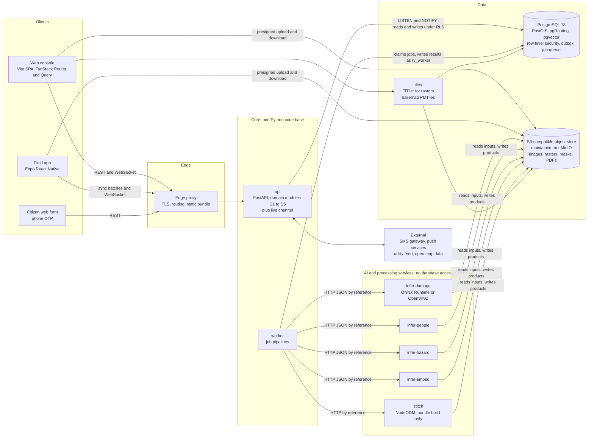
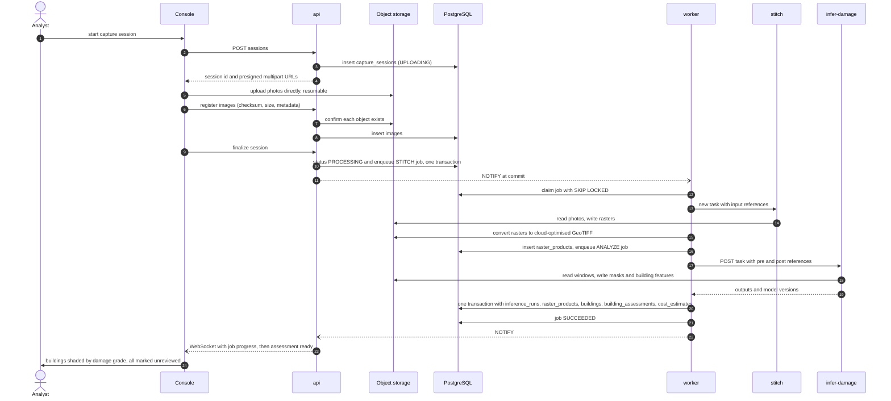
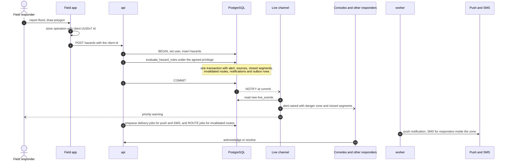

# RescueVision software architecture: Architect B proposal (phase 1, independent)

*Author: Architect B (GLM-5.4). Date: 2026-11-25. Status: independent proposal written for phase 1 of the architecture debate, before seeing the other architect's proposal. The executive summary and Sections 3, 4.4, 5, 6, 8, 10, 11, 12, 13, 15, 16 and 17 were revised later the same day, after the owner confirmed the constraints listed in Section 19.2; section numbers did not change.*

## Executive summary

1. **Microservices: no for the business core, yes for the AI edge.** Build the core as a modular monolith (one Python code base with domain modules that mirror the database domains, and one PostgreSQL), and deploy the AI models and the tile servers as a small number of separate, stateless services. It is a hybrid by deployment and a monolith by data.
2. The approved database decides more than any framework choice: row-level security on 56 tables, foreign keys that cross domains and a hazard engine written in PL/pgSQL all assume one database and one transaction. Splitting the core into services would break the "one report, one transaction" behaviour that makes the Electrified Water response safe.
3. **Models: one Docker container per model family**, exposing a task-level HTTP/JSON API, holding no database credentials and moving data by object-storage reference instead of by payload. A thin FastAPI server in each container is the right tool now. Triton, BentoML, Ray Serve and KServe solve problems this project does not have yet.
4. **Backend: Python with FastAPI** as a modular monolith (SQLAlchemy 2 async with asyncpg, SQL files as the only source of the schema, Import Linter to keep module boundaries real). It is the language the team already uses for the models, and no other choice removes Python from the server side.
5. **Communication:** in-process calls inside the core, REST over OpenAPI between the core and the model services, **PostgreSQL as job queue and event log** (`FOR UPDATE SKIP LOCKED`, a transactional outbox, `LISTEN`/`NOTIFY` as a doorbell) and **one WebSocket channel** for live updates. No Kafka, NATS or Redis until a measured need appears.
6. **Web console: a Vite single-page app with TanStack Router (without TanStack Start) and TanStack Query.** Typed URL state matters more for a map console than server rendering does. React Router is an acceptable second choice. Next.js buys nothing here.
7. **Mobile: Expo (React Native) confirmed**, sharing the TypeScript contracts and query hooks with the console. Offline support should be a local SQLite cache plus a queue of pending operations with client-generated UUIDv7 identifiers and idempotent replay, not CRDTs.
8. **Innovation bets, in order:** (1) an edge-to-cloud cascade that sends image crops instead of video for partially visible people, with a measured bandwidth-versus-recall result; (2) a dry-run mode of the hazard engine ("what if this substation floods?"); (3) incident replay from the history tables the schema already has; (4) a review feedback loop that reports live precision per model version; (5) a read-only LLM report drafter and query assistant. Full event sourcing, CRDT sync, phone mesh networking and WebGPU inference are rejected, with reasons.
9. **Report decisions D-02 and D-03 hold** and need sharper wording. I also found one defect by execution: the UC-07 path in which a field responder's flood report triggers the rule engine in the same session **fails under the implemented row-level security policies**, because a responder holds neither `analysis.run` nor `alert.resolve`. The report and the schema must agree on which privilege runs the engine.
10. **Schema deltas needed, all additive:** an outbox table for live events, a table for mobile operation identifiers, job lease columns, the model image digest on `ai_models`, a review state on `person_detections`, and a decision on a `SECURITY DEFINER` hazard-report function.
11. **Hosting, confirmed by the owner after phase 1 (Section 19.2).** The demonstration runs on one Contabo server that is CPU-only, with no GPU and no budget for one, for one user at a time. Training happens on free Kaggle or Colab GPUs. Inference uses ONNX Runtime or OpenVINO, with int8 where it helps. The orthomosaic and 3D products are precomputed. Object storage is a maintained S3-compatible store (SeaweedFS), not the archived MinIO. The buildable form of this proposal is the blueprint in `glm_proposal/` (Section 19.1).

---

## 1. How I worked, and what counts as evidence

I read the material the task lists: `AGENTS.md`, the database design and `database/README.md`, `docs/documentation/chapter5/section_3_3.md`, `frontend/` and `api/`, `configs/` and `mapping/`. I did not read `docs/architecture/platform-architecture-plan.md` or any other file in `docs/architecture/debate/`, as instructed, so nothing below is influenced by them.

Every factual statement in this document carries one of three labels:

- **(verified)**: I read it in this repository today, executed it, or fetched the cited page or API on 2026-11-25.
- **(judgment)**: my reasoning as an architect. It can be argued with.
- **(unverified)**: I could not check it in this pass. The team should check it before relying on it.

Two methods are worth knowing about:

- **An executed database experiment.** I built a throwaway PostgreSQL 18.6 cluster under `/tmp` (private Unix socket, no TCP), applied the team's schema files unchanged except for the single `CREATE EXTENSION pgrouting` line (pgRouting is not installed on this machine, and no schema or seed file calls a `pgr_*` function), loaded both seed files (56 tables), ran each test case inside one transaction and rolled everything back. The cluster was then deleted. Section 8.2 reports the results. The repository was not modified.
- **GitHub metadata.** Star counts, last-push dates, archive status and licences come from the GitHub API on 2026-11-25. Stars show popularity and community size only. They are not a quality measure, and I do not use them as one.

Several "facts" I remembered turned out to be wrong when checked (for example the authors and identifier of the xBD paper, and the DOI of a microservices review). Everything in the Sources list was therefore opened or queried directly before being cited.

## 2. What exists in the repository today

| Area | State (verified by reading) | Consequence for the architecture |
| --- | --- | --- |
| Database | The approved design is implemented: 56 tables, row-level security on every table, four application roles, `evaluate_hazard_rules()` and `resolve_compound_alert()` in PL/pgSQL, a demo scenario and self-checks. | The architecture must fit this database, not the other way round. |
| API | A 178-line FastAPI prototype (`api/main.py`). The `/predict` endpoint runs inference synchronously inside the request. There is no database and cases are stored on the file system. CORS allows every origin with credentials. `requirements.txt` does not list `fastapi`, `uvicorn` or `python-multipart`, so the Docker image as written could not start the API (I did not build it). | Retire it. It is useful as a list of endpoints, not as a base to extend. |
| Model code | Training scripts, YAML configs and Kaggle notebooks for building segmentation (U-Net), damage segmentation (6-channel U-Net), change detection (Siamese U-Net), a DINOv2 damage classifier and a SegFormer for FloodNet. Similar-case search uses FAISS. | This becomes the model services. FAISS is replaced by pgvector, which the approved schema already has (`image_embeddings`, `vector(768)`). |
| `src/rescuevision` | The core Python package is not in this worktree's `main` branch. | Decide where training and inference code live in the repository before splitting into containers. |
| Frontend | `frontend/` is a Turborepo of README files only: no TypeScript, and no `package.json` in either app. It points to `docs/FRONTEND_ARCHITECTURE.md`, which does not exist. | The frontend is still a plan, so the router and state choices are open. |
| Old dashboard and mapping | A small React prototype (`dashboard/`, six components) and Folium map scripts over Maxar imagery (`mapping/`). | Replace with the console. Reuse the imagery and the scripts as test fixtures. |

## 3. The forces that shape the design

1. **One approved, already implemented database.** Row-level security is the access-control decision (D-04). Tables in different domains reference each other directly (`alert_closed_segments` to `road_segments`, `routes` to `compound_alerts`, `missions` to `assistance_cases`). (verified)
2. **A safety-critical transaction.** One flood report must produce an alert, close roads, invalidate routes and warn responders together or not at all. The report describes this in UC-07 and in Section 3.3.8.2. (verified)
3. **Six students, one academic year.** Every network hop, broker and cluster is something the team must build, debug, monitor and demonstrate. (judgment)
4. **Weak or absent connectivity in the field.** The mobile app must work offline and synchronise later (D-08, FR-FC-05). (verified)
5. **Scarce compute time.** Analysis runs as queued jobs on separate workers (D-03), and the deployment view says GPU nodes can be rented only during an incident. (verified as a description of the report) Revised after phase 1: the owner has fixed a CPU-only server with no budget for a GPU. The scarce resources are CPU time on one host and free GPU hours for training, and the report's sentence about rented GPU nodes has to change (Section 19.2).
6. **Several agencies, one incident, different permissions.** Access depends on agency, role and incident participation, re-checked on every request. (verified)
7. **Sensitive data and a government context.** Citizen phone numbers, responder locations and disaster imagery. (judgment, from the requirements list)
8. **Arabic and English, right-to-left layout.** IR-UI-07 applies to the console, the mobile app and, I would add, generated reports. (verified for the interface, judgment for reports)

## 4. Question 1: should the platform use microservices?

### 4.1 What the research says

The strongest evidence is not "microservices are bad" but "microservices pay off only under specific conditions, and they are expensive otherwise".

- Martin Fowler's *Monolith First* (2015) reports that almost all successful microservice stories he knows started with a monolith that was later split, and that systems built as microservices from scratch "ended up in serious trouble". He adds a condition that matters here: do not start with microservices "unless you have reasonable experience of building a microservices system in the team" [S1]. (verified)
- Amazon's Prime Video team moved one service from a distributed design to a single process and cut its infrastructure cost by over 90%. The detail that matters for RescueVision is *why*: their two largest costs were the orchestration and passing video frames between components through S3. "We moved all components into a single process to keep the data transfer within the process memory" [S2]. They also say the choice "has to be made on a case-by-case basis". (verified)
- Shopify did not move to microservices. It moved from an unstructured monolith to a **modular monolith**: one code base, "strictly enforced boundaries between different domains", with an in-house tool (Wedge) that flags cross-component access that does not go through a component's public API [S3]. (verified)
- Segment consolidated more than 140 services into one and lists the trade-offs honestly: fault isolation becomes difficult, in-memory caches are less effective, and one dependency upgrade can affect everything [S4]. (verified)
- Peer-reviewed reviews of industrial experience exist. I confirmed that Jamshidi et al., "Microservices: The Journey So Far and Challenges Ahead" (*IEEE Software*) [S5] and Soldani et al., "The pains and gains of microservices" (*Journal of Systems and Software*) [S6] are real, with those titles and venues. **I did not read either paper in this pass**, so I make no claim here about what they conclude. They are listed for the team, and anything the report quotes from them must come from the texts. (verified existence only)

The other side of the argument deserves a fair hearing as well. Phoenix (Elixir) demonstrated two million WebSocket connections on one cluster [S9], which shows what a platform built for massive concurrency can do. That is a reason to consider Elixir for the live core (Section 4.3, alternative D), not a reason to cut the business core into services.

Finally, a search of GitHub repository names and descriptions for "incident command system" and "disaster response platform" on 2026-11-25 returned no relevant project above 40 stars. The larger hits were unrelated repositories that merely contain those words. The closest open-source neighbours I found are Sahana Eden (a toolkit for humanitarian and emergency-management applications), the Humanitarian OpenStreetMap Team's Field Tasking Manager [S84] and the xView2 baseline (damage assessment only) [S83]. This says nothing about commercial products such as GIS suites or crisis platforms, which are not on GitHub, and I did not search for those. On this evidence there is no widely adopted open-source reference architecture to copy, so the team should design from its own requirements. (verified search; judgment on what it means)

### 4.2 What this project's own constraints say

Three facts in the repository decide the question more than any blog post.

**The hazard engine is one database transaction that touches five domains.** `evaluate_hazard_rules()` reads `hazards`, `infrastructure_assets` and `road_segments`, then writes `compound_alerts`, `compound_alert_sources`, `alert_closed_segments`, `road_segments`, `routes` and `notifications` (`database/schema/12_hazard_engine.sql`). In my experiment a single call closed seven road segments and inserted a warning. If hazards, roads, routing and notifications were separate services, this would become a multi-service workflow with partial failures and compensations. The report's own requirement is the opposite: "Evaluation is idempotent" and "reversible" (Section 3.3.8.2). (verified)

**Access control lives in the database and depends on the caller's session.** Every policy checks `app.visible_incident_ids()` and `app.has_permission(...)`, which read the user identifier that the application sets for the current transaction with `set_config(..., true)` (`15_security.sql:35`). This is transaction-local by design and is compatible with transaction pooling [S29]. A service that does not carry the user's identity into its own transaction loses row-level security for that step. With one core, every step runs in the same transaction with the same identity. (verified)

**The team is small and the timeline is fixed.** Fowler's condition (prior microservice experience in the team) is the first question to ask. I do not know the team's experience, so I assume none. If the team does have it, alternative B in Section 4.3 becomes more defensible, but the first two facts still argue against it. (judgment)

### 4.3 Five complete alternatives compared

Each alternative is a whole system, not a fragment. Scores are my judgment on a scale from 1 (poor) to 5 (good). They exist to make the reasoning visible, not to measure anything.

| Criterion | A. Modular monolith + AI services (Python) | B. Microservices on Kubernetes | C. TypeScript core (NestJS) + Python AI | D. Elixir/Phoenix core + Python AI | E. Go core + Python AI |
| --- | --- | --- | --- | --- | --- |
| Fits the approved database and its row-level security | 5 | 1 | 3 | 3 | 3 |
| Hazard response stays one transaction | 5 | 2 | 4 | 4 | 4 |
| Team velocity in one year (assuming Python first) | 5 | 2 | 3 | 1 | 2 |
| Server-side languages kept to one | 5 | 2 | 3 | 3 | 3 |
| Geospatial library fit (GDAL, rasterio, shapely) | 5 | 3 | 2 | 2 | 2 |
| Real-time connection headroom | 3 | 4 | 4 | 5 | 4 |
| Operational simplicity | 4 | 1 | 3 | 3 | 3 |
| Can run on one offline machine (edge node) | 4 | 1 | 4 | 4 | 4 |
| **Total (of 40)** | **36** | **16** | **26** | **25** | **25** |

The totals only summarise the rows above them. The two rows that decide the result are the first two, and they are facts about the approved database rather than preferences.

**A. Modular monolith plus AI services (recommended).** One Python code base for everything that touches the database, plus separate containers for the models. All domain logic runs in one transaction with the user's identity. The cost is a single deployable unit for the core, which means a discipline problem (Section 5.4) rather than a technical one.

**B. Microservices on Kubernetes.** An API gateway, one service per domain, a message bus, service meshes, container registry and pipelines per service. It is the industry pattern for large organisations with many teams. For this project it has three concrete problems. First, the approved database would have to be dismantled or shared, and a shared database across "microservices" is a distributed monolith. Second, the hazard response becomes a saga. Third, the operational load on six students is the largest of all options. It would look impressive on a diagram and be the least likely to work at the demo. (judgment)

**C. TypeScript core with NestJS plus Python model services.** NestJS is a mature, well-documented framework ("from a small API in one file to enterprise-grade systems with many teams") [S8], and its module system enforces boundaries. Its real advantage is end-to-end TypeScript with the already planned `packages/contracts` and `packages/api`. Its disadvantages here are two server languages instead of one, weaker geospatial libraries, and a team that would abandon its Python backend experience. This is the best alternative if the team is in fact stronger in TypeScript than in Python. (judgment)

**D. Elixir and Phoenix core plus Python model services.** The BEAM is an excellent fit for the live channel: supervision trees make "the console keeps working when a service is slow" a platform feature rather than something you design, Phoenix Presence tracks who is online [S10], and the concurrency headroom is proven [S9]. The cost is steep for this team: a new language and runtime, thin geospatial libraries, and still Python for the models. It is the architecture I would pick for a product team that already knows Elixir. (judgment)

**E. Go core plus Python model services.** A single static binary and small memory footprint make Go attractive for an edge node. The geospatial ecosystem is thinner than Python's and the team would still maintain two server languages. (judgment)

### 4.4 Verdict

**Hybrid, and deliberately close to "no".** The business core is not microservices. The AI models, image stitching and tile serving are separate services because they have different dependencies, different resource needs, different failure behaviour and different release rhythms. That is exactly the case for a service boundary. The core does not cross a service boundary because it needs one transaction, one identity and one database.

This is also what decision D-02 already says ("a modular application with background workers, deployed as a small number of services"). The proposal keeps D-02 and makes it specific. Section 16 gives the wording.

## 5. The recommended architecture

### 5.1 Overview



### 5.2 Containers and responsibilities

There are two first-party deployables for the core, four first-party model services that run on CPU, one optional LLM service that is not on the demonstration server, and three third-party services (NodeODM, used only when a demo bundle is built; TiTiler; and the basemap tile source), plus the infrastructure. Everything except the proxy and the tile server sits on a private Docker network with no published port.

| Container | Based on | Responsibility | Database access | Runs on |
| --- | --- | --- | --- | --- |
| `api` | FastAPI | Sign-in, validation, all REST endpoints, the WebSocket live channel, presigned storage URLs, sync batches from mobile. Runs as `rv_app` (staff) or `rv_citizen` (citizens). | Yes, as the signed-in user, inside a transaction | CPU |
| `worker` | Same code base, different entry point | Claims `processing_jobs`, runs the pipelines (stitch, analyse, route, report), calls the model services, writes results, maintains leases and retries. Runs as `rv_worker`. | Yes, service identity | CPU |
| `infer-damage` | Python, thin HTTP server | F1: building footprints, damage grade and change from pre and post imagery; writes masks and building features. | None | CPU |
| `infer-people` | Python | F3 and F4: person detection under partial visibility and tracking; also the cloud half of the edge cascade (Section 10). | None | CPU |
| `infer-hazard` | Python | F5 and F2: flood, road, fire and smoke segmentation; road condition. | None | CPU |
| `infer-embed` | Python | Image embeddings for similar-case search. | None | CPU |
| `stitch` | NodeODM [S76] | Orthomosaic, surface model, point cloud and mesh from a capture session. | None | CPU and memory heavy. Precomputed when a demo bundle is built, never in a live request |
| `llm-copilot` (optional) | A hosted model, or Ollama or vLLM [S20] [S18] on separate hardware | Serves a small language model for the report drafter and query assistant. | None | Not on the demonstration server |
| `tiler` | TiTiler [S69] and a basemap tile source [S70] [S71] | Raster tiles from cloud-optimised GeoTIFFs; vector basemap tiles. | TiTiler: none. Martin, if used for the basemap: read-only on a non-sensitive schema | CPU |
| `postgres` | Custom image from the PGDG packages in `database/README.md` | PostgreSQL 18 with PostGIS, pgRouting and pgvector. | Owner of the data | CPU |
| `object-store` | A maintained S3-compatible store; SeaweedFS recommended | Object storage through the S3 API only. | No | CPU |
| `proxy` | Traefik or Caddy | TLS, routing, WebSocket upgrades, static bundle, request size limits. | No | CPU |

The observability stack (Section 13) is a separate Compose profile and is not part of the product.

Two inputs arrive from outside the model services. The road network of an incident is imported once from OpenStreetMap with osm2pgrouting, "Import tool for OpenStreetMap data to pgRouting database" [S77], which gives `road_nodes` and `road_segments` the integer identifiers pgRouting needs. Building footprints and heights come from open map data, as the context view already lists (IR-SW-02).

### 5.3 Communication paths

| From | To | Mechanism | Why this one |
| --- | --- | --- | --- |
| Module to module inside the core | Same process | Plain function calls through each module's public interface | No network, one transaction. Enforced by Import Linter [S41]. |
| `worker` to model services | `infer-*`, `stitch` | HTTP/JSON request and response. The body carries references (bucket key, bounding box, presigned URL), never image bytes. | The "claim check" pattern: store the payload in an external store and pass only a reference [S24] [S25]. It is what Prime Video's costly design lacked [S2]. |
| Model services to storage | The object store | S3 API with short-lived presigned URLs issued by the worker per job | Model containers hold no long-lived storage keys. |
| Core to database | PostgreSQL | One connection pool per database role. Transaction-local identity with `set_config(..., true)`. | Required by the row-level security design. |
| Job dispatch | `processing_jobs` | `SELECT ... FOR UPDATE SKIP LOCKED` [S28], with `LISTEN`/`NOTIFY` as the wake-up and a slow poll as the safety net | One less broker. Enqueue is atomic with the request that caused it. |
| Live events | `live_events` table plus `NOTIFY` | Triggers write an outbox row in the same transaction and send a short notification at commit. Each API replica keeps one dedicated `LISTEN` connection. | `NOTIFY` is delivered only on commit [S26], and PostgreSQL's own documentation suggests putting large data in a table and sending the key. |
| Console and app to core | `api` | REST for commands and queries, one WebSocket for pushes, batch sync for the mobile app | Section 7.3. |
| Browser to tiles | `tiler` | HTTPS GET, presigned for rasters | Keeps large image traffic off the API. |
| Core to outside | SMS gateway, FCM/APNs, utility feed, open data | Outbound calls are made by the worker; inbound webhooks (the utility feed) are signature-checked by `api` | Section 8.2 lists the utility feed among the inputs to the rule engine. |

### 5.4 What stays together, and how the boundary stays real

A modular monolith is only modular if something stops it from decaying. Shopify built a tool for exactly this [S3]. For this project three cheap mechanisms do the job:

1. **Import Linter contracts** [S41]: a module may import the shared platform package and the public interface of other modules, never their repositories or internals. The check runs in CI. A well-known .NET reference application, "Full Modular Monolith .NET application with Domain-Driven Design approach" [S7], shows the same layout of one code base and domain modules, for anyone who wants to read a complete example.
2. **Table ownership test**: each module declares the tables it owns. A test scans the module's SQL and fails if it references another module's tables outside its declared read list. Cross-module invariants live in the database, where the approved design already puts them.
3. **One schema owner.** The SQL files in `database/` stay the only source of the schema. No ORM generates tables, because generated schemas cannot express the triggers, policies and `SECURITY DEFINER` functions this design depends on.

The nine domain modules follow the database domains, as Figure 3-3 of the report already proposes: identity, operations, imagery, damage, routing, persons, hazards, field, and citizens plus reporting.

## 6. Question 2: how should the models be served?

### 6.1 The owner's requirement, and the real question behind it

The owner wants every model isolated from the backend, each in Docker, reached only through an API. I agree, and this section is about how.

"Is FastAPI the best way to serve models?" is at the wrong level. The choices that matter are, in order: the shape of the API, what travels over it, the process model inside the container, and only then the framework.

**API shape: task level, not tensor level.** A dedicated model server such as Triton is about executing models: its feature list covers concurrent execution, batching, ensembles and a model repository [S12]. It has no notion of coordinate reference systems, tiling a large raster, reading a window of a GeoTIFF, polygonising a mask or matching footprints. That knowledge has to live somewhere. If it lives in the backend, the backend becomes a monolithic pipeline, which is what the owner wants to avoid. So it lives in each model service, and the API speaks in the platform's terms: "assess these two rasters", "detect people in this image set". (judgment)

**What travels: references.** A drone capture session can be tens of gigabytes. Pushing that through the backend twice (in from the client, out to the model) wastes time and memory. The model service reads its input from object storage and writes its products there. Only the small result summary returns in the HTTP response. (judgment, following [S2] [S24])

**Process model: load once, one queue per service.** A model service loads its weights at start-up, accepts tasks into a small in-memory queue, and runs them one at a time on CPU, with one thread per physical core. It reports `/readyz` only when the weights are loaded and the runtime is usable. It is stateless beyond that queue: if the container restarts, the worker re-submits the task. Durability lives in PostgreSQL and object storage, not in the model container. (judgment)

### 6.2 A proposed model service contract

Every service exposes the same four resources. The contract is generated from the code, committed to the repository and checked in CI.

```
GET  /healthz                     liveness: the process is up
GET  /readyz                      the weights are loaded and the device is usable
GET  /v1/meta                     service version, image digest, device, and for each model:
                                 task, name, version, weights checksum, published metrics
POST /v1/tasks                    { job_id, run_id, inputs: {…references…}, params }
                                 -> 202 { task_id }
GET  /v1/tasks/{task_id}          { status, progress_pct, outputs: {…references…}, summary, timings }
```

Two rules make this safe to operate:

- `job_id` is the idempotency key. Submitting the same job twice returns the existing task or an equivalent one, so a retried job never double-writes.
- Outputs go to a deterministic prefix: `incidents/{incident}/runs/{run}/`. A retried job overwrites its own partial output and nothing else.

A small shared library (about 300 lines: health, metadata, the task queue, metrics, tracing, windowed GeoTIFF reads and writes) keeps each service to its model code and its pre- and post-processing. Without that library, "one container per model" becomes nine copies of the same boilerplate. (judgment on size)

### 6.3 One container per model, or per model family?

The owner said "each in Docker". I recommend **one container per model family**, where a family is a set of models that always run together on the same inputs:

| Container | Models inside | Why they share a container |
| --- | --- | --- |
| `infer-damage` | Building segmentation, 6-channel damage segmentation, change detection, DINOv2 classifier | They consume the same pre and post rasters in one pass, and their intermediate masks stay in memory instead of being written to storage between steps. This is precisely the saving Prime Video reported [S2]. |
| `infer-people` | Detector, tracker | The tracker consumes the detector's output frame by frame. |
| `infer-hazard` | Flood and road segmentation, fire and smoke, road condition | Same rasters, same output tables. |
| `infer-embed` | Embedding model | Different workload (batch, low urgency), so it is scheduled when no on-demand model is running. |

Inside a container every model keeps its own identity: its own weights file and checksum, its own version, its own metrics, and its own row in `ai_models`. The backend records each one in `inference_runs`, so provenance is unchanged. The report's requirement that "every result names the model version that produced it" (FR-IM-07) is met at model level, not container level.

The rule for splitting a model into its own container is: **split when it needs a different resource, latency, scaling or release profile.** Until then, container granularity is a deployment decision, not an architecture decision, and the backend does not change either way because the pipeline configuration maps each step to a URL. (judgment)

If the owner prefers one container per model literally, the design still works: each model gets the same contract and the worker chains them. The costs are more resident models on a CPU host, more round trips, and intermediate results that must be written out or sent as bytes. I would not pay them by default. (judgment)

### 6.4 The serving options, compared

| Option | What it is (verified from the cited source) | Fit for RescueVision now | It becomes the right choice when |
| --- | --- | --- | --- |
| **Thin FastAPI (or any ASGI) server per service, with a shared library** | Not a model-serving product. It gives the HTTP layer; the team owns the rest. | **Recommended.** Full control of geospatial pre- and post-processing, one language, nothing to learn beyond what the team has. | It is never wrong for this size. |
| BentoML | "A Python library for building online serving systems optimized for AI apps and model inference"; it generates Docker images and manages model versions [S13]. | Reasonable. It would save the shared library and give packaging for free, at the price of adopting its abstractions. | The team wants model packaging, a model store and multi-model composition handled by a framework rather than written in-house. |
| NVIDIA Triton | A multi-framework server with concurrent model execution, dynamic batching, ensembles and a file-based model repository, on GPUs and CPUs [S12]. | Tensor in, tensor out. The geospatial glue would move back into the backend. | Many models share one GPU, GPU utilisation is the measured bottleneck, and dynamic batching across models would repay the glue code. |
| Ray Serve | "Particularly well suited for model composition and multi-model serving" across a Ray cluster [S14]. | A cluster scheduler for a project with one CPU host. | Several nodes must be scheduled as one pool. |
| LitServe | A lightweight server with batching, multi-GPU and streaming built in, positioned as a migration path from FastAPI [S15]. | A credible middle ground if the team wants batching without BentoML's scope. | Batching many small requests (for example thousands of building crops) needs to be written anyway. |
| KServe | "The open-source standard for self-hosted AI ... inference on Kubernetes", with an `InferenceService` custom resource [S16]. | Needs Kubernetes. | The platform moves to Kubernetes and wants declarative model deployment. |
| TorchServe | The PyTorch organisation's server. | Excluded: the repository is archived (last push 2025-08-06) [S17]. | Never. |
| vLLM, Ollama | LLM serving engines ("Easy, fast, and cheap LLM serving for everyone" [S18]). | Not for vision models, and too heavy for the CPU demonstration server. Right for the optional `llm-copilot` if it ever gets its own hardware. | An LLM is part of the product and has hardware of its own. |
| ONNX Runtime, TensorRT, OpenVINO | Accelerated inference runtimes ("Production-grade AI engine" [S19]). | Not servers. ONNX Runtime and OpenVINO are now the default runtimes inside every serving container, because the server is CPU-only (Section 19.2). TensorRT needs NVIDIA hardware and is not used. | Always worth measuring before adding a serving framework. |

Vendor numbers for export speed-ups exist (Ultralytics claims "up to 5x GPU speedup with TensorRT" [S22]) but I did not measure anything, and the team should benchmark on its own models. The CPU feasibility study (`cpu_demo_feasibility.md`) has since timed ONNX Runtime and OpenVINO on proxy graphs; those numbers are estimates until the benchmark runs on the server.

### 6.5 Should the model calls be gRPC, or go through a queue?

- **gRPC**: its advantage is efficient binary transfer and streaming. With references instead of payloads, the bodies are a few hundred bytes. gRPC would add protobuf definitions, a second schema toolchain and harder debugging, for no gain. (judgment)
- **Queue**: the model services do not need to pull jobs. The worker already owns the queue, and letting model services pull would require giving them database access or a results API, which breaks the isolation the owner asked for. The two-step `POST` then `GET` contract gives the same decoupling (a long inference never holds one HTTP request open) while keeping the services stateless. (judgment)

### 6.6 A licensing point that affects model choice

Ultralytics YOLO is under AGPL-3.0 or a paid Enterprise licence, and Ultralytics' own licence page lists triggers for the commercial licence [S21]; the GitHub API reports the same licence for the repository. For a graduation project this is fine. For a platform used by government agencies it is a decision. Apache-2.0 alternatives exist for the detector family (YOLOX and RT-DETR are Apache-2.0; ByteTrack is MIT, all per the GitHub API) [S23]. OpenDroneMap and NodeODM are also AGPL-3.0 [S76]. Running an unmodified AGPL program as a separate service that you talk to over HTTP is normally acceptable, but the team should record the licences and ask the supervisor whether a licence register is expected. I am not a lawyer and this is not legal advice. (verified licences; judgment on implications)

## 7. Question 3: backend language, framework and communication

### 7.1 Language and framework: Python with FastAPI

| Criterion | FastAPI (Python) | NestJS (TypeScript) | Go | Rust | Elixir (Phoenix) |
| --- | --- | --- | --- | --- | --- |
| Same language as the models | Yes | No | No | No | No |
| Geospatial toolchain | GDAL, rasterio, shapely, geopandas, PDAL are all Python-first | Weaker | Thin | Thin | Thin |
| Row-level security ergonomics | `set_config` inside a transaction per request; asyncpg | Possible | Possible | Possible | Possible |
| Real-time fan-out at this scale (about a hundred messages a second) | Enough (judgment) | Good | Good | Good | Excellent [S9] |
| Learning cost for a Python-first team | None | Moderate | Moderate | High | High |
| Fit for one offline machine | Good | Good | Excellent | Excellent | Good |

FastAPI has 105,018 stars on GitHub (2026-11-25) [S11], which means a large body of examples, but popularity is not the reason to choose it. The reasons are the first two rows: the models are Python and the geospatial libraries are Python. (judgment)

Concrete choices inside that decision:

- **Concurrency.** Several worker processes per container, `async` endpoints for I/O, and blocking work moved to a thread or process pool. The current prototype calls the inference synchronously inside an `async` endpoint (`api/main.py`), which blocks every other request on that process. That pattern must not survive. (verified for the prototype; judgment on the fix)
- **Database access.** SQLAlchemy 2.0 async with asyncpg [S44], explicit transactions, and `set_config('app.user_id', …, true)` at the start of every request, exactly as `database/README.md` shows. One pool per database role: `rv_app` for staff, `rv_citizen` for the citizen channel, `rv_worker` in the worker, and `rv_readonly` for report rendering and analytics.
- **Pooling.** Start without PgBouncer and size the pools. Add it when connections become the limit. If it is added in transaction mode, remember its feature table: `LISTEN` is never available through a transaction pool and neither is `SET`/`RESET` [S29]. The live channel's listener bypasses the pool, and identity is always `set_config(..., true)` or `SET LOCAL`.
- **Schema management.** The SQL files stay the source of truth. `database/build.sh` drops and recreates the database, which is ideal for development and tests and impossible for a long-lived environment. Add a migration tool for staging and the pilot, for example Sqitch [S42], and keep the fresh build green so both paths agree.
- **Packages.** `uv` for lockfiles and workspaces [S43], `ruff` for linting, a type checker, `structlog` for structured logs.

### 7.2 Why PostgreSQL is the job queue

The approved schema already has `processing_jobs`, and the report already describes this mechanism: "Workers claim jobs with a database lock that skips rows already taken" (UC-02, Section 3.3.6). The proposal adopts it and adds the parts a queue needs.

```sql
UPDATE processing_jobs
   SET status = 'RUNNING', started_at = now(), heartbeat_at = now()
 WHERE id = (SELECT id
               FROM processing_jobs
              WHERE status = 'QUEUED'
              ORDER BY (CASE job_type WHEN 'ROUTE' THEN 0 WHEN 'REPORT' THEN 1 ELSE 2 END), queued_at
              FOR UPDATE SKIP LOCKED
              LIMIT 1)
RETURNING *;
```

| Need | Mechanism |
| --- | --- |
| Several workers, no duplicate work | `SKIP LOCKED` skips rows another worker already holds [S28]. |
| Wake-up without busy polling | `LISTEN` on a job channel; `NOTIFY` when a job is enqueued. A poll every few seconds catches a lost notification. |
| A worker dies mid-job | `heartbeat_at` stops being renewed. A reaper returns the job to `QUEUED` and increments `attempts`. |
| Too many failures | After a maximum, the job becomes `FAILED` with `error_message`, as the use case requires. |
| Progress every 30 seconds (NFR-PF-05) | The worker updates `progress_pct` and writes a progress event at a throttled interval. |
| Retries that are safe | Job id is the idempotency key at every step, including at the model services. |

What the alternatives would cost:

- **Celery** needs a message transport such as Redis or RabbitMQ [S33]. That is one more stateful service, and enqueueing would no longer be atomic with the database write.
- **PGMQ** is a Postgres extension that behaves like a simple queue [S32]. It needs the extension installed in the custom image and duplicates what `processing_jobs` already holds.
- **Procrastinate** is a close match for a Postgres-only stack, but its README says it is "looking for additional maintainers" [S31]. The worker loop above is about a hundred lines; I would own it.

(judgment on all of the above)

### 7.3 How services and clients communicate

**Inside the core:** function calls. There is no in-memory event bus between modules. When two modules must stay consistent, they do so in the same transaction.

**Events to clients: a transactional outbox with a notification as the doorbell.**

The problem is stated on the pattern page as "How to atomically update the database and send messages to a message broker?" and the solution is to store the message in the database "as part of the transaction that updates the business entities" [S30]. Applied here:

1. Row-level triggers on `compound_alerts`, `hazards`, `routes`, `assistance_cases`, `mission_assignments`, `sos_alerts` and `notifications` insert into a new `live_events` table and call `pg_notify('rv_events', …)` in the same transaction.
2. The notification is delivered only when that transaction commits [S26], so a rolled-back transaction never produces an event.
3. Each `api` replica holds exactly one dedicated connection that listens (`LISTEN` itself "takes effect at transaction commit" [S27]), reads the new rows and sends them to the sessions that may see them.
4. A client that reconnects asks for everything after its last sequence number and receives the missed events from the table. The notification can be lost; the row cannot.

This is the pattern PostgreSQL's documentation itself suggests for anything beyond a tiny payload ("put it in a database table and send the key of the record"), and it is necessary because the payload "must be shorter than 8000 bytes" by default [S26].

**WebSocket or Server-Sent Events?** Server-Sent Events reconnect by themselves and carry a `Last-Event-ID` header [S40], which is attractive for the console. They are one-way, and React Native has no built-in `EventSource`. One protocol for both clients is worth more than the shorter server code, so the proposal keeps **one WebSocket endpoint** with a small typed protocol (subscribe, event, heartbeat, resume-by-sequence). Server-Sent Events remain a good option for a read-only feed later. (judgment)

**What is not used, and why:**

| Technology | Why not now | The trigger that would introduce it |
| --- | --- | --- |
| Kafka [S35] | High-volume durable streams with many independent consumers. This platform has a few hundred small events a second at most and two consumers. | Stream processing of drone video across several nodes, or a dozen independent consumers that need replay. |
| NATS and JetStream [S34] | A good broker, but still a broker to run and a second place where events live. | Edge nodes that must store and forward between sites. |
| Redis Streams [S36] | Same as above, plus it is typically paired with Celery. | Never, unless Celery is adopted for other reasons. |
| Redpanda | The repository is archived (checked on 2026-11-25) [S37]. | Not applicable. |
| MQTT [S38] [S39] | Designed for constrained devices, with quality-of-service levels, retained messages and a last-will message. Phones do not need it because they already have batch sync. | Drones or vehicle gateways begin publishing telemetry. Then it is the right protocol, and the live channel can relay from it. |
| Polling | Used only as a fallback and as the basis of the mobile sync endpoint. | It stays as the degraded mode. |

## 8. Two data flows in detail

### 8.1 From drone upload to damage map



Points that need decisions rather than code:

- **Uploads bypass the API.** The client uploads straight to object storage with presigned multipart URLs, so uploads resume after an interruption (NFR-RL-03) and large files never pass through the application servers, as the report's deployment view already intends.
- **The active model is chosen from the registry.** The worker reads `ai_models` for the active model of each task. The schema enforces one active model per task. The response reports which versions actually ran, and the worker stores them in `inference_runs`.
- **Everything lands in one transaction.** Runs, masks, buildings, assessments and cost estimates appear together or not at all. With services per step, a crash between "buildings written" and "assessments written" would leave a half-finished map.
- **Results arrive unreviewed.** Every assessment is created with `review_status = 'PENDING'`, which is D-07 in the schema.
- **NodeODM's documented API does not list object-storage input** (checked in `docs/index.adoc` on 2026-11-25), so the worker stages images for it over its HTTP API or a shared volume. Confirm this against the version the team uses. (verified for the documentation file; the conclusion is open)
- **Stitching is precomputed (revised after phase 1).** The stitching steps, 13 to 15, do not run while a user waits on the CPU server. The demonstration loads stitched rasters from the evidence bundle (`glm_proposal/AI_PIPELINE.md` §10). Stitching runs when that bundle is built, with the same worker code, outside any interactive request.

### 8.2 From flood report to Electrified Water alert



**The defect I found, by execution.** Step 5 is where the report and the schema disagree. Figure 3-29 and the UC-07 text describe a field responder whose report triggers the rule engine. In the implemented policies:

- a staff user may insert a hazard only with `origin = 'RESPONDER_REPORTED'` and the `hazard.report` permission (`15_security.sql:584`);
- any write to `compound_alerts` requires `analysis.run` or `alert.resolve` (`15_security.sql:598`), and the same holds for `alert_closed_segments` and `road_segments`;
- `FIELD_RESPONDER` has `hazard.report` and neither of the other two (`seed/01_reference_data.sql`);
- `evaluate_hazard_rules()` is not `SECURITY DEFINER`.

Results from the throwaway database, each measured by the alert id the engine returned and all rolled back:

| Session that runs the engine | Result |
| --- | --- |
| Field responder: report and engine in one transaction and one session | **Failed**: `new row violates row-level security policy for table "compound_alerts"` (`12_hazard_engine.sql:37`) |
| `rv_worker` | Alert created, 7 road segments closed, 1 notification |
| Analyst through `rv_app` | Alert created, 7 road segments closed, 1 notification |
| Superuser (reference) | Alert created, 7 road segments closed, 1 notification |

Because the error aborts the transaction, the responder's report would be rejected as well. The self-checks I read do not cover this path: they resolve an alert as a commander (`checks.sql:305`) and run the engine as an analyst (`checks.sql:308`). The schema comment says the engine is "run by analysts or alert resolvers", so this is a design gap rather than a typo. (verified)

**Two ways to close it.** I recommend the first.

1. **A `SECURITY DEFINER` function that reports and evaluates.** `app.report_hazard(...)` checks `app.has_permission('hazard.report')`, inserts the hazard with the caller as `reported_by`, and calls `evaluate_hazard_rules()` as the function owner. The schema already uses this pattern for `app.respond_to_invitation`. It keeps the whole response in one transaction, which is what UC-07 promises. Inside the function, an exception block catches an engine failure, keeps the report, and records a pending evaluation for the worker, so a bug in the engine never costs a report. The tests must then include the responder path.
2. **Two transactions with two roles.** The report commits under the responder's identity together with a "needs evaluation" row. The worker, as `rv_worker`, evaluates immediately, and a periodic sweep catches anything missed. The report's durability is independent of the engine's health. It costs more code and a short window in which the hazard exists without its alert.

**Trust levels before the rule engine.** A rule engine that closes roads automatically is only as safe as its inputs. (verified: today `rv_citizen` is granted only its own profile row and the citizen request tables, so a citizen cannot insert a hazard directly; the tiering below is judgment)

| Source of a flood report | What happens before roads close |
| --- | --- |
| Authenticated staff report | Evaluated at once, as `SUSPECTED` until confirmed. |
| AI-detected flood mask | Evaluated at once, as `SUSPECTED`, and shown as unreviewed. |
| Utility feed (power state) | The incident is re-evaluated when an asset's `power_state` changes. |
| Citizen request through the one-time-code channel | Verified by an analyst and converted before any evaluation. Optionally accelerated when two or more independent citizens report within a small area and time window and the report is consistent with the latest flood mask. Never by one unverified report. |

Without this tiering, one unverified message could close a road and reroute a rescue team.

**The cautious default is kept.** An asset whose power state is unknown counts as energised (NFR-SF-02), and only a commander can resolve an alert (NFR-SF-03), exactly as the implemented function and policies do. (verified in `12_hazard_engine.sql`)

**Timing.** Steps 4 to 6 are one local transaction. Steps 7 to 10 are one notification and socket writes. They should complete far inside the 60-second target of NFR-PF-04. Push and SMS delivery (step 12) goes through the worker, because third-party services are slow and must not sit inside the request. These are design expectations, not measurements. Section 13 makes the first part a metric so that the report can quote a measured value.

## 9. Question 4: web console and mobile

### 9.1 The router decision

The console is an internal, signed-in tool built around two map engines and a live feed. It has no public pages, so search-engine rendering and first-paint server rendering are worth nothing here. What it does have is complicated state that must survive a link: incident, visible layers, selected feature, time slider, open panel.

| Option | Verified facts | Fit for a map console |
| --- | --- | --- |
| **TanStack Router + TanStack Query on Vite** | The router offers "100% inferred TypeScript support", "Typesafe JSON-first Search Params state management APIs", file-based route generation and loaders designed for "client-side data caches (TanStack Query, SWR)" [S47]. Query has 50,638 stars [S50]. | **Recommended.** Typed search parameters are the single most useful feature for a map console: a link to "this incident, these layers, this alert" is type-checked. |
| TanStack Start | "A full-stack React framework powered by TanStack Router" with "full-document SSR, streaming, server functions" [S48]. Version 1.0 was declared stable on 13 October 2026 [S49]. | Not needed. It adds a server and hydration problems for WebGL maps, and the backend is Python. It only became stable six weeks ago, which is another reason not to build the team's first React app on it. |
| React Router 7 | Remix v3 "is now going to be released as React Router v7" [S51]. 56,650 stars [S52]. | Acceptable. A fine router with a large ecosystem. Its search-parameter typing needs more manual work. Choose it if the team already knows it. |
| Next.js 16 | Released 21 October 2025 [S54]. Static export drops "features that require a Node.js server, or dynamic logic that cannot be computed during the build process" [S53]. | Not a good fit. Used as a static export it is a single-page app with extra constraints. Used with its server it duplicates a backend the project does not need. |

With TanStack Router but without Start, the console is a static bundle built with Vite [S55] and served by the proxy. There is no Node.js server in production. (judgment)

### 9.2 State and maps

- **Server state lives only in TanStack Query**, which the team's own `apps/web/README.md` already states as a rule. **Interface state** (layer toggles, selection, panel) lives in Zustand [S75]. **Shareable view state** lives in the URL through typed search parameters. The map viewport stays in local storage, because writing it to the URL on every pan makes the history unusable.
- **MapLibre GL JS is the primary engine** [S62]. Its README describes "an open-source library for publishing maps", with "GPU-accelerated vector tile rendering", that "originated as an open-source fork of mapbox-gl-js, before their switch to a non-OSS license in December 2020". That origin matters for a public-agency product. Buildings are extruded and coloured by damage grade with the fill-extrusion layer. This gives a "2.5D" damage-aware city model for free.
- **deck.gl handles dense layers** [S63]: thousands of detections, tracks, heat and arc layers. It is "designed to simplify high-performance, WebGL2/WebGPU based visualization of large data sets".
- **CesiumJS is loaded only when a photogrammetry mesh exists** [S64]. Maintaining two engines is expensive, so it is a lazy-loaded 3D view fed by 3D Tiles, not a second console. A map-independent scene store in `packages/contracts` drives whichever engine is active, which is how "2D and 3D share the selection" (Table 3-46) can be kept true.
- **Tiles for bulk, events for change.** The first view of a layer comes from tiles. A live change arrives as an event carrying the changed feature, and the client patches its overlay source instead of re-fetching tiles. On reconnect the client resumes by sequence number.
- **Vector layers for an incident are produced by PostGIS** (`ST_AsMVT`) inside an API request, so row-level security applies to them natively. Basemap tiles come from PMTiles, "a single-file archive format for tiled data" that can be hosted on S3 with no tile server [S71]. **Raster tiles come from TiTiler**, "a set of python modules that focus on creating FastAPI application for dynamic tiling" [S69]. Martin can generate vector tiles from PostgreSQL on the fly [S70] but has no way to check incident participation, so it serves the basemap only.
- **Caching and permissions.** A tile that depends on the viewer must never be cached for everyone. Tiles are cached per incident and per incident change number, and only for layers that every participating agency sees identically. Personal layers (my route, my notifications) travel as GeoJSON through the API.
- **Arabic and English.** Logical CSS properties, `dir` set per language, and a check that the map font has Arabic glyphs (unverified for the chosen basemap; test early).

### 9.3 Mobile: Expo confirmed

**Expo (React Native) is the right choice, with three caveats.** Expo is a long-maintained project (53,776 stars [S56]). The decisive argument is shared code: `packages/contracts` (zod schemas for every event) and `packages/api` (the generated client, query hooks, WebSocket client) are used by both apps, as the team's READMEs already plan. One domain language across console and field app is also a safety property, because a malformed event is rejected at the socket boundary on both. Flutter or native apps would give that up.

Caveats, each from the Expo documentation unless marked:

- **Background location needs real permissions and a real build.** On Android 14 and later a location foreground service needs `FOREGROUND_SERVICE_LOCATION`; background location on Android and background modes on iOS are separate opt-ins [S57]. As far as I know, Expo Go cannot demonstrate this and the app needs development builds and a distribution channel (an internal track or managed distribution for Android, TestFlight for iOS). I did not test that in this pass. (unverified)
- **Offline storage is SQLite.** `expo-sqlite` can use SQLCipher ("Use the SQLCipher implementations rather than the default SQLite") [S58], so responder data can be encrypted at rest on the device.
- **Push notifications go through FCM and APNs**, which Expo handles the complexity of [S59]. Push is the only reliable way to reach a backgrounded app. It must not be the only way: the sync batch is the guaranteed path and push is the wake-up call.

Expo Router provides typed routes through `experiments.typedRoutes` [S60]. Maps use MapLibre React Native, the community-maintained fork of the Mapbox and MapLibre wrapper [S61], so the web and mobile apps share one style.

**Should the citizen channel be an app?** No. Citizens will not install an app in a crisis. The citizen channel should be a responsive web page reached from an SMS link, built from the same `packages/api`. The report lists three client surfaces, while the frontend plan lists two, so this is a gap to close. (judgment)

### 9.4 Offline sync without CRDTs

The database design already anticipates offline clients: UUID v7 primary keys exist "because the offline mobile app can generate ids", and it states that the sync protocol "is a separate design" (Section 9 of the database design). This is that design.

**Why not CRDTs.** CRDTs such as Yjs and Automerge [S74] solve concurrent editing of the same value by several writers who cannot talk to each other. Almost nothing in RescueVision is like that. Positions, SOS calls, field reports and status events are append-only. Cases, missions and routes have one writer: the server, under the user's permissions. And access depends on who is asking, which a CRDT replica cannot evaluate. Sync engines exist for exactly this job. PowerSync "keeps a client-side SQLite database in sync with your backend database", using Postgres logical replication for a Postgres source [S72]. Electric describes itself as "Real-time sync for Postgres" [S73]. PowerSync decides what each client receives from its own bucket rules [S72]. Adopting it would mean writing the row-level security rules a second time, in a second language, and keeping the two equal to D-04. That is a real cost for a safety property, and it is why I would not adopt a sync engine for the permission-dependent data. (verified for what those tools are, from their READMEs and documentation; judgment on fit)

**The protocol:**

1. **Local store.** SQLite on the device holds the responder's missions, cases, routes, alert zones and reference data, plus an `outbox` table of pending operations. Each operation has a client-generated UUIDv7 id.
2. **Push.** `POST /sync/batch` sends pending operations. The server applies each one in its own transaction as the signed-in responder, so row-level security applies as usual. It records the operation id in a new `client_mutations` table with a unique key. A replayed batch returns the stored result and changes nothing.
3. **Pull.** `GET /sync?since=<sequence>` returns everything that changed for this user after that sequence, computed under the same policies, and the new sequence.
4. **Conflicts.** A status change that is no longer valid (the case was already closed by someone else) is rejected with the current state, and the app shows "already updated". Nothing is overwritten silently, because `case_events` and the other history tables keep every change.

This is "at least once delivery, exactly once effect". It gives the responder a usable app offline and the commander one consistent picture.

**When the data network is gone.** An SOS that cannot reach the server is also sent as an SMS through the gateway the citizen channel already needs (IR-SW-06). This is a cheap fallback that works when only the voice and text network survives. Whether that is common in disasters is a field assumption I have not verified; the team should ask a civil-defence contact.

## 10. Question 5: innovation

### 10.1 An honest starting point

"Never done before" cannot be promised. Satellite damage assessment is a research field with its own benchmark dataset and paper [S82], operational mapping services exist at European level [S91], and mesh radio, CRDTs and digital twins are all established technology. What a strong graduation project can do is combine known pieces around a problem nobody has combined them for, and then measure the result. The compound-hazard engine is the genuinely distinctive part of RescueVision. Most of the ideas below exist to make it more valuable or more defensible.

Scores are my judgment. Value is for disaster response. Feasibility is for six students in one academic year alongside the core platform.

| Idea | Value | Feasibility | Risk | Verdict |
| --- | --- | --- | --- | --- |
| 1. Edge-to-cloud cascade for partially visible people | 4 | 3 | Medium | **Do.** Signature experiment. |
| 2. Hazard-engine dry run ("what if this floods?") | 4 | 5 | Low | **Do.** Cheap and it strengthens the flagship feature. |
| 3. Incident replay from existing history tables | 3 | 4 | Low | **Do.** |
| 4. Review feedback loop with live precision per model version | 4 | 4 | Low | **Do.** |
| 5. Read-only LLM report drafter and query assistant | 3 | 4 | Medium | **Do, last and behind a feature flag.** |
| 6. Confidence-aware route cost | 3 | 5 | Low | **Do.** Small change to the route formula. |
| 7. SMS fallback for SOS and urgent warnings | 4 | 5 | Low | **Do.** Needs a gateway and a field assumption. |
| 8. Damage-aware 3D city model (extruded buildings) | 3 | 5 | Low | **Do** as the default 3D view. |
| 9. Photogrammetric 3D mesh as 3D Tiles | 3 | 2 | Medium | **Stretch.** The conversion tooling is the problem. |
| 10. LoRa mesh gateway for responders (Meshtastic) [S87] | 3 | 2 | High | **Stretch.** Hardware and regulation. |
| 11. Full event sourcing | 2 | 2 | High | **Skip.** |
| 12. CRDT-based sync | 1 | 3 | Medium | **Skip** for data. |
| 13. Phone-to-phone mesh networking over Bluetooth or Wi-Fi | 2 | 1 | High | **Skip.** |
| 14. WebGPU inference in the browser | 1 | 4 | Low | **Skip** as a feature. |
| 15. Satellite messaging integration | 3 | 1 | High | **Skip.** |

### 10.2 The five bets, in detail

**1. Edge-to-cloud cascade: send crops, not video.** A small detector runs on the drone's companion computer, or on a laptop playing that role during development. It sends three things over a throttled link: confident detections as data, image crops around uncertain or partly occluded candidates, and nothing else. The cloud service (`infer-people`) runs the heavy model on the crops and merges the results into tracks. When the link is down, detections and crops buffer on board and synchronise later.

Why it is worth doing: a long-range link cannot carry video, and partially visible people are exactly the detections a small model is least sure about, which makes them the ones worth spending bandwidth on. It turns F3 into a measurable research question: *how many bytes per correctly found person, at a fixed recall?*

Evaluation plan: run recorded drone video (the SARD, VisDrone or POP datasets the team already lists) through three configurations: video upload, edge only, and the cascade. Throttle the link with network emulation at several bandwidths and loss rates. Report recall on partially visible people, end-to-end latency and bytes sent. The likely result is that the edge model misses some of the hardest cases outright, so the cascade has a recall ceiling set by the edge model. That is a finding, not a failure, and it should be reported as one.

Risks: it needs a GPU laptop or a Jetson-class board, and an AGPL detector would have to be swapped for an Apache-2.0 one if the result is meant for agency use (Section 6.6). Real flight integration is possible later through PX4 and MAVSDK [S86], but the experiment does not need it. The flight simulators in `docs/SAR_Drone_Simulation_Research.md` are a separate question: Microsoft's AirSim site announces that the repository "will be archived" and points to other maintainers [S85], so that recommendation should be re-checked before anyone depends on it. (verified for the announcement)

**2. Hazard-engine dry run.** Add an optional `p_dry_run` parameter to `evaluate_hazard_rules()` that returns the alerts, closed segments, invalidated routes and affected responders *without writing anything*. Three uses follow at almost no cost:

- An analyst draws a hypothetical flood polygon and sees what would close.
- Before a disaster, the same function runs over a flood-hazard map to produce a closure plan per substation or zone.
- The demonstration can ask "what if this substation floods?" and get the answer.

This turns a reactive engine into a planning tool and gives the graduation project a second evaluation that needs no new data. (judgment)

**3. Incident replay.** The schema already keeps history in several places: `case_events`, `mission_status_history`, `road_condition_observations`, `responder_positions`, `alert_closed_segments.closed_at`, older `building_assessments`, and `audit_log`. A time slider can rebuild the situation at any moment for those entities. That supports after-action review, training and the after-action report (F6). It is limited: zones and notifications have no history, so replay must say which layers are historical and which are current. This is the honest alternative to event sourcing. (verified for which tables have history)

**4. Review feedback loop.** Every confirmed, corrected or rejected AI result is a labelled example. Three cheap things follow: a view of live precision per model version (how often analysts agreed with each model), an export of corrected cases as a hard-example dataset for retraining, and a per-incident figure the report can quote instead of a laboratory metric. It makes D-07 ("model errors are expected on local data") measurable. One gap blocks part of it: `person_detections` has no review state in the implemented schema (only `assistance_cases` has `verified_by`), although Table 3-46 describes a detection review screen with confirm, dismiss and pending. (verified)

**5. A read-only LLM assistant, narrowly scoped.** Two uses only. First, drafting the narrative of a situation report from the frozen statistics snapshot, which a human approves anyway under the existing workflow. Second, answering questions by calling typed, read-only tools over the API under the commander's own permissions, with every answer showing the query it ran and the record ids it used. It must never dispatch, close a case, resolve an alert or write warning text. Warning text comes from `hazard_rules.warning_template`, because a generated warning is a liability. Guard against prompt injection and excessive agency, the first and sixth entries of the OWASP list for LLM applications [S46]. For agency use the model must run on hardware the agency controls, because agencies will not send incident data to a third party. That is not the demonstration server, which has no GPU: there, with the fictional scenario data, the drafter would call a free hosted model through the read-only boundary with personal data removed (revised after phase 1). If the model is unavailable, the feature disappears and nothing else degrades. A bilingual report drafter (Arabic and English) is a realistic benefit. (judgment)

### 10.3 What I would not do, and why

- **Full event sourcing** stores every change as an immutable event and rebuilds state by replaying [S89]. It conflicts with three things this project depends on: row-level security on current tables, pgRouting reading materialised edge tables, and the difficulty Fowler himself notes of replaying events when external systems are involved. The current design of "current state plus append-only history" gives most of the benefit. The outbox in Section 7.3 adds reliable events where they are needed.
- **CRDT sync** is the wrong tool for server-authoritative, permission-dependent data (Section 9.4). If the team wants a visible CRDT feature, a shared tactical sketch layer where commanders draw on the map together is a cheap and honest one, and it is optional.
- **Phone-to-phone mesh networking** fails on platform limits: as far as I know, both mobile operating systems restrict Bluetooth and Wi-Fi activity in the background, and the live channel would have to run as a foreground service (judgment from general platform knowledge; I did not check the platform documentation for this in this pass). It also has a security history. A USENIX Security 2022 paper notes that an August 2020 analysis "reported severe vulnerabilities that invalidated Bridgefy's claims of confidentiality, authentication, and resilience" in a Bluetooth mesh messaging app; its title, "Adopting libsignal is not enough", says that the redesign did not settle the matter. I read only the opening of its abstract [S88]. A graduation project should not put responder safety on that.
- **The realistic version of mesh radio is hardware, not an app.** A small LoRa radio node per responder and one gateway that forwards short messages (an SOS with a position) into the platform. Meshtastic describes itself as "an open-source LoRa mesh networking project designed for long-range, low-power communication without relying on internet or cellular infrastructure" [S87]. It is a stretch goal (row 10 in the table) because it needs hardware, a gateway component and a check of radio regulations for the band in Egypt (unverified).
- **WebGPU inference in the browser.** Transformers.js can run models in the browser [S90], but the models that matter are too large for the benefit, and the field app has a far better target: native code on the phone.
- **Satellite messaging.** Android publishes a `SatelliteManager` API reference [S79] and a background-location guide [S78], but availability depends on device and carrier, and I did not look for an iOS equivalent in this pass. Do not promise it.
- **A photogrammetric "digital twin" as a headline feature.** OpenDroneMap produces orthorectified imagery, elevation models, point clouds and textured 3D models [S76], and 3D Tiles is an open standard for streaming 3D geospatial data [S67]. The gap is tiling a mesh into 3D Tiles with open tooling: `py3dtiles` is archived [S68], and Cesium ion requires a paid commercial licence in several cases, one of which is "If you are working on a government project" [S65]. Google's Photorealistic 3D Tiles can be shown in "a compatible 3D Tiles renderer (like CesiumJS)" [S66] and make an impressive backdrop for a demonstration, but they are third-party content that needs internet access at display time and must be labelled as such. Build the extruded-building view first.

## 11. Repository layout

One repository, no build orchestrator beyond Turborepo for the TypeScript side and `uv` for the Python side. Paths that exist today are kept where they are.

*Revised after phase 1: the layout below is kept as written for the debate record. The tree to build is in `glm_proposal/REPO_TREE.md` (`ai/` instead of `models/` and `pipelines/`, plus `specs/`, `scenarios/` and `fixtures/`), and `glm_proposal/REPO_CLEANUP.md` says which existing paths move and which four folders are never deleted.*

```
rescuevision/
├── backend/                      # Python backend (uv workspace)
│   ├── src/rescuevision/
│   │   ├── app/                  # composition root: settings, middleware, main
│   │   ├── platform/             # database pools and transactions, storage, auth,
│   │   │                         # outbox, live channel, job runner, telemetry, tiles
│   │   ├── modules/              # one package per database domain
│   │   │   ├── identity/  operations/  imagery/  damage/  routing/
│   │   │   ├── persons/  hazards/  field/  citizens/  reporting/
│   │   │   └── <module>/         #   api.py, service.py, repo.py, schemas.py, events.py
│   │   └── worker/               # entry point and pipeline definitions
│   ├── tests/                    # unit, integration, RLS matrix, contracts
│   └── Dockerfile
├── models/                       # training and serving, separated by concern
│   ├── libs/rv_modelkit/         # shared training utilities and metrics
│   ├── libs/rv_serving/          # the shared serving library (Section 6.2)
│   ├── tasks/
│   │   ├── damage/  people/  hazard/  embedding/      # each: train/, serve/, Dockerfile
│   │   └── copilot/                                    # optional
│   └── eval/                     # benchmarks per model version
├── pipelines/                    # non-AI processing: raster conversion, ODM wrapper
├── database/                     # unchanged owner of the schema, seeds and checks
├── frontend/                     # unchanged layout: apps/web, apps/mobile, packages/*
├── deploy/
│   ├── docker/                   # compose files, postgres image, observability profile
│   └── monitoring/               # dashboards and alert rules
├── contracts/                    # OpenAPI and event schemas, committed and diffed in CI
├── tools/                        # scenario replay, load tests, fixtures
└── docs/adr/                     # architecture decision records
```

`api/` and `dashboard/` are retired after their endpoints and screens are ported. Training code moves out of `scripts/` and `notebooks/` into `models/tasks/*/train/` once `src/rescuevision` is available on `main`.

## 12. Deployment

**Development: Docker Compose.** One command starts PostgreSQL, the S3-compatible object store, the proxy, `api`, `worker`, the model services and the tile server, with hot reload for `api`, `worker` and both frontends. A GPU override exists for a workstation that has one; it is never applied on the server. The PostgreSQL image is built from the same PGDG packages that `database/README.md` documents, so development, CI and the pilot run the same versions.

**Continuous integration: GitHub Actions.**

1. Lint, type-check, Import Linter, unit tests (no services).
2. Integration tests against the real PostgreSQL image and the chosen object store, started from the test process with Testcontainers [S81].
3. Contract checks: the generated OpenAPI and event schemas must match the committed copies; the frontend type-checks against them.
4. Build images, scan them, publish to a registry by digest.

**Demonstration: Docker Compose on one Contabo virtual machine with no GPU.** This is not a student compromise. A disaster-response platform has to be installable on one machine with no external dependencies, and Compose is the right tool for that. The pilot is one machine with the full stack, object storage on separate disks, daily backups to another location and a restore that is rehearsed before any exercise (NFR-RL-05). The model services run on CPU with ONNX Runtime or OpenVINO, one task at a time. Training runs on free Kaggle or Colab GPUs. The orthomosaic and 3D products are precomputed into an evidence bundle, and no GPU is rented (revised after phase 1, Section 19.2).

**Edge node: the same Compose project on an air-gapped machine.** Images are exported and loaded, the basemap ships as a PMTiles file, and model services run on CPU with smaller inputs. Phones join the node's own Wi-Fi. This is the practical version of "local-first when the towers are down". Its limit must be stated honestly: the edge node is the only writer while it is disconnected, and merging two independently used nodes is out of scope.

**Scaling path.** The same images move to Kubernetes when there is more than one node and someone whose job is to operate it. Section 17 lists the triggers.

## 13. Observability

The question the tools must answer during an exercise is not "is the CPU busy" but "is the alert path healthy and is the analysis stuck".

| Signal | How it is produced | What it tells the team |
| --- | --- | --- |
| Request rate, errors and latency per endpoint | OpenTelemetry instrumentation [S81] | Whether the console is responsive. |
| **Alert path latency** | One trace from hazard insert to the alert frame written to sockets | Whether NFR-PF-04 is met, with a number for the report. |
| Queue depth and age of the oldest queued job | Query on `processing_jobs` | Whether analysis is stuck. |
| Job duration and failure rate by type and by model version | Worker spans | Which model or step is the bottleneck. |
| CPU time, memory and latency per model task | Worker spans, and the benchmark on the server | Whether each task meets its CPU budget, and whether two model jobs are competing for cores. |
| Live channel: sessions, notification-to-send latency, resume count | API metrics | Whether clients are keeping up. |
| RLS denials and rejected sync operations | Database logs and API counters | A permission bug, or an abuse attempt. |
| Model agreement with human review per version | View over review states | The feedback loop of Section 10.2. |

Logs are structured JSON with a trace identifier and an incident identifier. They never contain citizen phone numbers or coordinates. Three dashboards are enough: console health, alert path, analysis pipeline. Alert rules fire on the oldest queued job's age, on model services that are not ready, and on a rising count of engine errors.

Tracing continues across the job boundary: the worker stores the trace context with the job, sends it to the model service as an HTTP header, and the model service continues the same trace.

## 14. Security and safety

| Area | Measure |
| --- | --- |
| Staff sign-in | Short-lived access tokens and rotating refresh tokens stored in `user_sessions`, so a suspended user is cut off on the next request. Passwords hashed with Argon2id, as the OWASP password-storage guidance recommends [S45]. A second factor for commanders and administrators, who can resolve alerts and dispatch teams. |
| Citizen channel | One-time codes that are hashed, short-lived, limited in attempts and rate-limited per phone number, with the same response whether or not a number is known. |
| Authorisation | Row-level security in the database (D-04), re-checked on every request, plus permission checks in the application. Every request runs inside a transaction that sets the user's identity. |
| Live channel | A subscription requires active participation in the incident. Each event is authorised when it is sent, not only when the client subscribed, so an agency that is withdrawn stops receiving at once. |
| Model services | No database credentials. Reachable only from the worker over a private network. Inputs and outputs through short-lived presigned URLs. |
| Uploads | Presigned URLs with size and content-type conditions, magic-byte checks after upload, pixel-count limits, and EXIF removal from citizen photos. |
| Geometry input | Validity, vertex-count limits, SRID 4326, and a check against the incident area. |
| Web configuration | Replace the prototype's "any origin with credentials" CORS rule with an explicit origin list. |
| Secrets and supply chain | No secrets in images. Lockfiles with hashes, automated dependency updates, image scanning and a software bill of materials in CI. Images pinned by digest. |
| Networks | Separate Docker networks for the edge, the application, the model services and observability. Only the proxy publishes a port. |
| Data at rest | Disk encryption, encrypted object storage, SQLCipher on devices, monthly partitions for retention. |
| Backups | Daily base backup with continuous archive, and a restore that is rehearsed and timed. |
| Privacy | No identification of people from images (NFR-PV-03). Detections store position and confidence, never identity. |
| Abuse resistance | The trust levels in Section 8.2, duplicate detection on citizen requests, and rate limits on every public endpoint. |

## 15. Testing

| Layer | What | Tool |
| --- | --- | --- |
| Unit | Module services with fake repositories; geometry helpers; the sync conflict rules | pytest |
| Database self-checks | The existing `checks.sql`, extended with the responder-to-engine path | psql |
| **RLS matrix** | For every table and every demo persona: select, insert, update, delete, and compare with the expected outcome. Generated from the catalog so a new table cannot be forgotten. | SQL, generated |
| API contracts | Property-based requests generated from the OpenAPI document, which must never return a server error | Schemathesis [S81] |
| Model contracts | Each model service against a tiny fixed input with a golden output, on CPU | pytest |
| End-to-end pipeline | A synthetic two-building raster, already stitched, runs through analyse and land in the database, with a tiny model, on every commit | Integration test |
| Web | Component tests, then browser flows. Map assertions read the scene store and intercepted tile responses, with a few visual checks for legends and right-to-left layout. | Vitest, Playwright |
| Mobile | Flows for mission, SOS and sync, including airplane mode | Maestro [S80] |
| Load | Positions and sync at ten times the expected rate; WebSocket sessions | k6 [S81] |
| Fault injection | A killed model container mid-job, a lost connection to a phone, a slow object store | Compose commands, Toxiproxy [S81] |
| Scenario replay | A script that posts a recorded incident timeline through the public API, so every demonstration is reproducible | In-house tool |

Two tests exist because of requirements in the report rather than because of code: "the console keeps working when the AI service is slow or unavailable" (NFR-RL-04) is tested by killing the model containers during a replay, and "a restore is to be tested" (NFR-RL-05) by restoring last night's backup into an empty database in CI every night.

## 16. Fit with the report: D-02, D-03, and what should change

### 16.1 D-02 holds, with sharper wording

D-02 today: "A modular application with background workers, deployed as a small number of services", with the alternative "many independent microservices". This proposal is that decision, made specific. The reason it needs sharper wording is its last sentence, "a module can be separated later if load requires it". That is only true if the boundaries are enforced from the first week (Section 5.4), and the report should say so.

Proposed replacement for the D-02 row:

> **D-02.** A modular application: one deployable code base whose modules follow the database domains, with background workers. The AI models and the tile server are deployed as separate stateless services, one container per model family, that share no code or database access with the application and exchange object-storage references over HTTP. Image stitching is a service of the same kind, run in advance to prepare demonstration data. *Alternative considered:* many independent microservices; or models loaded inside the application. *Reason and trade-off:* fewer moving parts suit a student team and a pilot. The compound-hazard response is one database transaction, which separate services could not guarantee. Because the models run in their own containers, a slow or failing model cannot block map viewing, case management or route planning (NFR-RL-04), and each model can be replaced, versioned and scaled alone. Module boundaries are checked automatically, so a module can be separated later if load requires it. *Requirements:* NFR-MT-02, NFR-RL-04, NFR-PF-06.

### 16.2 D-03 holds, with the mechanism named

D-03 ("Analysis runs as queued background jobs") is correct, and the report already describes the mechanism once, in UC-02. Proposed addition to the row's reason: "Jobs are rows in the processing-jobs table. Workers claim them with a database lock that skips rows already taken, renew a lease while running, and return a job to the queue if its worker stops. A failed job shows its error and can be retried."

### 16.3 Changes the report should make

1. **Required correction (verified by execution).** Figure 3-29 and the UC-07 text show a field responder's report triggering the rule engine. Under the implemented policies that path fails. The report must state which privilege runs the engine (Section 8.2 gives two options), and `database/tests/checks.sql` must include the responder path.
2. **Required addition.** D-07 says "every AI result has a review state", and Table 3-46 describes reviewing a person detection. `person_detections` has no review state. Add one, or state that review happens at the assistance-case level and change Table 3-46.
3. **Suggested new decision row, D-11 (live updates).** "Changes are written to an event table in the same transaction as the data change, and a database notification wakes the live-update channel. Clients resume by sequence number after a reconnect." This refines D-10 and makes it testable.
4. **Suggested new decision row, D-12 (offline synchronisation).** "The mobile application keeps pending operations with identifiers created on the device. The server applies each operation once, under the responder's own permissions." This fills the gap that the database design explicitly leaves open and refines D-08.
5. **Wording to update.** `database/README.md` describes the worker role as used by an "AI / Celery pipeline". With this design there is no Celery. `frontend/apps/web/README.md` names React Router; if TanStack Router is chosen, that line changes. The deployment view says GPU nodes are rented during an incident. The owner has confirmed that the server has no GPU and no budget for one, so the view must show CPU inference containers and precomputed imagery products.
6. **Things Section 3.3 already gets right and should stay:** the separation of the interactive application from the analysis pipeline (NFR-RL-04), the deployment view's edge node, tile server, analysis workers and object storage, cloud-optimised GeoTIFF with signed links, and "only a person can confirm a person, close a case or dispatch a team".

### 16.4 Schema deltas required by this proposal

All are additive except the `SECURITY DEFINER` row, which changes one function.

| Change | Why |
| --- | --- |
| Table `live_events` (outbox) | Durable live events with resume by sequence. |
| Table `client_mutations` (operation id, user, response) | Exactly-once effect for mobile sync. |
| Columns on `processing_jobs`: `heartbeat_at`, `attempts` | Lease and retry for the job queue. |
| Column `ai_models.container_image` | Record the image digest that produced each result. |
| Review state on `person_detections` | Required by D-07 and by the feedback loop. |
| `app.report_hazard(...)` as `SECURITY DEFINER`, or `SECURITY DEFINER` on the engine | Make the responder path work (Section 8.2). |
| Optional `p_dry_run` on `evaluate_hazard_rules()` | The dry-run feature. |

These are proposals to the owner of the database design, not changes I have made.

## 17. Risks, open questions, and what would change my mind

**Risks in my own recommendation**

| Risk | Mitigation |
| --- | --- |
| The monolith decays into an unstructured one. | Import Linter and the table-ownership test from the first sprint. |
| Python blocks on work that is not I/O. | Blocking work in thread or process pools; heavy compute stays in PostgreSQL and the model services. |
| Four model families compete for the cores and memory of one CPU host. | One inference task at a time, threads pinned to the physical cores, per-container limits, and heavy work precomputed. |
| WebSocket reliability on mobile in the background. | Sync batch as the guaranteed path; push as the wake-up. |
| MapLibre and Cesium double the frontend work. | Cesium is a separate, lazy-loaded view, behind the scene store. |
| Arabic glyphs in the map font. | Test in the first frontend sprint. |
| A team that is in fact stronger in TypeScript. | Alternative C. The container and data-flow design is unchanged; only the core's language changes. |

**Open questions for the team**

1. Does anyone on the team have production experience with microservices? (Fowler's condition.)
2. What GPU hardware is available for the demonstration, and is a Jetson-class board possible? *Answered for the server on 2026-11-25: none, and no budget for one. Still open for the edge cascade experiment of Section 10.2, which needs a workstation or borrowed hardware, or stays a simulation.*
3. What are the real sizing numbers: responders, incidents, buildings and road segments per incident, and images per drone flight? The design assumes one city-scale incident, tens of console users and hundreds of responders. I have not seen these numbers in Section 3.3.
4. Is a licence register expected for the report, given the AGPL components?
5. What does a civil-defence contact say about SMS availability during disasters and about the 30-metre rule distance?

**What would change my mind**

| If this is measured or decided | Then |
| --- | --- |
| A module needs its own scaling, release rhythm or owning team | Extract that module into a service behind the same interface. |
| CPU time is the measured bottleneck with one task at a time, or more than about ten models must share one host with mixed runtimes | Put a dedicated model server such as Triton, BentoML or LitServe inside a model service. |
| Drones publish continuous telemetry | Add an MQTT broker and a stream processor; consider Kafka only with several nodes. |
| More than two nodes, or a dedicated operator | Move the same images to Kubernetes. |
| A public, search-indexed surface becomes a priority | Reconsider Next.js or TanStack Start for that surface only. |

## 18. How this could be split across six students

The boundaries in this proposal are also work boundaries. Each owner has a contract to build against, so the six can work in parallel from the first month.

| Owner | Builds | Depends on |
| --- | --- | --- |
| Platform | `api` composition root, identity and operations modules, auth, the live channel | The OpenAPI and event contracts |
| Geospatial backend | Imagery, damage, routing and hazards modules, tile serving, job runner | The model service contract |
| Models A | `infer-damage`, evaluation, registry entries | Fixtures from the geospatial owner |
| Models B | `infer-people`, `infer-hazard`, the edge cascade experiment | The same |
| Web console | Router, map, review screens, routing and alert screens | `packages/api` |
| Mobile | Expo app, sync, SOS and tracking, SMS fallback | `packages/api` |

The database stays with its current owner. Architecture decision records (one page each, in `docs/adr/`) capture the ten decisions in this document, so that Chapter 3 of the report can cite them.

## 19. Blueprint and confirmed owner constraints

### 19.1 The blueprint

Sections 5 to 12 say what to build. The files in `glm_proposal/` are the drafts of the documents that a person or an AI coding agent will build from. Each is written as the final document would read.

| File | What it holds |
| --- | --- |
| [`AGENTS.md`](glm_proposal/AGENTS.md) | Draft of the new root guide for AI coding agents: vision, system map, folder boundaries, commands, conventions, contract-first rules, tests and definition of done, worktrees, never-list, and how to keep the documents true. |
| [`VISION.md`](glm_proposal/VISION.md) | One page: the problem, the chain from seeing to acting, the distinctive idea of rules that are data, five principles. |
| [`ARCHITECTURE.md`](glm_proposal/ARCHITECTURE.md) | The system: containers, ten modules, data, three flows, operating envelope, milestones, and decisions ADR-001 to ADR-017. |
| [`REPO_TREE.md`](glm_proposal/REPO_TREE.md) | The target tree after Milestone 0, the rule that guards each boundary, where a new thing goes, and size discipline. |
| [`DOCKER.md`](glm_proposal/DOCKER.md) | Images, Compose files and profiles, how AI containers are isolated and called, and how everything runs on CPU. |
| [`AI_TRAINING_LAYOUT.md`](glm_proposal/AI_TRAINING_LAYOUT.md) | `ai/training/<feature>/vN/`: what a version folder holds, thin notebooks, the ledger, and the free Kaggle GPU budget. |
| [`AI_PIPELINE.md`](glm_proposal/AI_PIPELINE.md) | From training to the user's screen: export for CPU, gates, registry, the model-service contract, landing results, the evidence bundle, rollback. |
| [`CONTRACTS.md`](glm_proposal/CONTRACTS.md) | An index of the seven contracts and the rules for changing one. |
| [`TESTING.md`](glm_proposal/TESTING.md) | Test layers, what each kind of change must prove, the row-level-security matrix, scenarios as code. |
| [`CI_CD.md`](glm_proposal/CI_CD.md) | The GitHub Actions pipeline with one required status, a deployment step by step, releases, and how to undo them. |
| [`BRANCHING.md`](glm_proposal/BRANCHING.md) | Trunk-based development, names, rules on `main`, pull requests, and how agents work in worktrees. |
| [`HOSTING_CONTABO.md`](glm_proposal/HOSTING_CONTABO.md) | One CPU-only Contabo host: Compose, staging beside production, secrets, backups, the S3 store to use, first-day setup. |
| [`DOCUMENTATION_SET.md`](glm_proposal/DOCUMENTATION_SET.md) | Every Markdown file the repository should have, the reading paths, and the checks that keep documents true. |
| [`REPO_CLEANUP.md`](glm_proposal/REPO_CLEANUP.md) | A verdict for every path that exists today, the four folders that are never deleted, and the history-size decision. |

Where the text above and a blueprint file differ, build from the blueprint file: it was written after the debate and checked against the constraints in §19.2. Three differences are deliberate: `ai/` replaces `models/` and `pipelines/` (§11); integration tests start their services as GitHub Actions service containers, not with Testcontainers (§12); and there are seventeen decision records, not ten (§18).

Two limits of the folder:

- Citations of the form [B n] in the blueprint files point to a source list that was never written. They are markers to resolve or remove in Milestone 0, and none of them was checked in this revision.
- Links such as `../glm_proposal.md` and `../cpu_demo_feasibility.md` are correct inside `docs/architecture/debate/`. When a draft becomes a root document, its links have to be re-pointed.

### 19.2 Owner constraints confirmed on 2026-11-25

| Constraint | Where it is applied | What changed in this document |
| --- | --- | --- |
| The server is a CPU-only Contabo machine, with no GPU and no budget for one, running a single-user demo | `glm_proposal/ARCHITECTURE.md` ADR-008 and ADR-013; `glm_proposal/HOSTING_CONTABO.md` §1 and §12; `glm_proposal/DOCKER.md` §1 | Sections 3, 5.1, 5.2, 6.1, 12, 13 and 17: the model services run on CPU, and the sentence about renting GPU nodes is gone |
| Training happens on free Kaggle and Colab GPUs | `glm_proposal/AI_TRAINING_LAYOUT.md` §12; `glm_proposal/AI_PIPELINE.md` §2 | Nothing: it was already the design |
| Inference uses CPU-friendly runtimes: ONNX Runtime or OpenVINO, int8 where it helps | `glm_proposal/ARCHITECTURE.md` ADR-010; `glm_proposal/AI_PIPELINE.md` §3 and §4; `glm_proposal/DOCKER.md` §7 | Section 6.4: the two runtimes move from "worth measuring" to the default, and a PyTorch fallback on the server is no longer offered |
| Heavy jobs, the orthomosaic and 3D, are precomputed | `glm_proposal/ARCHITECTURE.md` ADR-009; `glm_proposal/AI_PIPELINE.md` §10; `glm_proposal/DOCKER.md` §3 and §7 | Sections 5.1, 8.1, 12 and 15: stitching leaves the live path and runs only when the evidence bundle is built |
| The MinIO repository is archived, so a maintained S3-compatible store is needed | `glm_proposal/HOSTING_CONTABO.md` §6: SeaweedFS is recommended, RustFS is the alternative, and a compatibility suite decides; `glm_proposal/ARCHITECTURE.md` ADR-011 | Sections 5.1, 5.2, 5.3 and 12: MinIO is replaced |

The CPU figures quoted in the revised passages come from the feasibility study [`cpu_demo_feasibility.md`](cpu_demo_feasibility.md): proxy graphs timed on an Intel laptop and scaled to the Contabo host by estimate. They are for planning. The benchmark on the real server replaces them, as `glm_proposal/ARCHITECTURE.md` §10 requires.

Three things stay open after these constraints:

1. **The report's deployment view.** Section 3.3 shows GPU workers rented per incident. With no GPU and no budget for one, that figure and its text need the correction in Section 16.3.
2. **The optional language-model assistant** (Section 10.2, bet 5) cannot run on the server. Whether it is built at all, and on whose hardware for a real agency, is a decision for the team.
3. **The edge cascade experiment** (Section 10.2, bet 1) needs a GPU laptop or an edge board that the project does not have. Without borrowed hardware it stays a simulation, which is still a measurable result.

---

## Sources

All URLs were opened or queried on 2026-11-25 unless marked otherwise. Star counts are from the GitHub API on that date and are given only as an indication of community size.

**Architecture style and backend frameworks**

- [S1] Martin Fowler, *Monolith First* (3 June 2015). https://martinfowler.com/bliki/MonolithFirst.html
- [S2] Prime Video Tech, *Scaling up the Prime Video audio/video monitoring service and reducing costs by 90%*. https://www.primevideotech.com/video-streaming/scaling-up-the-prime-video-audio-video-monitoring-service-and-reducing-costs-by-90
- [S3] Shopify Engineering, *Deconstructing the Monolith: Designing Software that Maximizes Developer Productivity* (21 February 2019). https://shopify.engineering/deconstructing-monolith-designing-software-maximizes-developer-productivity
- [S4] Segment (now Twilio), *Goodbye Microservices: From 100s of problem children to 1 superstar* (2018). https://www.twilio.com/en-us/blog/developers/best-practices/goodbye-microservices
- [S5] P. Jamshidi, C. Pahl, N. C. Mendonça, J. Lewis, S. Tilkov, "Microservices: The Journey So Far and Challenges Ahead", *IEEE Software*. https://doi.org/10.1109/MS.2018.2141039 (title, authors and DOI confirmed through the Semantic Scholar API; the text was not read)
- [S6] J. Soldani, D. A. Tamburri, W.-J. van den Heuvel, et al., "The pains and gains of microservices: A Systematic grey literature review", *Journal of Systems and Software* (2018). https://doi.org/10.1016/j.jss.2018.09.082 (title and DOI confirmed through the Crossref API; the text was not read)
- [S7] Modular monolith reference application (.NET). https://github.com/kgrzybek/modular-monolith-with-ddd (14,148 stars, MIT)
- [S8] NestJS documentation. https://docs.nestjs.com/
- [S9] Phoenix Framework, *The Road to 2 Million Websocket Connections in Phoenix* (3 November 2015). https://phoenixframework.org/blog/the-road-to-2-million-websocket-connections
- [S10] `Phoenix.Presence` documentation. https://phoenix.hexdocs.pm/Phoenix.Presence.html
- [S11] FastAPI repository. https://github.com/fastapi/fastapi (105,018 stars)

**Serving models**

- [S12] NVIDIA Triton Inference Server, user guide. https://docs.nvidia.com/deeplearning/triton-inference-server/user-guide/docs/index.html
- [S13] BentoML repository. https://github.com/bentoml/BentoML (8,950 stars, Apache-2.0)
- [S14] Ray Serve documentation. https://docs.ray.io/en/latest/serve/index.html
- [S15] LitServe documentation. https://lightning.ai/docs/litserve
- [S16] KServe documentation. https://kserve.github.io/website/
- [S17] TorchServe repository (archived; last push 2025-08-06). https://github.com/pytorch/serve
- [S18] vLLM repository. https://github.com/vllm-project/vllm (97,555 stars)
- [S19] ONNX Runtime. https://onnxruntime.ai/
- [S20] Ollama repository. https://github.com/ollama/ollama (188,108 stars)
- [S21] Ultralytics, licence page. https://www.ultralytics.com/license
- [S22] Ultralytics, export modes. https://docs.ultralytics.com/modes/export/
- [S23] Detector and tracker repositories: https://github.com/Megvii-BaseDetection/YOLOX (Apache-2.0), https://github.com/lyuwenyu/RT-DETR (Apache-2.0), https://github.com/FoundationVision/ByteTrack (MIT)
- [S24] Microsoft Azure Architecture Center, *Claim Check pattern*. https://learn.microsoft.com/en-us/azure/architecture/patterns/claim-check
- [S25] Enterprise Integration Patterns, *Claim Check*. https://www.enterpriseintegrationpatterns.com/patterns/messaging/StoreInLibrary.html

**Data, queues and communication**

- [S26] PostgreSQL 18 documentation, `NOTIFY`. https://www.postgresql.org/docs/18/sql-notify.html
- [S27] PostgreSQL 18 documentation, `LISTEN`. https://www.postgresql.org/docs/18/sql-listen.html
- [S28] PostgreSQL 18 documentation, `SELECT` (locking clause, `SKIP LOCKED`). https://www.postgresql.org/docs/18/sql-select.html
- [S29] PgBouncer, features (pooling modes and what transaction pooling breaks). https://www.pgbouncer.org/features.html
- [S30] microservices.io, *Transactional Outbox*. https://microservices.io/patterns/data/transactional-outbox.html
- [S31] Procrastinate repository (the README says the project is looking for additional maintainers). https://github.com/procrastinate-org/procrastinate
- [S32] Postgres Message Queue (PGMQ). https://github.com/pgmq/pgmq
- [S33] Celery documentation, introduction ("Celery requires a message transport"). https://docs.celeryq.dev/en/stable/getting-started/introduction.html and https://github.com/celery/celery
- [S34] NATS documentation. https://docs.nats.io/ and https://github.com/nats-io/nats-server
- [S35] Apache Kafka, introduction. https://kafka.apache.org/intro and https://github.com/apache/kafka
- [S36] Redis documentation, streams. https://redis.io/docs/latest/develop/data-types/streams/
- [S37] Redpanda repository (archived on 2026-11-25). https://github.com/redpanda-data/redpanda
- [S38] OASIS, MQTT Version 5.0 specification. https://docs.oasis-open.org/mqtt/mqtt/v5.0/mqtt-v5.0.html
- [S39] MQTT brokers: https://github.com/emqx/emqx and https://github.com/eclipse-mosquitto/mosquitto
- [S40] WHATWG HTML Standard, *Server-sent events*. https://html.spec.whatwg.org/multipage/server-sent-events.html
- [S41] Import Linter. https://github.com/import-linter/import-linter
- [S42] Sqitch. https://github.com/sqitchers/sqitch
- [S43] uv. https://github.com/astral-sh/uv
- [S44] asyncpg and SQLAlchemy repositories. https://github.com/MagicStack/asyncpg and https://github.com/sqlalchemy/sqlalchemy
- [S45] OWASP Cheat Sheet Series, *Password Storage*. https://cheatsheetseries.owasp.org/cheatsheets/Password_Storage_Cheat_Sheet.html
- [S46] OWASP GenAI Security Project, Top 10 for LLM Applications. https://genai.owasp.org/llm-top-10/

**Web, mobile and geospatial**

- [S47] TanStack Router, overview. https://tanstack.com/router/latest/docs/overview and https://github.com/TanStack/router (15,366 stars)
- [S48] TanStack Start, overview. https://tanstack.com/start/latest/docs/framework/react/overview
- [S49] TanStack blog, *TanStack Start 1.0 is Stable* (13 October 2026). https://tanstack.com/blog/tanstack-start-1-0
- [S50] TanStack Query repository. https://github.com/TanStack/query (50,638 stars)
- [S51] Remix, *Merging Remix and React Router* (15 May 2024, updated December 2024). https://remix.run/blog/merging-remix-and-react-router
- [S52] React Router repository. https://github.com/remix-run/react-router (56,650 stars)
- [S53] Next.js documentation, *Static Exports*. https://nextjs.org/docs/app/guides/static-exports
- [S54] Next.js blog, *Next.js 16* (21 October 2025). https://nextjs.org/blog/next-16
- [S55] Vite repository. https://github.com/vitejs/vite (84,098 stars)
- [S56] Expo repository. https://github.com/expo/expo (53,776 stars)
- [S57] Expo SDK reference, `expo-location` (config plugin options for background location). https://docs.expo.dev/versions/latest/sdk/location/
- [S58] Expo SDK reference, `expo-sqlite` (`useSQLCipher`). https://docs.expo.dev/versions/latest/sdk/sqlite/
- [S59] Expo, push notifications overview. https://docs.expo.dev/push-notifications/overview/
- [S60] Expo Router, installation (typed routes). https://docs.expo.dev/router/installation/
- [S61] MapLibre React Native. https://github.com/maplibre/maplibre-react-native (677 stars, MIT)
- [S62] MapLibre GL JS. https://github.com/maplibre/maplibre-gl-js
- [S63] deck.gl. https://github.com/visgl/deck.gl
- [S64] CesiumJS. https://github.com/CesiumGS/cesium (Apache-2.0)
- [S65] Cesium, pricing plans. https://cesium.com/platform/cesium-ion/pricing/
- [S66] Google Maps Platform, *Photorealistic 3D Tiles*. https://developers.google.com/maps/documentation/tile/3d-tiles
- [S67] Open Geospatial Consortium, *3D Tiles Standard*. https://www.ogc.org/standards/3dtiles/
- [S68] 3D Tiles tooling: https://github.com/CesiumGS/3d-tiles-tools and https://github.com/Oslandia/py3dtiles (archived)
- [S69] TiTiler. https://github.com/developmentseed/titiler
- [S70] Martin. https://github.com/maplibre/martin
- [S71] PMTiles. https://github.com/protomaps/PMTiles
- [S72] PowerSync service and documentation. https://github.com/powersync-ja/powersync-service, https://docs.powersync.com/architecture/powersync-service, https://docs.powersync.com/sync/rules/overview
- [S73] Electric ("Real-time sync for Postgres"). https://github.com/neondatabase/electric
- [S74] CRDT libraries: https://github.com/yjs/yjs and https://github.com/automerge/automerge
- [S75] Frontend libraries: https://github.com/OP-Engineering/op-sqlite, https://github.com/drizzle-team/drizzle-orm, https://github.com/openapi-ts/openapi-typescript, https://github.com/pmndrs/zustand
- [S76] OpenDroneMap: https://github.com/OpenDroneMap/ODM and https://github.com/OpenDroneMap/NodeODM (both AGPL-3.0; NodeODM API reference `docs/index.adoc`)
- [S77] osm2pgrouting. https://github.com/pgRouting/osm2pgrouting
- [S78] Android developers, *Request location access: background location*. https://developer.android.com/develop/sensors-and-location/location/background
- [S79] Android developers, `SatelliteManager` reference. https://developer.android.com/reference/android/telephony/satellite/SatelliteManager
- [S80] Maestro (mobile UI testing). https://github.com/mobile-dev-inc/Maestro

**Testing and observability**

- [S81] https://github.com/testcontainers/testcontainers-python, https://github.com/schemathesis/schemathesis, https://github.com/Shopify/toxiproxy, https://github.com/grafana/k6, https://github.com/open-telemetry/opentelemetry-python

**Domain and innovation**

- [S82] R. Gupta et al., "xBD: A Dataset for Assessing Building Damage from Satellite Imagery", arXiv:1911.09296 (21 November 2019). https://arxiv.org/abs/1911.09296
- [S83] xView2 baseline. https://github.com/DIUx-xView/xView2_baseline
- [S84] Sahana Eden. https://github.com/sahana/eden and Humanitarian OpenStreetMap Team, Field Tasking Manager. https://github.com/hotosm/field-tm
- [S85] Microsoft AirSim site and repository. https://microsoft.github.io/AirSim/ and https://github.com/microsoft/AirSim
- [S86] Drone tooling: https://github.com/PX4/PX4-Autopilot, https://github.com/mavlink/MAVSDK-Python, https://github.com/cyberbotics/webots
- [S87] Meshtastic: https://github.com/meshtastic/firmware (GPL-3.0) and https://github.com/meshtastic/Meshtastic-Android
- [S88] "Breaking Bridgefy, again: Adopting libsignal is not enough", USENIX Security 2022. https://www.usenix.org/conference/usenixsecurity22/presentation/albrecht
- [S89] Martin Fowler, *Event Sourcing*. https://martinfowler.com/eaaDev/EventSourcing.html
- [S90] Transformers.js. https://github.com/huggingface/transformers.js
- [S91] Copernicus Emergency Management Service. https://emergency.copernicus.eu/
