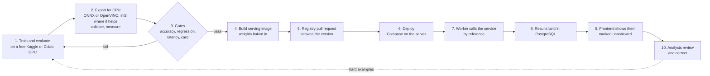

# The AI pipeline: from training to the user's screen

*Draft blueprint. It describes how a model moves from research to a versioned artifact, into a serving container, through the backend and to the frontend. It also defines the contract between the backend and each AI service, the registry, and rollback. Everything that runs on the server runs on CPU.*

## 1. The whole path



| Stage | Where it happens | Input | Output | Gate |
| --- | --- | --- | --- | --- |
| 1. Train and evaluate | Free Kaggle or Colab GPUs. A workstation is optional | `ai/training/<feature>/vN/` scripts and configuration | weights, `metrics.json`, `MODEL_CARD.md` | Configuration and dataset versions are pinned |
| 2. Export for CPU | Same place, at the end of the run | Weights | `.onnx` file or OpenVINO model, int8 only where it helps; `latency.json` | Accuracy drop within the policy; no quantisation without a speed gain |
| 3. Gates | Continuous integration | The version folder | Pass or fail | `ai/registry/policy.yaml` |
| 4. Serving image | Continuous integration | The merged version folder and the weights | `infer-<family>:<feature>-vN-<sha>` | Image builds, loads the model, passes its golden test |
| 5. Registry | A pull request on `ai/registry/` | The image | The desired active version | Review by the code owners |
| 6. Deploy | Continuous delivery to the server | Release tag | Running containers | Health checks |
| 7. Call | The server | A job | A task on the AI service | Job ticket, time budget |
| 8. Land | The server | Task result | Rows in PostgreSQL | One transaction per run |
| 9. Show | The browser | Database rows and tiles | A layer on the map | Every result carries its confidence and review state |
| 10. Review | The browser | A person's decision | Review states, corrections | Only a person can confirm |

## 2. Stage 1: train and evaluate

The version folder is described in `AI_TRAINING_LAYOUT.md`. Three outputs of this stage matter to the product:

- **`metrics.json`**: the numbers, computed on a fixed evaluation split, with the commit, the dataset versions and the seed.
- **The weights**, stored outside Git and pinned by a SHA-256.
- **`MODEL_CARD.md`**: what the model can and cannot do.

## 3. Stage 2: export for CPU

`export.py` in the version folder turns the trained model into what the server can run.

1. **Export to ONNX** with the PyTorch exporter [B28], with a fixed operator set and fixed input sizes where the model allows it.
2. **Quantise to int8** with ONNX Runtime's static quantisation, which uses a set of calibration inputs [B20]. The calibration set comes from the training split.
3. **Validate**: run the original and the quantised model on the evaluation split and record the accuracy change. If it is larger than the policy allows, or if int8 is not faster on the reference CPU, the exported model stays at full precision. int8 is a decision per model, not a default: dynamic int8 made a depthwise-convolution segmentation model 4.1 times slower in the local benchmark (`../cpu_demo_feasibility.md` §2).
4. **Measure**: record inference latency on a named reference CPU in `latency.json`, with the processor and its instruction-set flags. The server's own budget is checked later with `make bench` on the server, and only that number counts. The Contabo host has AVX2 but no AVX-512 or VNNI, so an int8 gain measured on a development laptop is expected to shrink by 1.3 to 1.8 times per core there (estimate, `../cpu_demo_feasibility.md` §2).
5. **Alternative runtime** (optional, per model): convert the ONNX model to OpenVINO [B26] and apply its post-training quantisation [B27] with NNCF [B25]. Keep whichever is faster at equal accuracy and record the choice in the model card.

The serving image contains only the exported file. The training framework is not needed at run time. At run time a service uses one thread per physical core and runs one task at a time (`DOCKER.md` §7).

ONNX Runtime is the default engine because its Python package is current (version 1.32.0, released on 13 November 2026, MIT licence, according to PyPI on 2026-11-25) and it exposes several execution providers, including Intel OpenVINO [B21]. Because its source repository was not reachable at its published address on 2026-11-25, the serving library hides the engine behind one small adapter. If ONNX Runtime becomes unavailable, the OpenVINO adapter takes over without changing the contract or the backend. These two are the only serving runtimes. PyTorch exists only in the training environment, where `export.py` uses it to produce and check the exported file. It is never installed in a serving image.

## 4. Stage 3: gates

The gates are data, in `ai/registry/policy.yaml`, one entry per feature. They are checked in CI for every pull request that touches a version folder.

| Gate | Rule | Why |
| --- | --- | --- |
| Completeness | Every required file of the version folder exists, and every section of the model card is filled | An unexplained model is not a candidate |
| Reproducibility | `metrics.json` records a commit, the dataset versions and a seed | Otherwise the number cannot be defended |
| Floor | Each primary metric is above an absolute minimum | A model that is not useful is not shipped |
| Regression | No primary metric is more than a set amount below the active version | Progress on one metric must not silently break another |
| Quantisation | A quantised model is within the allowed accuracy band and faster than the full-precision model on the reference CPU. Otherwise it is served at full precision | Speed must not be bought with accuracy, and accuracy must not be risked for a speed gain that does not exist |
| Export | The exported file loads in the CPU runtime and produces the same output as the reference on the golden fixture | The server runs the export, not the training code |
| Latency | Latency on the reference CPU is within the feature's budget. The budget is confirmed on the server with `make bench` | The single-user demo must feel immediate |

The numeric thresholds are set by the team in Milestone 4 from the first measurements. Until then the policy file contains the structure and `TBD` values, and the CI job checks only structure and completeness.

## 5. Stage 4: the serving image

- The image is built from `ai/services/<family>/Dockerfile` on the shared CPU base.
- The build downloads the weights named in `weights.yaml`, checks the SHA-256, converts them if needed, and copies the result into the image.
- `/v1/meta` reports, for each model, its task, name, version, weights checksum, runtime and whether it is quantised.
- A golden test runs the container on CI with a tiny fixture and compares the output with the committed reference.
- The image tag carries the feature and the version: `infer-damage:damage-assessment-v3-<sha>`.

## 6. Stage 5 and 6: registry and activation

**The registry has two halves.**

- **Desired state in Git**: `ai/registry/<feature>.yaml` says which version is active.
- **Record of truth in the database**: the `ai_models` table, which the approved schema already defines with one active model per task.

```yaml
# ai/registry/damage-assessment.yaml
feature: damage-assessment
active: v3
image: ghcr.io/OWNER/infer-damage:damage-assessment-v3-a1b2c3d
models:
  - task: BUILDING_SEGMENTATION
    name: building-footprints
    version: "3"
    runtime: onnxruntime-cpu-int8
    weights_sha256: <64 hex characters>
  - task: DAMAGE_CLASSIFICATION
    name: damage-grade
    version: "3"
    runtime: onnxruntime-cpu-fp32
    weights_sha256: <64 hex characters>
```

Activation is a small, reviewed pull request that changes this file. During deployment, `python -m rescuevision.registry apply` runs in a one-off container and upserts the model rows and flips `is_active` in one transaction. The database's own rule that exactly one model per task is active protects against mistakes.

A running job is never affected: the worker reads the active model when the job starts and records what it used in `inference_runs`.

## 7. The contract between the backend and an AI service

The contract is the same for every AI service. Its OpenAPI document lives in `contracts/openapi/<service>.yaml`, and the backend's client for it is generated [B55], never written by hand.

| Resource | Purpose |
| --- | --- |
| `GET /healthz` | The process is running. Used for restarting a container. |
| `GET /readyz` | The weights are loaded and the runtime is usable. Used before sending work. |
| `GET /v1/meta` | The service version, the image digest, the device, and one entry per model with task, name, version, weights checksum, runtime and published metrics. |
| `POST /v1/tasks` | Submit a task. Returns `202` and a task id at once. |
| `GET /v1/tasks/{id}` | Status, progress, outputs, summary and timings. |
| `POST /v1/tasks/{id}/cancel` | Ask the service to stop. |

Rules of the contract:

- **By reference.** A task names its inputs and outputs as object-storage keys plus short-lived presigned URLs. Image bytes never travel through the backend. This is the claim-check pattern: store the payload and pass a reference [S24].
- **Idempotent.** The job id from `processing_jobs` is the idempotency key. A task submitted twice for one job returns the first task.
- **Deterministic output prefix.** Products go to `incidents/{incident}/runs/{run}/`. A retry overwrites its own partial output and nothing else.
- **Job ticket.** The task carries a signed ticket with the job id and an expiry. The service verifies it before reading any input.
- **Stateless service.** A task lives in the memory of the service until it finishes. If the container restarts, the task is lost and the worker submits it again.
- **Task states**: `queued`, `running`, `succeeded`, `failed`, `cancelled`.
- **Errors** have a stable code and a `retryable` flag. The worker retries only retryable errors, up to the job's attempt limit.
- **No database.** The service has no database driver and no credentials.
- **Versioning.** The path starts with `/v1`. Additive changes are allowed inside a version. A breaking change needs `/v2`, a new generated client and a decision record. CI compares the committed OpenAPI document with the previous one and fails on a breaking change (for example with oasdiff [B54]).
- **Compatibility test.** Every new serving image is tested in CI against the backend's current client, and every backend client change is tested against the current serving image.

## 8. Landing the results in the database

The worker is the only writer of AI results. For each finished run it opens one transaction as `rv_worker` and writes:

| Table | What |
| --- | --- |
| `inference_runs` | One row per model used, with the model id from `ai_models` and the parameters |
| `raster_products` | Masks and rasters produced, with their storage keys and bounds |
| `buildings`, `building_assessments`, `cost_estimates` | From the damage service. Assessments are created as `PENDING` review |
| `person_tracks`, `person_detections` | From the people service |
| `hazards`, `road_condition_observations` | From the hazard service, as `AI_DETECTED` and `SUSPECTED` |
| `image_embeddings` | From the embedding service |
| `processing_jobs` | Progress and the final status |

Because everything for a run is written together, a crash leaves no half-finished map.

After hazards land, the worker calls the rule engine for that incident once, so that an AI-detected flood near a live asset raises its alert like a reported one does.

## 9. Stage 9 and 10: the frontend and review

- The frontend never talks to an AI service. It reads the database through the backend and draws tiles from the tile server.
- Every AI result shows its confidence, the model version that produced it and its review state.
- Reviewing means confirm, correct or reject. The decision is stored with the reviewer and the time.
- Only a person can turn a detection into an assistance case.

## 10. The evidence bundle: precomputed heavy work

**Problem.** Stitching a drone flight and analysing a whole session take longer than a single user is willing to wait on a CPU server. Stitching 50 to 80 photos takes an estimated 12 to 25 minutes, and 100 to 200 photos need about 16 GB of memory (`../cpu_demo_feasibility.md` §3.2).

**Solution.** The heavy work is done once, off the server, for the fictional demonstration incident. The result is a **bundle**: the orthomosaic and surface model, 3D tiles or a mesh if one exists, masks, building features, detections, embeddings of the archive, the metrics of the run, and the model versions used. It is stored in object storage or as a release asset and pinned by `scenarios/<scenario>/manifest.yaml`, which lists every file with its SHA-256.

- **Producing it** is a pipeline run on free Kaggle or Colab GPUs, or on a workstation with enough memory, with the same code and the same model versions that the server would use: `make bundle-build SCENARIO=<name>`. Stitching with NodeODM is part of this step and of no other.
- **Loading it** happens at deployment or on demand: `make demo-load SCENARIO=<name>` checks every checksum, uploads the files and inserts the rows in one transaction.
- **Labelling it** is mandatory. The bundle's capture sessions use the `SIMULATION` source type that the schema already defines, so that nobody mistakes them for live analysis.
- **On demand**, the analyst draws an area of a few tiles or uploads one photo. The server analyses it live through the same services, which shows the real pipeline within the CPU budget. An area-wide sweep is never run on demand.

## 11. Rollback

| Situation | Action |
| --- | --- |
| A new model version gives worse results | Revert the registry pull request. On the next deployment the previous version is active again. |
| A serving image is broken | Redeploy the previous release tag. `compose.prod.yaml` pins every image by digest. |
| Both at once | Redeploy the previous release, which includes its registry state. |

The last three releases' images stay in the registry. A rollback is rehearsed once before the demonstration and written up in the runbook `docs/runbooks/model-rollback.md`.

## 12. The review feedback loop

Reviews are labels. They make the product learn from its own use:

1. Analysts confirm, correct or reject AI results in the console.
2. `make hard-examples FEATURE=<feature>` exports the corrected cases as a versioned dataset: the image crop, the model's answer and the person's answer.
3. A new training version adds that dataset and is evaluated on a holdout that contains field corrections.
4. The model card reports two numbers: agreement with human review in the field, and the laboratory metric.

This is the idea usually called active learning. The team should survey the literature before citing it in the report; it was not surveyed for this blueprint.

**One gap blocks part of it.** `person_detections` has no review state in the current schema, although the report describes reviewing a detection. The column has to be added first.

## 13. The language model (optional)

A language model could draft the narrative of a report from the frozen statistics and answer questions through read-only tools. It never dispatches, closes a case, resolves an alert or writes warning text. It **does not run on the demonstration server**: the CPU feasibility study puts an 8-billion-parameter model at 4.5 to 5.5 GB of memory and 20 to 30 seconds per structured answer on an 8-vCPU EPYC host (`../cpu_demo_feasibility.md` §3.4). For the demonstration, with its fictional data, the drafter would call a free hosted model through the `rv_readonly` boundary with personal data removed. With real agency data it has to run on hardware the agency controls. It is a stretch goal after Milestone 8, and nothing else depends on it.

## 14. Open issues

- The ONNX Runtime source repository returned 404 at its published address on 2026-11-25. The project's current status must be checked before Milestone 4. The design does not depend on it alone.
- Ultralytics YOLO is under AGPL-3.0 or a commercial licence [S21]. For the person detector, prefer an Apache-2.0 model family if the result is meant for agency use, or record the licence in `THIRD_PARTY_NOTICES.md`.
- The policy thresholds in `ai/registry/policy.yaml` and the CPU budgets in `ai/benchmarks/budgets.yaml` are set from the first measurements.
- The review state on `person_detections` is missing.
