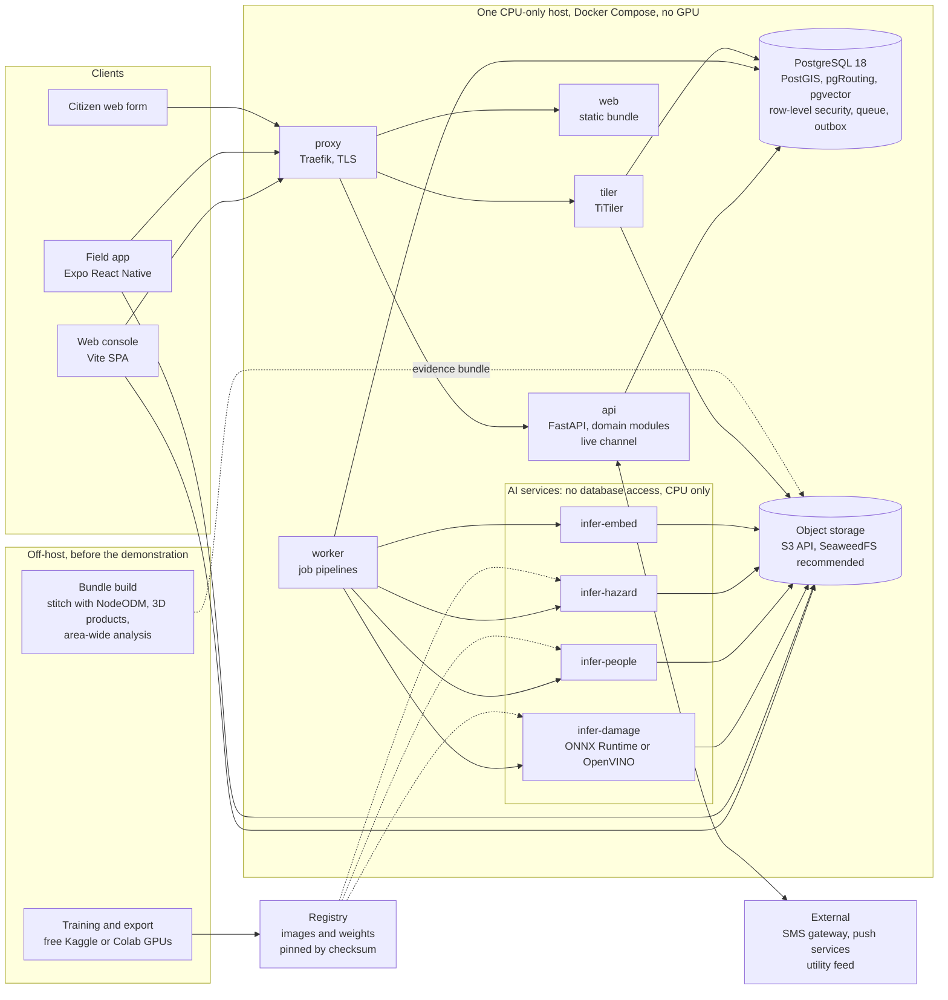

# RescueVision architecture

*Draft of the repository's `ARCHITECTURE.md`: the document a person or an AI coding agent reads to learn what to build and where it lives. Rationale, alternatives and evidence for each decision are in the proposal `../glm_proposal.md` and in the other files of this blueprint folder.*

## 1. What this document is for

It describes the system that the repository builds: which parts exist, what each one owns, how they talk, and which decisions are already made. If you change any of them, change this document and the matching decision record in the same pull request.

Read in this order: `VISION.md`, this file, then the `AGENTS.md` of the folder you will work in.

## 2. The system in one picture

**The shape in one sentence:** one modular application that owns the data, plus a few separate, stateless AI and processing services that never touch the database.

## 3. Decisions already made

| No. | Decision | One-line reason | Blueprint file |
| --- | --- | --- | --- |
| ADR-001 | Modular monolith for the business core. No microservices for the database-facing logic. | The hazard response is one database transaction under one user identity. | `../glm_proposal.md` §4 |
| ADR-002 | AI models run in their own containers, one per model family, with no database access. | Isolation of dependencies, versions and failure. | `AI_PIPELINE.md`, `DOCKER.md` |
| ADR-003 | Model services are called over HTTP/JSON by reference. Image bytes never pass through the backend. | Object storage is the only path for large data. | `AI_PIPELINE.md`, `CONTRACTS.md` |
| ADR-004 | PostgreSQL is the job queue and the event log. No Kafka, NATS or Redis. | One less broker; enqueue and events are atomic with the data. | `../glm_proposal.md` §7 |
| ADR-005 | One WebSocket live channel, fed by an outbox table and `LISTEN`/`NOTIFY`. | No phantom events on rollback; clients resume by sequence number. | `../glm_proposal.md` §7.3 |
| ADR-006 | Web console: Vite single-page app, TanStack Router, TanStack Query, MapLibre GL JS, deck.gl. | Typed URL state and a map drawn by the viewer's own graphics hardware; no server rendering. | `../glm_proposal.md` §9 |
| ADR-007 | Field app: Expo React Native. Offline means SQLite plus a queue of pending operations with idempotent replay. | One TypeScript domain language for both apps. | `../glm_proposal.md` §9.4 |
| ADR-008 | **CPU-only server.** The Contabo host has no GPU and no budget for one. Every runtime part works on CPU. Training and export run on free Kaggle or Colab GPUs. | The product runs as a single-user demonstration on one ordinary server. | `DOCKER.md`, `AI_PIPELINE.md`, `HOSTING_CONTABO.md` |
| ADR-009 | Heavy jobs are precomputed into a versioned **evidence bundle**: the orthomosaic, the surface model, 3D products and area-wide analysis. On-demand analysis is limited to a small area of interest or one photo. | Stitching takes minutes and splat training hours on a CPU; a single-user demo must feel immediate. | `AI_PIPELINE.md` §10 |
| ADR-010 | Exported models with a swappable CPU runtime: ONNX Runtime by default, OpenVINO as the alternative. int8 only where a measurement shows it helps. | No lock-in to one inference engine; no training framework on the server. | `AI_PIPELINE.md` §3 |
| ADR-011 | Object storage is consumed through the **S3 API only**, from a maintained store. SeaweedFS is the recommendation, RustFS the alternative. | The MinIO open-source repository is archived and no longer maintained. | `HOSTING_CONTABO.md` §6 |
| ADR-012 | `ai_models` in the database is the record of what is deployed; `ai/registry/<feature>.yaml` in Git is the desired state. | Rollback is a revert. | `AI_PIPELINE.md` §6 |
| ADR-013 | Deployment is Docker Compose on one host, driven by GitHub Actions over SSH. No Kubernetes. | Single user, single host, six developers. | `HOSTING_CONTABO.md` |
| ADR-014 | Trunk-based development with short-lived branches and Conventional Commits. | Small, reviewable changes from people and agents alike. | `BRANCHING.md` |
| ADR-015 | Documentation is part of the product: a fixed document set, nested `AGENTS.md` files, and checks in CI. | Agents and people must read the same truth. | `DOCUMENTATION_SET.md` |
| ADR-016 | Demonstrations and end-to-end tests replay **scenarios as code** through the public API. | Reproducible demo, reproducible tests. | `TESTING.md`, `scenarios/` |
| ADR-017 | The schema lives in SQL files only. No ORM generates tables. | Triggers, policies and functions cannot be generated. | `database/AGENTS.md` |

## 4. Containers and what each one owns

| Container | Image built from | Owns | Database access | Runs on |
| --- | --- | --- | --- | --- |
| `proxy` | Traefik (third-party) | TLS, routing to `web`, `api`, `tiler`, WebSocket upgrades, request limits | None | CPU |
| `web` | `frontend/apps/web/Dockerfile` | The static console bundle | None | Browser does the work |
| `api` | `backend/Dockerfile`, target `api` | Sign-in, REST endpoints, the WebSocket live channel, presigned storage URLs, mobile sync batches | Yes, as the signed-in user, inside a transaction | CPU |
| `worker` | `backend/Dockerfile`, target `worker` | Claims jobs, runs pipelines (analyse, route, report, notify), lands AI results in the database | Yes, as the service role `rv_worker` | CPU |
| `tiler` | TiTiler (third-party) | Raster tiles from cloud-optimised GeoTIFF | None | CPU |
| `postgres` | `database/Dockerfile` | All persistent state: records, geometry, the road graph, embeddings, the job queue, the outbox | Owner of the data | CPU |
| `object-store` | A maintained S3-compatible store: SeaweedFS by default, confirmed by the compatibility test in Milestone 0 (`HOSTING_CONTABO.md` §6) | Images, rasters, masks, features, reports, the evidence bundle | None | CPU |
| `infer-damage` | `ai/services/damage/Dockerfile` | Building footprints, damage grade, change detection | None | CPU, ONNX Runtime or OpenVINO |
| `infer-people` | `ai/services/people/Dockerfile` | Person detection and tracking | None | CPU, ONNX Runtime or OpenVINO |
| `infer-hazard` | `ai/services/hazard/Dockerfile` | Flood, road, fire and smoke segmentation | None | CPU, ONNX Runtime or OpenVINO |
| `infer-embed` | `ai/services/embed/Dockerfile` | Image embeddings for similar-case search | None | CPU, ONNX Runtime or OpenVINO |
| `stitch` | NodeODM (third-party, profile `stitch`) | Orthomosaic, surface model and mesh. Runs only when an evidence bundle is built, never during a demonstration | None | CPU and memory heavy: precomputed |

No container needs a GPU, and no language model runs on this host (`AI_PIPELINE.md` §13).

## 5. Inside the application

The application is one Python code base (`backend/`) with one package, `rescuevision`, deployed twice (`api` and `worker`).

| Module | Owns these tables | May call |
| --- | --- | --- |
| `identity` | agencies, roles, permissions, role_permissions, users, user_sessions, user_devices, teams, team_members, vehicles | platform |
| `operations` | incidents, incident_agencies, zones, missions, mission_assignments, mission_status_history | identity |
| `imagery` | capture_sessions, images, raster_products, ai_models (read), processing_jobs, inference_runs | identity, operations |
| `damage` | buildings, building_assessments, cost_profiles, cost_profile_unit_rates, cost_profile_repair_ratios, cost_estimates | imagery |
| `routing` | road_nodes, road_segments, road_condition_observations, routes, route_segments, alert_closed_segments (write only by the hazard engine) | imagery, hazards (read) |
| `persons` | person_tracks, person_detections, facilities, assistance_cases, case_events | operations, imagery |
| `hazards` | infrastructure_assets, hazards, hazard_rules, compound_alerts, compound_alert_sources, alert_closed_segments | routing (read), persons (read) |
| `field` | responder_positions, responder_last_positions, sos_alerts, notifications | operations, persons |
| `citizens` | citizens, citizen_requests, media_files, citizen_request_media | operations, persons |
| `reporting` | reports, report_shares, image_embeddings | all, read only |

Rules that keep the modules separate:

- A module imports only the platform package and the **public interface** of another module. Import Linter fails the build otherwise.
- A module's SQL may name only the tables it owns plus the tables in its declared read list. A generated test checks this.
- Cross-module rules that must always hold live in the database (foreign keys, triggers, functions), not in application code.

## 6. Data

**PostgreSQL** is the only database. Four roles: `rv_app` (the API acting for a staff user), `rv_citizen` (the citizen channel), `rv_worker` (the worker), `rv_readonly` (report rendering and analytics). Every request runs inside a transaction that sets the acting user with `set_config('app.user_id', …, true)`.

Three mechanisms live in PostgreSQL and have no separate service:

1. **Job queue**: rows in `processing_jobs`, claimed with `FOR UPDATE SKIP LOCKED`, with a heartbeat and a retry count.
2. **Event outbox**: rows in `live_events`, written by triggers in the same transaction as the data change. `NOTIFY` wakes the live channel; a slow poll is the safety net.
3. **Rule engine**: `evaluate_hazard_rules()` and `resolve_compound_alert()` in PL/pgSQL.

**Object storage** holds every large file. The key layout is defined in `contracts/storage-keys.md` and starts with `incidents/{incident}/…` so that one incident can be copied or removed as a unit.

**Nothing is stored on local disk** except what PostgreSQL and the object store manage themselves.

## 7. Three flows to know by heart

Full sequences are in the proposal (§8). In short:

- **Imagery to map.** The demonstration starts from the evidence bundle: stitched rasters, buildings, assessments and costs are loaded in one transaction and appear unreviewed. On demand, the analyst draws a small area of interest or uploads one photo. The worker calls the AI services by reference and lands each run in one transaction. Stitching runs only when a bundle is built, never inside a request.
- **Report to alert.** A flood report and the rule engine run in one transaction. On commit, the outbox wakes the live channel, which pushes the alert to the consoles and a priority warning to responders in the zone.
- **Offline to online.** The field app stores each pending operation with a client-generated UUIDv7 identifier. On reconnect it sends them in a batch. The server applies each once, under the responder's own permissions, and returns everything that changed since the last sequence number.

## 8. The AI side at run time

- Each AI service exposes the same four resources: `/healthz`, `/readyz`, `/v1/meta`, `/v1/tasks` (`POST` to submit, `GET` to poll). The contract is in `contracts/openapi/infer-<name>.yaml` (`CONTRACTS.md`).
- Only the `worker` can reach the AI services. The `api` never calls a model.
- `/v1/meta` reports, for every model in the container, its task, name, version and weights checksum. The worker records these in `inference_runs`.
- The worker reads the active model for each task from `ai_models` when a job starts. Changing the active model never affects a running job.
- Each job type has a **CPU time budget** in `ai/benchmarks/budgets.yaml`. A job that cannot meet the interactive budget must be precomputed into the evidence bundle. Only one inference task runs at a time, with one thread per physical core (`DOCKER.md` §7).

## 9. Clients

- **Web console**: one single-page app. MapLibre GL JS draws the 2D map and the extruded 3D buildings; deck.gl draws dense layers. CesiumJS is loaded only if a photogrammetry mesh exists. All 3D rendering happens in the browser. The mesh comes from the evidence bundle; nothing 3D is computed on the server.
- **Field app**: Expo. Local SQLite with SQLCipher. Sync by batch. Push notifications wake the app; SMS is the fallback for an SOS.
- **Citizen channel**: a responsive web page reached from an SMS link. No app to install.

## 10. Operating envelope

The design target is one incident, one user at a time, on one Contabo host with no GPU.

| Concern | Budget | How it is checked |
| --- | --- | --- |
| Console page load | Set in Milestone 1 | Playwright timing |
| Hazard report to alert on screen | Far inside the 60-second requirement of the report (NFR-PF-04) | Metric from the trace, scenario test |
| Interactive analysis (area of interest) | Seconds | CPU benchmark on the server |
| Full-session analysis, stitching | Precomputed | Evidence bundle manifest |
| Model latency per task | `ai/benchmarks/budgets.yaml` | `make bench` on the server |
| Inference concurrency | One task at a time, one thread per physical core | Worker settings; `make bench` |

The numeric budgets are filled in after the first measurement on the real server. Until then they are marked `TBD` and no design may depend on them. The CPU feasibility study (`../cpu_demo_feasibility.md`) gives a first estimate per model. It is for planning, not a budget. Two of its findings apply from the first day: inference threads must equal the physical cores, and the Contabo processor has AVX2 but no AVX-512, so a latency measured on a development machine does not transfer.

## 11. Build order

The order is by dependency only. Who does what is not part of the architecture. Each milestone is a set of specifications in `specs/`.

| Milestone | Result at the end |
| --- | --- |
| **M0 Repository foundation** | New tree, root documents, Makefile, CI for lint and unit tests, branch protection, nested `AGENTS.md` files, templates. |
| **M1 Walking skeleton** | Sign in, one incident on a map, live channel says hello, CI integration tests against PostgreSQL and object storage. |
| **M2 Data and permissions** | Fresh build and migrations, the generated row-level-security matrix, the hazard-engine privilege fix, demo scenario in the database. |
| **M3 Evidence bundle** | The demo sortie is stitched and analysed once, off the server; the bundle loads and the map shows damage. |
| **M4 AI services and pipelines** | CPU inference containers, registry, model cards, on-demand analysis of an area of interest. |
| **M5 Operations** | Cases, missions, routing, compound alerts, notifications, reports. |
| **M6 Field app** | Missions, tracking, SOS, offline sync, SMS fallback. |
| **M7 Citizen channel** | Phone one-time code, request, verification, conversion. |
| **M8 Hardening and rehearsal** | Backups and restore drill, security review, scenario replay for the demonstration, documentation audit. |
| **Stretch** | Dry-run mode of the hazard engine, incident replay, the edge-to-server cascade experiment, report drafter. |

## 12. Deliberately not built

Kubernetes, Kafka or another message broker, a GPU or paid GPU time for the server, a language model on the server, stitching or 3D reconstruction inside a request, a service mesh, CRDT sync, phone-to-phone mesh networking, an event-sourced store, and any form of automatic action without human review. The conditions under which each would be reconsidered are in the proposal (§17).

## 13. Open issues that need a decision

| Issue | Why it matters | Where |
| --- | --- | --- |
| Which privilege runs the rule engine for a field report | The path described in the report fails under the implemented policies today. | Proposal §8.2 |
| No review state on `person_detections` | Reviewing a detection is required by the report and has no column. | Proposal §16.3 |
| Confirm SeaweedFS, or the next candidate, against the compatibility suite | The MinIO open-source repository is archived and no longer maintained. | `HOSTING_CONTABO.md` §6 |
| Current status of the ONNX Runtime source repository | Its GitHub address returned 404 on 2026-11-25; the PyPI package is being released. | `AI_PIPELINE.md` §14 |
| The report says GPU workers are rented per incident | Decided on 2026-11-25: no GPU and no budget for one. The deployment view in the report must be corrected. | Proposal §16, §19.2 |
