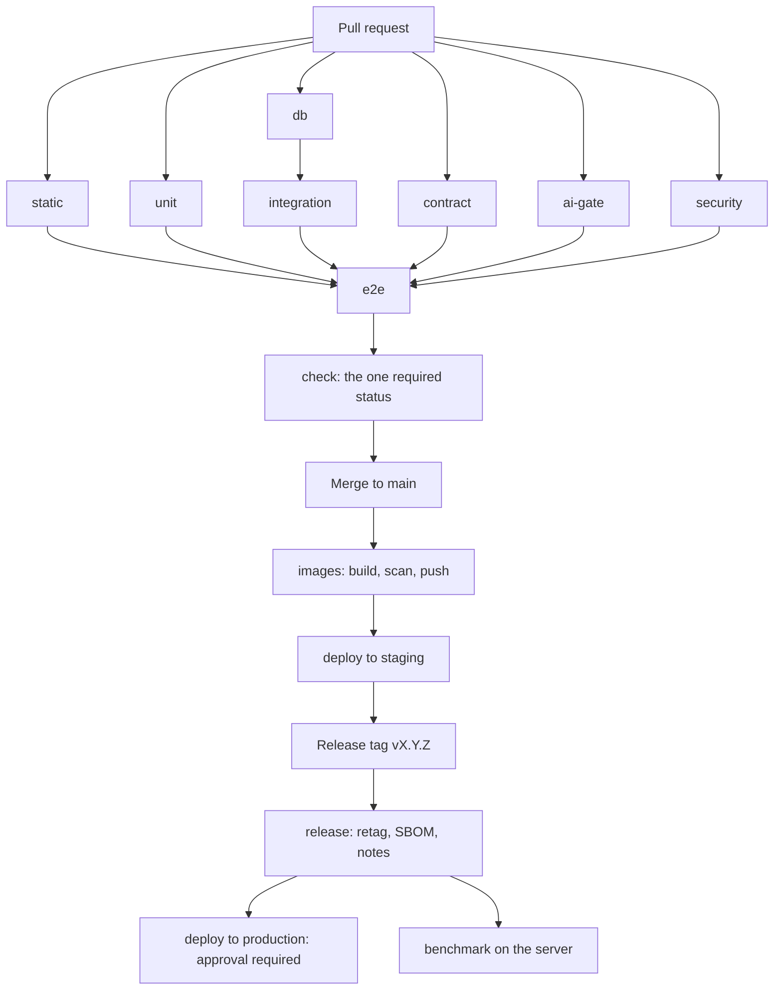

# Continuous integration and delivery

*Draft blueprint for `.github/workflows/` and `deploy/bin/`. It defines the whole pipeline: lint, type checks, unit, contract, database integration with PostGIS, AI evaluation gates, image builds, security scans and deployment to the Contabo server.*

## 1. Which CI, and why

**GitHub Actions.** The repository is already on GitHub. Actions comes with the pieces this workflow needs without another service to run: status checks on pull requests, protected branches and rulesets [B41] [B42], code owners [B43], deployment environments with required reviewers [B44], service containers for PostgreSQL [B38], dependency updates [B47], code scanning [B46] and a container registry. The workflow syntax is documented in one place [B37].

Two facts shape the design:

- **GitHub's hosted runners have no GPU** and modest CPU. Everything that runs on every pull request is small and CPU-only. Real model training and evaluation happen on Kaggle or Colab, and CI checks their results.
- **A private repository pays for minutes.** The pull-request pipeline is short, and the heavy tests run only when their part of the repository changed.

## 2. The pipeline at a glance

## 3. Jobs on a pull request

| Job | What it does | Runs when | Depends on |
| --- | --- | --- | --- |
| `changes` | Works out which areas changed | Always | — |
| `static` | Formatting, lint, type checks, Import Linter, module table ownership, `make repo-check`, `make docs-check` | Always | `changes` |
| `unit` | Unit tests for backend, frontend and AI libraries | Always | `changes` |
| `db` | Builds the PostgreSQL image, builds the database from scratch, runs the self-checks and the row-level-security matrix, and checks that a migrated database equals a fresh build | `database/`, `backend/` or the workflow changed | `changes` |
| `security` | Secret scan, dependency audit, code scanning, licence check against `THIRD_PARTY_NOTICES.md` | Always | `changes` |
| `integration` | Starts PostgreSQL and the object store as service containers [B38], runs the backend's integration tests | `backend/`, `database/`, `contracts/` changed | `db` |
| `contract` | Checks that the OpenAPI and event snapshots are current, runs the property-based API tests, detects breaking changes, tests each changed AI service against its golden fixture and against the backend's current client | `backend/`, `ai/services/`, `contracts/`, `frontend/packages/api/` changed | `integration` |
| `ai-gate` | Validates every changed version folder against the policy (`AI_PIPELINE.md` §4): completeness, reproducibility, floor, regression, quantisation, export parity, reference latency | `ai/training/` or `ai/registry/` changed | `changes` |
| `e2e` | Builds the images affected by the change, starts the full stack in Compose on the runner, replays one short scenario through the public API, runs the browser smoke test | After the others | all above |
| `check` | Does nothing itself. It passes only if every required job passed. It is the single required status on `main`. | Always | all above |

## 4. Other workflows

| Workflow | Trigger | What it does |
| --- | --- | --- |
| `images` | Push to `main` | Builds, scans and pushes every first-party image tagged with the commit SHA and `edge`. Records the digests. |
| `deploy-staging` | After `images` | Deploys that commit to the staging project on the server (§7). Replays the demo scenario. |
| `release` | Push of a tag `vX.Y.Z` | Retags the images built from that commit as `X.Y.Z`, attaches a software bill of materials and the digests to the release, and generates the notes from the commit history. |
| `deploy-production` | After `release`, with a required reviewer on the `production` environment [B44] | Deploys the release to the production project. Runs the server benchmark. |
| `model-release` | Push of a tag `model-<feature>-v<N>` | Attaches the weights and `metrics.json` to a release, as the training layout describes. |
| `nightly` | Schedule | The full end-to-end suite, mobile flows on an emulator, resilience scenarios, a restore from last night's backup into an empty database, dependency and container re-scans, link checks. |
| `renovate` | Automatic | Dependency updates as small pull requests, which pass through the same pipeline. |

## 5. Keeping it fast and cheap

- **Path filters** skip jobs whose area did not change.
- **Concurrency groups** cancel a run when a new commit is pushed to the same pull request.
- **Caches** for the Python environment, the Node environment and the Docker layers.
- **One database image per run**, with each test class getting a database created from a template.
- **Tiny models** in CI. Real models are checked by the gates on their recorded results.
- **Nightly** for everything that takes longer than a few minutes.

## 6. Security of the pipeline itself

| Rule | Reference |
| --- | --- |
| Pin every third-party action to a full-length commit SHA | GitHub's hardening guidance [B40] |
| Give each job the smallest token permissions it needs | [B40] |
| No secrets for pull requests from forks | Review checklist |
| Cloud credentials through OpenID Connect where a provider supports it; otherwise a dedicated deploy key limited to one repository | [B45] |
| Code scanning with CodeQL | [B46] |
| Secret scanning in history and in commits (for example gitleaks) | [B53] |
| Dependency updates and alerts | [B47] |
| Container image scanning before push (for example Trivy), a software bill of materials (for example Syft) attached to each release | [B53] |
| Production deployment waits for a person's approval in a protected environment | [B44] |

## 7. A deployment, step by step

The server runs Docker Compose. The workflow talks to it over SSH with a dedicated key.

1. **Fetch.** The server checks out the exact commit or tag into `deploy/` (it holds only the deployment files).
2. **Pull.** `docker compose -f compose.yaml -f compose.prod.yaml pull` downloads the images named by digest.
3. **Back up.** `backup.sh` takes a database dump before anything changes.
4. **Migrate.** Database migrations run in a one-off container. A failed migration stops the deployment here.
5. **Registry.** `python -m rescuevision.registry apply` makes the `ai_models` table match `ai/registry/`.
6. **Demo data.** On staging, `make demo-load` loads the evidence bundle.
7. **Switch.** `docker compose up -d --remove-orphans` replaces the containers.
8. **Health.** `healthcheck.sh` waits for `api`, `worker`, `postgres` and the object store, then calls the public endpoints.
9. **Smoke.** The replay tool runs the short scenario and checks its expectations.
10. **On failure, roll back.** The workflow redeploys the previous release tag and reports. Nothing is fixed by hand on the server.

Staging and production are two Compose projects on the same host, with separate volumes, networks and subdomains (see `HOSTING_CONTABO.md`).

## 8. Releases and versioning

- A release is a tag `vX.Y.Z` following semantic versioning [B51]. The version is bumped by a pull request that edits one version file, or derived automatically from the commit history, whichever the team chooses in Milestone 0.
- Commit messages follow the Conventional Commits format, checked by commitlint [B52]. The release notes are generated from them.
- Each release records: the commit, the image digests, the active model versions from the registry, the benchmark numbers from the server, and the scenario results.

## 9. Undoing a deployment

| Situation | Action |
| --- | --- |
| A deployment failed its health check | The workflow has already redeployed the previous release |
| A bug is found after deployment | Redeploy the previous release tag, then run its migrations' down path if the database changed |
| A model misbehaves | Revert the registry pull request and deploy, as in `AI_PIPELINE.md` §11 |
| The database must go back | Stop the application, restore from the pre-deployment dump with `restore.sh`, redeploy the previous release |

The runbook is `docs/runbooks/rollback.md`. It is rehearsed once in Milestone 8.

## 10. Open points for Milestone 0

- Whether the repository is public or private. Public repositories use the hosted runners without a minute quota; the design above keeps the pipeline short either way. Check the current runner table [B39] before relying on specifications.
- How the version number is derived (one version file, or from commit history).
- Whether to add a self-hosted runner on a team workstation for GPU tests. The design does not need one.
