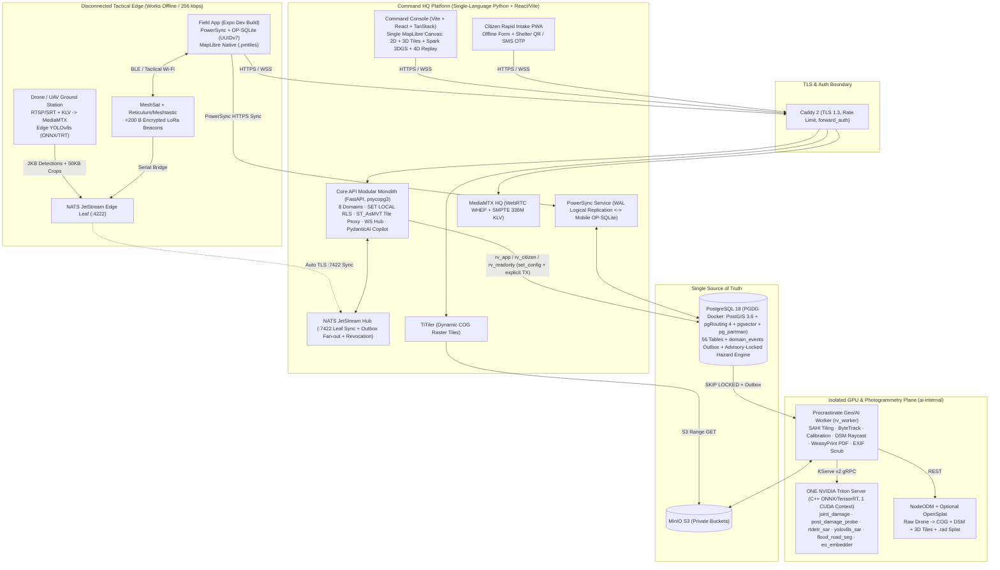

# RescueVision — Unified System Architecture (`ARCHITECTURE.md` Blueprint)

> **Status:** Canonical Target Architecture ("Local-First Tactical Digital Twin"). Supersedes all split-brain NestJS, 4-LitServe, Martin-direct, and dual-CesiumJS drafts.

---

## 1. Architectural Thesis: Local-First Tactical Digital Twin

RescueVision solves multi-agency disaster coordination under the worst realistic failure mode: **collapsed cellular networks, heterogeneous drone/satellite imagery, strict agency compartmentalization, and compounding physical hazards**.

Instead of a fragile cloud-only web stack, the platform enforces five structural pillars:
1. **Single ACID Core (`PostgreSQL 18` + `PostGIS 3.6` + `pgRouting 4` + `pgvector` + `pg_partman`):** Holds all incidents, Row-Level Security (`D-04`), spatial routing, `evaluate_hazard_rules()`, `processing_jobs` (`Procrastinate`), and a transactional `domain_events` outbox.
2. **Single-Language Platform Backend (`Python 3.12+ FastAPI` + `psycopg3`):** An 8-module modular monolith (`import-linter`-enforced) paired with `geo-worker`—handling geospatial projections, `WeasyPrint` PDFs, authenticated `ST_AsMVT` vector tiles, and a strictly read-only `PydanticAI` Spatial Copilot (`rv_readonly`).
3. **Packed Single-Context AI Runtime (`ONE NVIDIA Triton Server` + `NodeODM`):** Consolidates ONNX/TensorRT inference into one shared CUDA context isolated behind `geo-worker` on `ai-internal`.
4. **Live Edge & Disconnected Sync (`MediaMTX` + `NATS JetStream` + `PowerSync` + `MeshSat`):** Live drone RTSP/SRT + `SMPTE 336M` KLV edge person detection; `PowerSync` + `OP-SQLite` offline mobile operations; `<200 B` `MeshSat`/`Reticulum` LoRa SOS & flood beacon failover.
5. **One Unified 2D/3D/4D Map Canvas (`MapLibre GL JS`):** Vector `ST_AsMVT` + offline `PMTiles` + `TiTiler` COGs + `maplibre-gl-three` (`3DTilesRendererJS`) + `Spark` 3D Gaussian Splats + 4D Time-Travel Scrubber—zero CesiumJS duplication.

---

## 2. System Topology

---

## 3. Mandatory Architectural Fixes (Resolved Before Feature Code)

1. **`evaluate_hazard_rules()` RLS `42501` Crash & Race Condition (`12_hazard_engine.sql` + `15_security.sql`):**
   - *Problem:* Currently `SECURITY INVOKER` without an advisory lock; `FIELD_RESPONDER` has `hazard.report` but lacks `analysis.run`/`alert.resolve`, triggering `42501` RLS errors on `road_segments`/`compound_alerts` and racing concurrent flood reports.
   - *Fix:* Convert `evaluate_hazard_rules(p_incident)` to `SECURITY DEFINER` with `SET search_path = public, pg_temp`, enforce explicit caller authorization (`app.has_permission(p_incident, 'hazard.report') OR app.has_permission(p_incident, 'analysis.run')`), and acquire `pg_advisory_xact_lock(hashtext(p_incident::text))` as its first lock step.
2. **True RLS on Vector Tiles (Replacing Unauthenticated `Martin`):**
   - *Problem:* `Martin` uses a static pool and cannot execute per-request `SET LOCAL` RLS transactions; PL/pgSQL HMAC query hacks disable caching and auto-publishing.
   - *Fix:* Serve RLS-protected operational vector layers (`buildings`, `road_segments`, `compound_alerts`, `assistance_cases`, `responder_last_positions`) through a dedicated FastAPI `ST_AsMVT` endpoint running `BEGIN; SELECT set_config('app.user_id', %s, true); ...` behind Caddy `forward_auth`, cached in Redis keyed by `(incident_id, role_scope, filter_hash, z, x, y)` and invalidated by `domain_events`. Serve static basemaps via `.pmtiles` and dynamic rasters via `TiTiler` behind Caddy `forward_auth`.
3. **PostgreSQL 18 Container Packaging (`database/Dockerfile`):**
   - *Fix:* Extend `pgrouting/pgrouting:18-3.6-4.0`, install `postgresql-18-pgvector` and `postgresql-18-partman`, mount volumes at `/var/lib/postgresql`, and replace hardcoded 2026–2027 manual partitions in `11_field_reports_audit.sql` with automated `pg_partman` maintenance.
4. **Live Video & Intrinsics Schema (`04_imagery_ai.sql` & `08_persons_cases.sql`):**
   - *Fix:* Add `STREAM_CLIP`/`EDGE_CROP` to `media_kind`, store camera intrinsics (`focal_length_px`, `cx`, `cy`, distortion) on `capture_sessions`, and allow `person_detections.image_id` to be `NULL` when `stream_ref` + `frame_pts_ms` + `crop_object_key` are provided (`CHECK (image_id IS NOT NULL OR stream_ref IS NOT NULL)`).
5. **PowerSync Conflict Semantics & Instant Socket Revocation:**
   - *Fix:* Add `sync_version` / monotone status transition checks for `assistance_cases` (`DETECTED → VERIFIED → ASSIGNED → ON_SCENE → RESCUED`), append-only semantics for `case_events`/`hazards`, and publish `rv.sec.revoked_users` via `domain_events` → NATS whenever `users.status` or `incident_agencies.status` changes so open WebSockets disconnect immediately.
6. **Citizen Privacy Hygiene:**
   - *Fix:* Uploads to `citizen-quarantine` trigger a `geo-worker` `EXIF_SCRUB` job stripping device/personal EXIF tags after extracting validated coordinates before moving media to `incident-media`.

---

## 4. End-to-End Critical Flows

### Flow A: Drone Survey OR Live Stream → Calibrated Damage, Cost & Survivor Triage
1. **Live Tactical Path:** Drone sends RTSP/SRT + `SMPTE 336M` KLV → Edge `MediaMTX` → `edge-detector` (`YOLOv8s` + `ByteTrack`) → DSM/DEM raycast → `NATS Edge Leaf` publishes `2 KB` detection JSON + `50 KB` JPEG crop → HQ `geo-worker` creates `person_tracks` + `person_detections` + `DETECTED` `assistance_cases`.
2. **Survey Photogrammetry Path:** Analyst uploads raw DJI photos via pre-signed MinIO URL → `POST /api/v1/captures/{id}/commit` → `geo-worker` calls `NodeODM` (COG orthomosaic + DSM + 3D Tiles, plus optional `OpenSplat` `.rad` for flagged collapse zones).
3. **Triton Inference:** `geo-worker` slices COG windows, calls Triton (`joint_damage` + `flood_road_seg` + `eo_embedder`) over gRPC, applies `calibration_temp` from `ai_models`, computes `cost_estimates`, writes to Postgres + `domain_events`, and `apps/web` refreshes `ST_AsMVT` + `TiTiler` + 3D Tiles inside the single MapLibre canvas.

### Flow B: Flood Report → *Electrified Water* Compound Alert & Safe Re-Route (`< 60s` SLA)
1. Field responder, citizen intake triage, or `flood_road_seg` commits `FLOOD_WATER` geometry to `hazards`.
2. Inside the same ACID transaction (`BEGIN` + `set_config`), `evaluate_hazard_rules(p_incident)` acquires `pg_advisory_xact_lock`, matches `FLOOD_WATER` within hazard radius of `ENERGIZED` or `UNKNOWN` `power_assets`, inserts `compound_alerts`, snapshots `alert_closed_segments`, sets overlapping `road_segments` `cost = -1`, invalidates affected `routes`, and writes `alert.raised` + `route.invalidated` to `domain_events`.
3. Outbox relay publishes to NATS JetStream → instant WebSocket push to Command Console + Expo Push to Mobile + `geo-worker` runs vehicle-aware `pgr_aStar` (`water_depth_cm <= vehicle.max_water_depth_cm`) pushing new safe routes within `< 5s`.

### Flow C: Offline Field Operations & LoRa Mesh Failover
1. Before leaving staging, `apps/mobile` caches incident `.pmtiles` and syncs assigned missions/cases/hazards via `PowerSync` → encrypted `OP-SQLite`.
2. When cellular drops, responder continues offline triage & flood reporting locally using client-generated `uuidv7()` keys (`OFFLINE` banner + pending queue count visible).
3. If `SOS` or `FLOOD_WATER` stays unacknowledged > 15 s without cellular, `apps/mobile` hands a `<200 B` CBOR packet via BLE/Wi-Fi to `MeshSat`/`Reticulum` LoRa → hops across relays to any backhaul node → injected into `core-api` tagged `origin = 'MESH_RELAY'`.
4. Upon reconnect, `PowerSync` replays queued writes idempotently; server merges `case_events` append-only and preserves monotone forward status progression.

---

## 5. Modular Monolith Domains (`backend/src/rescuevision/domains/`)

1. `auth_org`: JWT verification, `rv_app`/`rv_citizen` context binding, agency permissions, revocation events.
2. `incidents`: Incident lifecycle, multi-agency invitations, team assignments, 4D timeline replay queries.
3. `imagery_ingest`: Pre-signed MinIO uploads, `capture_sessions` camera intrinsics, `NodeODM` & `OpenSplat` orchestration, `MediaMTX` stream tokens.
4. `damage_cost`: `building_assessments` calibration, analyst verification workflow, immutable `cost_estimates` & `ai_models` sync.
5. `hazards_routing`: `hazards`, `power_assets`, `evaluate_hazard_rules()` trigger points, `pgr_aStar` vehicle routing, `ST_AsMVT` operational tile builder.
6. `persons_cases`: `person_tracks`/`person_detections` deduplication, `assistance_cases` START triage, offline sync reconciliation.
7. `citizens_reports`: `citizen_requests` triage, shelter QR/OTP intake, frozen `WeasyPrint` bilingual PDF `reports` (`stats_snapshot`).
8. `copilot`: Strictly read-only `PydanticAI` spatial assistant bound to `rv_readonly` views + `pgvector` HNSW semantic search (cites clickable entity IDs; zero write permissions).
