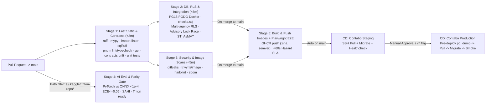

# RescueVision — CI/CD Pipeline Blueprint (`CI_CD.md`)

> **Platform Choice:** **GitHub Actions** (paired with **GitHub Container Registry `ghcr.io`**, **Turborepo cache**, and **optional self-hosted/on-demand GPU runner** for Stage 4 AI gates).
> **Why GitHub Actions over Jenkins / GitLab / CircleCI:** Zero CI infrastructure to host or patch on Contabo, native PR status checks & CODEOWNERS, first-class BuildKit layer caching, and seamless path-filtered workflows so frontend PRs run in `< 3 min` without waiting on GPU or PostGIS builds.

---

## 1. End-to-End CI/CD Architecture

---

## 2. Detailed Pipeline Workflows (`.github/workflows/`)

### 2.1 `ci-fast.yml` (Every PR & Push — Target `< 3 min`)
Runs in parallel matrix jobs on `ubuntu-latest`:
1. **`python-static`:**
   - `uv sync --frozen`
   - `uv run ruff check backend ai` & `uv run ruff format --check backend ai`
   - `uv run mypy backend/src`
   - `uv run lint-imports` *(enforces 8 modular monolith domains + bans PyTorch inside `backend/api`)*
   - `uv run pytest backend/tests/unit ai/tests`
2. **`sql-lint`:**
   - `sqlfluff lint database/schema database/migrations`
   - Custom check verifying every `SECURITY DEFINER` function explicitly sets `search_path = public, pg_temp`.
3. **`frontend-static`:**
   - `pnpm install --frozen-lockfile`
   - `pnpm turbo run lint typecheck test` *(includes ESLint RTL check banning `ml-`/`mr-`/`left-`/`right-`)*
4. **`contracts-drift`:**
   - Starts FastAPI in schema-export mode (no DB needed), runs `make gen-contracts`, and fails if `git diff --exit-code contracts/openapi frontend/packages/api` shows uncommitted drift!
   - Validates `edge/meshsat/` LoRa CBOR round-trip tests (`payload <= 200 bytes`).

### 2.2 `ci-db-integration.yml` (Every PR touching `database/`, `backend/`, `contracts/` — Target `< 6 min`)
Runs against real containerized services (no mocked Postgres):
- Builds `database/Dockerfile` (`pgrouting/pgrouting:18-3.6-4.0` + `pgvector` + `pg_partman`, `/var/lib/postgresql` mount).
- Boots `pgbouncer`, `redis`, `nats:2.14.1-alpine`, `minio`.
- Executes:
  1. Ordered `database/schema/*.sql` + `database/migrations/*.sql` + `database/seed/*.sql` idempotency check.
  2. `psql -f database/tests/checks.sql`.
  3. **Multi-Agency RLS Matrix (`pytest backend/tests/integration/test_rls_matrix.py`):** Verifies zero leaks across Agency A, Agency B, `FIELD_RESPONDER`, `rv_citizen`, `rv_readonly`, and `/tiles/vector/{z}/{x}/{y}.mvt`.
  4. **Hazard Engine Concurrency & Privilege Test:** Proves `FIELD_RESPONDER` flood report succeeds (no `42501`), and 10 parallel `FLOOD_WATER` submissions produce **1** compound alert via `pg_advisory_xact_lock`.
  5. **WebSocket Revocation Test:** Suspends user → verifies NATS `rv.sec.revoked_users` terminates active WS connection within `< 2s`.

### 2.3 `ci-security.yml` (Every PR & Nightly)
- **`gitleaks`:** Scans full commit diff for leaked Kaggle tokens, AWS/MinIO keys, JWT secrets, or `.env` files.
- **`hadolint`:** Lints `database/Dockerfile`, `backend/Dockerfile`, `frontend/apps/*/Dockerfile`, `ai/Dockerfile.*`.
- **`trivy`:** Vulnerability scan on Python `uv.lock`, Node `pnpm-lock.yaml`, and built Docker images (fails on unfixed `CRITICAL` CVEs in runtime containers).
- **`pip-audit` & `pnpm audit`:** Dependency advisory check.

### 2.4 `ci-ai-gate.yml` (Triggered on `ai/**`, `kaggle/**`, `triton-repo/**`, or manual dispatch)
- **Lightweight PR Check (CPU):** Validates YAML schemas (`kaggle/*/*/config.yaml`), JSON metrics schema (`metrics.json`), `triton-repo/*/config.pbtxt` syntax (`tritonserver` dry-run / parser), and PyTorch-vs-ONNX numerical parity (`max_abs_diff < 1e-4`) on tiny fixture crops.
- **Full Model Promotion Gate (Self-Hosted Lab GPU Runner or On-Demand Cloud GPU):**
  - Pulls held-out evaluation split (`splits_event_aware.csv` + `LADI v2` / `RescueNet` / `HERIDAL`) from MinIO.
  - Runs `uv run python -m rv_ai.eval.gate_check`:
    - `joint_damage`: asserts `XView2PixelScorer` F1 regression-free & `ECE <= 0.05`.
    - `person_sar_*`: asserts SAHI recall & latency budget.
  - Boots `tritonserver` container and runs gRPC KServe v2 smoke inference.
  - Posts Markdown benchmark diff table back onto the PR.

### 2.5 `ci-e2e.yml` & Container Build (`on merge to main` + Nightly)
1. **Docker BuildKit Push:** Builds multi-stage images (`backend-api`, `backend-worker`, `postgres-pg18`, `web`, `citizen`, `edge-detector`) and pushes immutable digests to `ghcr.io/<org>/rescuevision-*:${{ github.sha }}`.
2. **Playwright Full-Stack E2E:** Boots `infra/compose/docker-compose.yml` (`core` profile), logs in, verifies MapLibre 2D/3D + `TiTiler`, submits a `FLOOD_WATER` hazard, asserts **Electrified Water** alert + closed road + re-route render in `< 60s` (`NFR-PF-04`), toggles Arabic RTL, and checks `WeasyPrint` PDF download.

---

## 3. Continuous Deployment (`cd-deploy.yml`)

| Environment | Trigger | Deployment Action | Rollback Mechanism |
|---|---|---|---|
| **Staging** (`staging.rescuevision...`) | Automatic on green `main` merge (`ci-e2e.yml` pass) | 1. SSH to Contabo Staging node. 2. Sync `infra/compose/` + decrypt staging secrets (`sops`). 3. `docker compose pull` pinned `sha` images. 4. Run idempotent DB migrations (`make db-migrate`). 5. `docker compose up -d --remove-orphans` + `/health` probe. | Re-run workflow against previous green commit SHA or `docker compose up -d` with prior `.env.release` image tag. |
| **Production** (`app.rescuevision...`) | Manual workflow approval on release tag `v*.*.*` | 1. **Mandatory Pre-Deploy Backup:** Run verified `pg_dump` + upload snapshot tag to off-site backup bucket. 2. Pull signed `semver` images from `ghcr.io`. 3. Run forward migrations in maintenance/zero-downtime step. 4. Rolling recreate `core-api` → `geo-worker` → `web`/`citizen` → `caddy reload`. 5. Run external smoke probe (`health`, tile `200`, DB RLS check). | **Code:** Instant re-pin to previous `v(X.Y.Z-1)` image tag (`< 60s`). **Schema:** Additive-only forward migrations during live ops; point-in-time `pgBackRest` restore if catastrophic. **AI Model:** Flip `ai_models.is_active` row or Triton version folder without touching containers (`< 30s`). |
