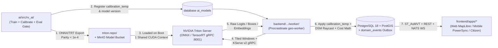

# RescueVision — Target Repository Layout

> **Design Rule:** Every folder has a single clear owner plane (**Software Engineering** vs. **AI Engineering** vs. **Shared Contracts & Docs**). If an AI coding agent cannot immediately tell where a file belongs—and what is **forbidden** inside it—the layout is broken.

---

## 1. High-Level Separation of Planes

```
RescueVision/
├── AGENTS.md                  # Root AI-agent & developer operating contract
├── VISION.md                  # Single 1-page product & technical story
├── ARCHITECTURE.md            # Unified system topology, flows & technical decisions
├── REPO_LAYOUT.md             # This file: directory ownership & boundaries
├── Makefile                   # Canonical task runner (up-core, up-gpu, db-check, gen-contracts, test)
├── pyproject.toml             # Workspace Python toolchain (uv workspace: backend + ai)
│
├── contracts/                 # [SEAM] Shared API, NATS event, Triton tensor & geo schemas
├── database/                  # [SWE] PostgreSQL 18 + PostGIS/pgRouting/pgvector schema, seeds & checks
├── backend/                   # [SWE] FastAPI modular monolith, Procrastinate geo-worker & PowerSync config
├── frontend/                  # [SWE] pnpm Turborepo: apps/web, apps/mobile, apps/citizen & shared packages
├── edge/                      # [SWE+EDGE] Tactical field kit: MediaMTX config, edge ONNX runner, MeshSat bridge
├── infra/                     # [SWE] Docker Compose files, Caddyfile, Prometheus/Grafana, CI helpers
│
├── ai/                        # [AI] Training, datasets loaders, calibration, DSM raycasting & ONNX export
├── triton-repo/               # [SEAM -> AI] Versioned NVIDIA Triton model repository (config.pbtxt + pointers)
├── datasets/                  # [AI] Dataset manifests, DVC/S3 pointers, event-aware splits (NO raw images in git)
│
├── docs/                      # Architecture ADRs, model cards, experiment logs, thesis documentation
├── .github/                   # CI/CD workflows enforcing lint, contracts, RLS, AI parity & E2E gates
└── scripts/                   # Repo-wide dev bootstrap, seeding, and verification scripts
```

---

## 2. Folder-by-Folder Specification (Allowed vs. Forbidden)

### 2.1 Shared Seams (`contracts/`)
| Folder | What Lives Here | What Is **Forbidden** Here |
|---|---|---|
| `contracts/` | Top-level contract version pins and README explaining schema generation. | Runtime application logic or language-specific business services. |
| `contracts/openapi/` | Exported canonical `openapi.json` snapshot generated from FastAPI (`backend/`). | Hand-edited OpenAPI YAML/JSON files drifting from FastAPI Pydantic schemas. |
| `contracts/events/` | JSON Schema / AsyncAPI definitions for `domain_events` & NATS subjects (`rv.inc.*`, `rv.sec.*`), plus LoRa `<200 B` CBOR binary packet schemas. | Database connection strings or UI rendering code. |
| `contracts/triton/` | Canonical input/output tensor shapes, dtype contracts, and class-label enums shared between `ai/export/` and `backend/.../triton_client`. | Trained binary weights (`.onnx`, `.plan`, `.pt`). |

### 2.2 Software Engineering Side (`database/`, `backend/`, `frontend/`, `edge/`, `infra/`)

#### `database/`
| Folder | What Lives Here | What Is **Forbidden** Here |
|---|---|---|
| `database/Dockerfile` | Pinned PostgreSQL 18 PGDG image extending `pgrouting/pgrouting:18-3.6-4.0` with `pgvector` and `pg_partman`. | Hardcoded production passwords or host data volumes. |
| `database/schema/` | Ordered DDL files (`00_extensions.sql` .. `16_powersync_outbox.sql`), RLS policies, `SECURITY DEFINER` hazard engine, `domain_events` outbox. | Sample incident data or Python application code. |
| `database/migrations/` | Forward-only incremental SQL/Alembic migration scripts applied after initial baseline. | Destructive unreviewed table drops without backup notes. |
| `database/seed/` | Deterministic reference data (`roles`, `hazard_rules`, `ai_models`, `cost_profiles`) and reproducible Cairo demo scenario. | Real citizen PII or synthetic bloat data (>5 MB). |
| `database/tests/` | SQL assertion suite (`checks.sql`), RLS cross-agency denial tests, and advisory-lock race tests. | Mocked in-memory SQLite tests masquerading as Postgres checks. |

#### `backend/`
| Folder | What Lives Here | What Is **Forbidden** Here |
|---|---|---|
| `backend/Dockerfile` | Multi-stage Python 3.12+ image (`api` and `geo-worker` targets) with `WeasyPrint`, `GDAL`/`rasterio`, `curl`, and zero GPU/PyTorch bloat. | `torch`, `torchvision`, `ultralytics`, `mmcv`, `CUDA` runtimes, or `.pt`/`.onnx` weight files. |
| `backend/src/rescuevision/api/` | FastAPI HTTP routers (`/api/v1/*`), WebSocket hub, Caddy auth adapter, `ST_AsMVT` Redis-cached tile proxy, OpenAPI exporter. | Direct cross-domain SQL queries bypassing domain modules, or blocking sync I/O (`nodeodm`, `WeasyPrint`) inside request handlers. |
| `backend/src/rescuevision/domains/` | Eight strictly bounded domain packages (`auth_org`, `incidents`, `imagery_ingest`, `damage_cost`, `hazards_routing`, `persons_cases`, `citizens_reports`, `copilot`) governed by `import-linter`. | Cross-domain private imports (must use explicit domain ports or `domain_events`). |
| `backend/src/rescuevision/infra/` | `psycopg3` pool + explicit `BEGIN`/`set_config` RLS helper, NATS JetStream publisher/outbox relay, MinIO S3 signer, Redis cache, OTel telemetry. | Domain-specific business logic or AI math. |
| `backend/src/rescuevision/worker/` | `Procrastinate` task definitions (`STITCH`, `ANALYZE`, `REROUTE`, `REPORT_PDF`, `EXIF_SCRUB`), SAHI/COG window slicer, Triton gRPC client, NodeODM/OpenSplat REST client, `WeasyPrint` PDF builder. | PyTorch training loops, dataset loading, or uncalibrated raw model files. |
| `backend/tests/` | `unit/` (domain rules, raycast geometry wrapper, cost math), `contract/` (OpenAPI/NATS schema drift), and `integration/` (Testcontainers PG18+RLS+Redis+NATS). | Tests that skip RLS (`rv_admin` only) or mock away spatial PostGIS checks. |

#### `frontend/` (pnpm + Turborepo)
| Folder | What Lives Here | What Is **Forbidden** Here |
|---|---|---|
| `frontend/apps/web/` | Command Console SPA (React 19, Vite, TanStack Router/Query, 4D Time-Travel Scrubber, `PydanticAI` Copilot drawer, Arabic/English RTL). | CesiumJS, hand-written API types, or direct Postgres/MinIO credentials. |
| `frontend/apps/mobile/` | Field Responder app (Expo Development Build, Expo Router, `@powersync/react-native` + `op-sqlite`, `@maplibre/maplibre-react-native`, `.pmtiles`, BLE Meshtastic hook). | `Expo Go` workarounds, custom hand-rolled SQLite outbox queues, or `Mapbox` proprietary SDKs. |
| `frontend/apps/citizen/` | Standalone low-bandwidth Citizen Rapid Intake PWA (offline form + EXIF client/server-safe upload + shelter QR/SMS OTP flow). | Internal responder/commander routes, RLS agency views, or heavy 3D WebGL bundles. |
| `frontend/packages/api/` | **Auto-generated** `@hey-api/openapi-ts` typed REST client + Zod WebSocket/NATS event parsers (`make gen-contracts`). | Manual edits (overwritten on every generation). |
| `frontend/packages/map-core/` | Shared MapLibre styling tokens, colorblind-safe damage patterns, `maplibre-gl-three` + `3DTilesRendererJS` + `maplibre-gl-splat` (`Spark`) adapter, `TiTiler` swipe layer. | App-specific routing/state or CesiumJS dependencies. |
| `frontend/packages/sync-schema/` | Shared `PowerSync` client SQLite table schema + local conflict-resolution helpers shared with `backend/` WAL publication rules. | Divergent ad-hoc SQLite DDL. |
| `frontend/packages/ui/` | Shared RTL-first design primitives (`ms-*`/`me-*`), `i18next` EN/AR dictionaries, accessibility tokens (`NFR-US-02`). | Hardcoded `left`/`right`/`ml-`/`mr-` directional CSS or untranslated strings. |

#### `edge/` & `infra/`
| Folder | What Lives Here | What Is **Forbidden** Here |
|---|---|---|
| `edge/mediamtx/` | `mediamtx.yml` configuring RTSP/SRT/WebRTC + MPEG-TS `SMPTE 336M` KLV passthrough and authentication hooks. | Storing recorded multi-GB video files inside Git. |
| `edge/detector/` | Lightweight standalone ONNX Runtime / TensorRT `YOLOv8s` edge stream consumer + `ByteTrack` + KLV projection publishing `person_detection` + `50 KB` crops to NATS Edge Leaf. | Heavy training frameworks (Lightning/TorchGeo) or `NodeODM` stitching. |
| `edge/meshsat/` | `MeshSat` / `Reticulum` + `Meshtastic` LoRa bridge config encoding/decoding `<200 B` CBOR `SOS` / `FLOOD_WATER` beacons to `NATS Leaf`. | Plaintext unencrypted emergency payloads or high-bandwidth image transfers over LoRa. |
| `infra/compose/` | Split Compose definitions (`docker-compose.yml` core, `docker-compose.gpu.yml`, `docker-compose.edge.yml`). | Monolithic unprofiled Compose mixing Kaggle training with production ingress. |
| `infra/caddy/` | `Caddyfile` (TLS, `forward_auth`, rate limits, `/tiles/*`, `/api/*`, `/media/*` WHEP proxy). | Direct unauthenticated proxy rules to MinIO or database ports. |
| `infra/powersync/` | `powersync.yaml` & `sync-rules.yaml` scoping replicated Postgres rows per agency/incident/responder. | Unrestricted global `SELECT *` sync buckets leaking cross-agency data. |
| `infra/observability/` | Prometheus scrape configs, Grafana dashboards (`NFR-PF-04` `<60s` alert latency, Triton GPU VRAM, PowerSync lag), OTel collector config. | Application source code. |

### 2.3 AI Engineering Side (`ai/`, `triton-repo/`, `datasets/`)

| Folder | What Lives Here | What Is **Forbidden** Here |
|---|---|---|
| `ai/src/rv_ai/datasets/` | PyTorch/TorchGeo datamodules (`xBD`, `BRIGHT`, `RescueNet`, `LADI v2`, `SARD`, `HERIDAL`, `FloodNet`), GSD normalization & oblique/radiometric augmentations. | Raw `.tif`/`.jpg` datasets committed to Git. |
| `ai/src/rv_ai/models/` | Model architectures (`SiameseUNetSE`, `ChangeOS`, `Clay`/`DINOv2` + `HASTE` linear probe, `RT-DETR`, `YOLOv8s`, `SegFormer-B2`). | FastAPI servers, SQL queries, or HTTP routing. |
| `ai/src/rv_ai/training/` | Deterministic Lightning/YAML training runners (`configs/`), MLflow logging, EMA/SWASoup hooks. | Hardcoded Kaggle `/kaggle/working` paths or `git clone` hacks. |
| `ai/src/rv_ai/calibration/` | Temperature Scaling optimizer (`ECE`), conformal prediction intervals, and DSM pixel-to-GPS raycaster calibration scripts. | Production API endpoints. |
| `ai/src/rv_ai/eval/` | Authoritative evaluation gates (`XView2PixelScorer`, SAHI recall, ECE, temporal/event-held-out `LADI v2` benchmark) writing Markdown/JSON metrics. | Cherry-picked demo screenshots presented as benchmark scores. |
| `ai/src/rv_ai/export/` | `torch.onnx.export` / TensorRT builder + numerical parity verifier (`abs_diff < 1e-4` PyTorch vs. ONNX Runtime) emitting artifacts to `triton-repo/`. | Unverified weight exports lacking parity assertions or `config.pbtxt` validation. |
| `ai/notebooks/` | Exploratory Kaggle/Colab notebooks (cleanly importing `rv_ai` via editable package install, never cloning broken `src/`). | Canonical production inference logic (must live in `ai/src/rv_ai/`). |
| `ai/tests/` | Unit tests for losses, GSD transforms, Temperature Scaling math, DSM raycasting, and ONNX parity smoke checks. | Tests requiring multi-hour full-dataset training on PRs. |
| `triton-repo/` | Checked-in Triton model directory skeleton (`<model_name>/config.pbtxt`, `<model_name>/labels.json`, `.gitkeep` per version) + S3/DVC pull script for `.onnx`/`.plan` binaries. | Binary model files > 5 MB committed directly to Git (pull via MinIO/DVC checksum manifest). |
| `datasets/` | `splits_event_aware.csv`, SHA-256 checksum manifests, license notes, and download scripts (`xBD`, `RescueNet`, `LADI v2`, `SARD`, `HERIDAL`, `FloodNet`). | Raw images, orthomosaics, or private drone footage inside Git. |

---

## 3. How Software Engineering & AI Connect End-to-End



**Why this separation works for 6 students + AI coding agents:**
- An agent modifying **damage calibration or adding a new Triton model** never touches FastAPI, React, or RLS SQL—it edits `ai/`, passes `ai.eval.gate_check`, updates `triton-repo/<model>/<version>/config.pbtxt`, and registers a row in `ai_models`.
- An agent modifying **routing, hazard rules, or UI** never touches PyTorch, CUDA, or dataset loaders—it works purely inside `database/`, `backend/`, and `frontend/` using mocked or real Triton gRPC contracts (`contracts/triton/`).
