# RescueVision — Database & ERD Design

**Date:** 2026-11-23 · **Status:** Approved and implemented in `database/` (PostgreSQL 18.7) · **Target:** PostgreSQL 16 + PostGIS 3 + pgRouting 3 + pgvector

RescueVision is a multi-agency disaster-response platform for **Government, Police, Ambulance (EMS) and Fire** services. This document defines the product features and the complete relational data model that supports them.

---

## 1. Product features

### F1 · Before/After Damage Assessment & Restoration Cost Estimation
RescueVision compares pre-disaster and post-disaster satellite or drone imagery of the same area. For every building it extracts the footprint and grades its condition on the international xBD scale (*No Damage, Minor, Major, Destroyed*), with a probability for each grade. Each building then receives an **indicative restoration cost**: repair ratio for its damage grade (FEMA HAZUS-based) × floor area (footprint × floors) × local construction cost per m². The cost is shown as a low–high range, with every assumption visible and editable. Results roll up into per-building reports, area totals and a reconstruction-priority list.

### F2 · 2D/3D Situational Mapping & Rescue Route Planning
Drone photos are stitched into one georeferenced map. A **2D operational map** (MapLibre) and a **3D city view** (CesiumJS, buildings extruded and colored by damage) display the same layers: damage, people, hazards and routes. The street network becomes a routable graph. Blocked roads detected by AI, flooded segments, debris and nearby collapsed buildings raise each segment's travel cost or close it. The system computes the safest fastest route for a rescue team from its staging area to a victim or zone, plus alternatives, and recomputes when the map changes. Vehicle capability matters: a 4x4 may cross shallow water and an ambulance may not.

### F3 · Aerial Person Detection Under Partial Visibility
A detector trained on aerial search-and-rescue data (SARD, VisDrone, POP for occluded persons) finds people in drone imagery at different altitudes and angles. It also works when **only part of the body is visible**: half-covered by debris, behind walls, or only head or limbs exposed. Each detection is converted from pixel to GPS with an **uncertainty radius in metres**. Repeated sightings across overlapping photos raise confidence. *Scope statement:* the system detects visible or partially visible persons. It does not see through rubble.

### F4 · Multi-Object Person Tracking
Detections across video frames or photo sequences are linked into **tracks** (ByteTrack). Each person gets a stable ID, a movement path, a last-known position and a movement state. A person who stays still for a long time may be injured, and a person moving towards a hazard needs a warning. Tracks turn into **assistance cases**, so command can assign a team to a specific person.

### F5 · Compound Hazard Intelligence — "Danger on the Road" Alerts
Some dangers are lethal only in combination. The system records individual hazards (floodwater, fire, smoke, downed power lines, gas leaks, collapse risk, debris) and infrastructure (power lines, transformers, gas pipelines). A **rule engine** fires a **Compound Hazard Alert** when two of them interact in space. The flagship rule is **"Electrified Water"**: floodwater within 30 m of an energized power line. The alert:
1. draws a no-entry danger zone on the 2D and 3D maps,
2. automatically closes the affected road segments for routing,
3. invalidates and recomputes routes passing through the zone,
4. pushes a warning to every responder inside or routed through it.

Further rules: *Fire + Gas → Explosion Risk*, *Collapse-Risk Building + Road → Falling-Debris Zone*. Rules are data, so agencies can add them without code changes.

### F6 · General Reports
Auto-generated reports (PDF/HTML): situation reports, damage and cost, casualty summary, mission after-action and full incident. Each report freezes its statistics at generation time, lists the model versions used, follows an approval workflow (draft → approved → published), can be shared across agencies, and carries the mandatory disclaimer: *"AI decision-support output; human review required."*

### Platform capabilities
- Agencies and roles.
- Shared multi-agency incidents (Incident Command System style).
- Missions assigned to teams or individuals.
- Responder field app (live GPS, SOS, field reports).
- Citizen help-request channel with verification.
- Similar past cases (pgvector).
- A full audit trail.

---

## 2. Decisions made with the team

| Topic | Decision |
|---|---|
| ERD scope | Full platform, not only the AI features |
| User categorization | **Agency + Role** (two independent axes) + a **Platform Admin** above all agencies |
| Agency types | `GOVERNMENT`, `POLICE`, `EMS`, `FIRE` |
| Roles (same in every agency) | `AGENCY_ADMIN`, `COMMANDER`, `ANALYST`, `FIELD_RESPONDER`; plus `PLATFORM_ADMIN` |
| Multi-agency model | One shared **Incident**, a lead agency invites the others; each agency runs its own **Missions** |
| Assignment | Missions are assigned to **Teams and/or individual responders** |
| Ground reporting | **Responders and citizens** (citizens through a verified channel) |
| Database approach | Normalized relational core + typed PostGIS layers (not a generic feature table, not JSON blobs) |

### Role responsibilities

| Role | Scope | Can do |
|---|---|---|
| Platform Admin | Whole system | Create agencies, manage agency admins, model registry, global hazard rules |
| Agency Admin | Own agency | Manage users, teams and vehicles of the agency |
| Commander | Joined incidents | Create incidents/missions, invite agencies, assign teams, approve reports, resolve alerts |
| Analyst / Operator | Joined incidents | Upload imagery, run analysis, review AI results, plan routes, verify citizen requests |
| Field Responder | Assigned missions | Mobile app: mission tasks, live GPS, SOS, field reports, case status updates |

Permissions are stored in `role_permissions`, so they can be changed without code.

---

## 3. Global conventions

- **Extensions:** `postgis`, `pgrouting`, `vector`, `citext`, `pgcrypto`.
- **Primary keys:** `uuid` (UUID v7, time-ordered) for business entities, because the offline mobile app can generate ids. `bigint` identity for high-volume tables (`person_detections`, `responder_positions`, `audit_log`) and the pgRouting graph (`road_nodes`, `road_segments`), because pgRouting requires integer ids.
- **Spatial:** all geometry is `SRID 4326`. Every geometry column has a GiST index. Metric distances use `ST_DWithin(a::geography, b::geography, metres)`. Never use `ST_Distance(...) < x`, because it cannot use the index.
- **Timestamps:** `timestamptz` everywhere. Mutable tables have `created_at` and `updated_at`, and users have `deleted_at` (soft delete).
- **Vocabularies:** Postgres `ENUM` for fixed lists such as statuses. Lookup tables for anything agencies may edit: `roles`, `permissions`, `hazard_rules`, `cost_profiles`.
- **Provenance:** every AI-produced row references `inference_runs` and carries `confidence`. Human input carries the reporting user or citizen. A `CHECK (num_nonnulls(...) = 1)` constraint enforces exactly one source.
- **Current state plus history:** a fast current-state column (for example `road_segments.condition`, `building_assessments.is_current`) and an append-only history table (`road_condition_observations`, `case_events`, `mission_status_history`).
- **Files:** images, rasters, PDFs and media live in MinIO (S3 API). Postgres stores `storage_key`, `sha256` and metadata only.
- **Access control:** a user sees incident data only if their agency has an `ACTIVE` row in `incident_agencies`. This is enforced in the API layer, with optional Postgres Row-Level Security.

---

## 4. Domain overview (56 tables)

| # | Domain | Tables |
|---|---|---|
| D1 | Identity & Access | agencies, roles, permissions, role_permissions, users, user_sessions, user_devices, teams, team_members, vehicles |
| D2 | Incidents & Operations | incidents, incident_agencies, zones, missions, mission_assignments, mission_status_history |
| D3 | Imagery & AI Pipeline | capture_sessions, images, raster_products, ai_models, processing_jobs, inference_runs |
| D4a | F1 Buildings & Cost | buildings, building_assessments, cost_profiles, cost_profile_unit_rates, cost_profile_repair_ratios, cost_estimates |
| D4b | F2 Roads & Routing | road_nodes, road_segments, road_condition_observations, routes, route_segments |
| D4c | F3/F4 Persons & Cases | person_tracks, person_detections, facilities, assistance_cases, case_events |
| D4d | F5 Hazards & Alerts | infrastructure_assets, hazards, hazard_rules, compound_alerts, compound_alert_sources, alert_closed_segments |
| D5 | Field, Citizens, Reports, Audit | responder_positions, responder_last_positions, sos_alerts, citizens, citizen_requests, media_files, citizen_request_media, notifications, reports, report_shares, image_embeddings, audit_log |

Feature-to-table map:

| Feature | Core tables |
|---|---|
| F1 Damage & cost | buildings, building_assessments, cost_*, cost_estimates, capture_sessions (PRE/POST), inference_runs |
| F2 Mapping & routing | raster_products (orthomosaic/DSM/3D tiles), road_nodes, road_segments, road_condition_observations, routes, route_segments, vehicles, zones, facilities |
| F3 Detection | person_detections, images, inference_runs |
| F4 Tracking | person_tracks, assistance_cases, case_events |
| F5 Compound hazards | hazards, infrastructure_assets, hazard_rules, compound_alerts, compound_alert_sources, alert_closed_segments, notifications |
| F6 Reports | reports, report_shares (+ reads every domain) |

---

## 5. Table definitions

Notation: `PK` primary key, `FK` foreign key, `?` nullable, `UQ` unique.

### D1 · Identity & Access

**agencies**: `id uuid PK` · `name text` · `agency_type agency_type` (GOVERNMENT | POLICE | EMS | FIRE) · `parent_agency_id uuid? FK→agencies` · `jurisdiction geometry(MultiPolygon,4326)?` · `phone text?` · `is_active bool` · `created_at`, `updated_at`

**roles**: `code text PK` (PLATFORM_ADMIN | AGENCY_ADMIN | COMMANDER | ANALYST | FIELD_RESPONDER) · `name text` · `scope role_scope` (PLATFORM | AGENCY)

**permissions**: `code text PK` (e.g. `incident.create`, `mission.assign`, `route.plan`, `case.triage`, `report.approve`, `alert.resolve`) · `description text`

**role_permissions**: `role_code FK→roles` · `permission_code FK→permissions` · `PK(role_code, permission_code)`

**users**: `id uuid PK` · `agency_id uuid? FK→agencies` · `role_code text FK→roles` · `full_name text` · `email citext UQ` · `phone text?` · `password_hash text` · `job_title text?` (display only: "Paramedic", "Fire Captain") · `badge_number text?` · `status user_status` (INVITED | ACTIVE | SUSPENDED) · `last_login_at?` · `created_at`, `updated_at`, `deleted_at?`
- `CHECK ((role_code = 'PLATFORM_ADMIN') = (agency_id IS NULL))`

**user_sessions**: `id uuid PK` · `user_id FK→users` · `refresh_token_hash text UQ` · `device_info text?` · `created_at` · `expires_at` · `revoked_at?`

**user_devices**: `id uuid PK` · `user_id FK→users` · `platform device_platform` (IOS | ANDROID | WEB) · `push_token text UQ` · `last_seen_at`

**teams**: `id uuid PK` · `agency_id FK→agencies` · `name text` · `team_type team_type` (AMBULANCE_UNIT | FIRE_ENGINE | RESCUE_SQUAD | POLICE_PATROL | DRONE_CREW | COMMAND_UNIT) · `home_base geometry(Point,4326)?` · `status team_status` (AVAILABLE | DEPLOYED | OFF_DUTY) · `UQ(agency_id, name)`

**team_members**: `id uuid PK` · `team_id FK→teams` · `user_id FK→users` · `is_leader bool` · `joined_at` · `left_at?`
- `UNIQUE (user_id) WHERE left_at IS NULL`: one active team per responder (ICS unity of command)

**vehicles**: `id uuid PK` · `agency_id FK→agencies` · `team_id uuid? FK→teams` · `call_sign text` · `vehicle_type vehicle_type` (AMBULANCE | FIRE_TRUCK | PATROL_CAR | OFFROAD_4X4 | BOAT | DRONE) · `plate_number text?` · `max_water_depth_cm int?` · `status vehicle_status` (AVAILABLE | IN_USE | OUT_OF_SERVICE)

### D2 · Incidents & Operations

**incidents**: `id uuid PK` · `code text UQ` ("INC-2026-0007") · `name text` · `disaster_type disaster_type` (EARTHQUAKE | FLOOD | FIRE | STORM | TSUNAMI | LANDSLIDE | EXPLOSION | OTHER) · `status incident_status` (ACTIVE | CONTAINED | CLOSED) · `severity smallint CHECK 1–5` · `lead_agency_id FK→agencies` · `area geometry(MultiPolygon,4326)` · `is_historical bool DEFAULT false` (reference events for similar-case search, e.g. Palu 2018, Türkiye 2023) · `started_at` · `closed_at?` · `created_by FK→users`

**incident_agencies**: `incident_id FK` · `agency_id FK` · `PK(incident_id, agency_id)` · `participation participation_role` (LEAD | SUPPORT) · `status participation_status` (INVITED | ACTIVE | WITHDRAWN) · `invited_by FK→users` · `joined_at?`

**zones**: `id uuid PK` · `incident_id FK` · `name text` · `zone_type zone_type` (SECTOR | STAGING_AREA | SAFE_ZONE | EVACUATION_POINT | NO_ENTRY) · `geom geometry(Geometry,4326)` · `created_by FK→users`

**missions**: `id uuid PK` · `incident_id FK` · `agency_id FK→agencies` (owning agency) · `code text` · `title text` · `mission_type mission_type` (SEARCH_RESCUE | MEDICAL_EVACUATION | FIRE_SUPPRESSION | ROAD_SECURITY | DAMAGE_SURVEY | DRONE_SURVEY | EVACUATION) · `priority smallint CHECK 1–4` · `status mission_status` (PLANNED | ASSIGNED | IN_PROGRESS | COMPLETED | CANCELLED) · `target_zone_id uuid? FK→zones` · `target_geom geometry(Geometry,4326)?` · `created_by FK→users` · `started_at?` · `completed_at?` · `UQ(incident_id, code)`

**mission_assignments**: `id uuid PK` · `mission_id FK` · `team_id uuid? FK→teams` · `user_id uuid? FK→users` · `vehicle_id uuid? FK→vehicles` · `assigned_by FK→users` · `assigned_at` · `released_at?` · `response assignment_response` (PENDING | ACCEPTED | DECLINED)
- `CHECK (num_nonnulls(team_id, user_id) = 1)`: a team **or** an individual

**mission_status_history**: `id bigint PK` · `mission_id FK` · `from_status?` · `to_status` · `changed_by FK→users` · `changed_at` · `note text?`

### D3 · Imagery & AI Pipeline

**capture_sessions**: `id uuid PK` · `incident_id FK` · `mission_id uuid? FK→missions` · `source_type capture_source` (DRONE | SATELLITE | SIMULATION | FIELD_PHONE) · `phase capture_phase` (PRE_EVENT | POST_EVENT) · `provider text?` · `captured_from`, `captured_to` · `coverage geometry(Polygon,4326)?` · `uploaded_by FK→users` · `status session_status` (UPLOADING | PROCESSING | READY | FAILED)

**images**: `id uuid PK` · `session_id FK→capture_sessions` · `media_kind media_kind` (PHOTO | VIDEO_FRAME) · `frame_index int?` · `storage_key text` · `sha256 text UQ` · `width_px`, `height_px` · `spectral_band spectral_band` (RGB | THERMAL) · `captured_at` · `camera_position geometry(PointZ,4326)?` · `altitude_agl_m?` · `gimbal_pitch?`, `gimbal_yaw?`, `gimbal_roll?` · `gsd_cm?` · `gps_accuracy_m?` · `footprint geometry(Polygon,4326)?` · `exif jsonb?`

**raster_products**: `id uuid PK` · `session_id FK→capture_sessions` · `produced_by_run_id uuid? FK→inference_runs` · `product_type raster_type` (ORTHOMOSAIC | DSM | DTM | POINT_CLOUD | MESH_3D_TILES | DAMAGE_MASK | CHANGE_MASK | FLOOD_MASK) · `storage_key text` · `resolution_m numeric?` · `bounds geometry(Polygon,4326)` · `created_at`

**ai_models**: `id uuid PK` · `name text` · `version text` · `task model_task` (BUILDING_SEGMENTATION | DAMAGE_CLASSIFICATION | CHANGE_DETECTION | PERSON_DETECTION | PERSON_TRACKING | ROAD_CONDITION | HAZARD_SEGMENTATION | FIRE_SMOKE_DETECTION | IMAGE_EMBEDDING) · `architecture text` · `training_datasets text[]` · `metrics jsonb` · `weights_uri text` · `is_active bool` · `UQ(name, version)`

**processing_jobs**: `id uuid PK` · `incident_id FK` · `session_id uuid? FK→capture_sessions` · `job_type job_type` (STITCH | ANALYZE | ROUTE | REPORT) · `status job_status` (QUEUED | RUNNING | SUCCEEDED | FAILED) · `progress_pct smallint` · `error_message text?` · `requested_by FK→users` · `queued_at` · `started_at?` · `finished_at?`

**inference_runs**: `id uuid PK` · `job_id FK→processing_jobs` · `model_id FK→ai_models` · `pre_raster_id uuid? FK→raster_products` · `post_raster_id FK→raster_products` · `params jsonb` · `status job_status` · `started_at` · `finished_at?`

### D4a · F1 Buildings, Damage & Cost

**buildings**: `id uuid PK` · `incident_id FK` · `external_ref text?` (OSM/Overture id) · `footprint geometry(Polygon,4326)` · `area_m2 numeric GENERATED ALWAYS AS (ST_Area(footprint::geography)) STORED` · `floors smallint?` · `height_m numeric?` · `occupancy occupancy_type` (RESIDENTIAL | COMMERCIAL | HOSPITAL | SCHOOL | GOVERNMENT | INDUSTRIAL | RELIGIOUS | UNKNOWN) · `construction construction_type` (REINFORCED_CONCRETE | MASONRY | STEEL | WOOD | UNKNOWN) · `est_occupants int?` · `address text?` · `source building_source` (OSM | OVERTURE | AI_SEGMENTATION | MANUAL)

**building_assessments**: `id uuid PK` · `building_id FK` · `inference_run_id uuid? FK` · `assessed_by uuid? FK→users` · `method assessment_method` (AI_BEFORE_AFTER | AI_POST_ONLY | FIELD_INSPECTION) · `damage_grade damage_grade` (NO_DAMAGE | MINOR | MAJOR | DESTROYED | UNCLASSIFIED) · `p_no_damage`, `p_minor`, `p_major`, `p_destroyed numeric(4,3)?` · `pre_image_id uuid? FK→images` · `post_image_id uuid? FK→images` · `review_status review_status` (PENDING | CONFIRMED | CORRECTED | REJECTED) · `reviewed_by?`, `reviewed_at?` · `is_current bool` · `created_at`
- `UNIQUE (building_id) WHERE is_current`
- `CHECK (inference_run_id IS NOT NULL OR assessed_by IS NOT NULL)`

**cost_profiles**: `id uuid PK` · `name text` · `region text` · `currency char(3)` · `source text` · `valid_from date`

**cost_profile_unit_rates**: `profile_id FK` · `occupancy` · `construction` · `cost_per_m2_low`, `cost_per_m2_high numeric` · `PK(profile_id, occupancy, construction)`

**cost_profile_repair_ratios**: `profile_id FK` · `damage_grade` · `ratio_low`, `ratio_high numeric(4,3)` · `PK(profile_id, damage_grade)`

**cost_estimates**: `id uuid PK` · `building_id FK` · `assessment_id FK→building_assessments` · `cost_profile_id FK` · `floor_area_m2` · `repair_ratio_low`, `repair_ratio_high` · `cost_low`, `cost_high numeric` · `currency char(3)` · `assumptions jsonb` · `computed_at`
- Values are intentionally snapshotted, so a published report never changes when rates are edited later.

### D4b · F2 Roads & Routing (pgRouting)

**road_nodes**: `id bigint PK` · `incident_id FK` · `geom geometry(Point,4326)`

**road_segments**: `id bigint PK` · `incident_id FK` · `osm_way_id bigint?` · `source bigint FK→road_nodes` · `target bigint FK→road_nodes` · `geom geometry(LineString,4326)` · `name text?` · `road_class road_class` (PRIMARY | SECONDARY | RESIDENTIAL | SERVICE | PATH) · `width_m?` · `is_bridge bool` · `oneway bool` · `length_m` · `base_travel_s` · `condition road_condition` (CLEAR | DAMAGED | DEBRIS | FLOODED | BLOCKED | HAZARD_CLOSED | UNKNOWN) · `water_depth_cm?` · `condition_confidence?` · `condition_updated_at?` · `cost float8` · `reverse_cost float8` (negative = closed)
- Indexes: btree `source`, btree `target`, GiST `geom`.

**road_condition_observations**: `id bigint PK` · `segment_id FK` · `condition` · `water_depth_cm?` · `confidence?` · `inference_run_id?` · `reported_by? FK→users` · `citizen_request_id? FK` · `observed_at`
- `CHECK (num_nonnulls(inference_run_id, reported_by, citizen_request_id) = 1)`

**routes**: `id uuid PK` · `incident_id FK` · `mission_id uuid? FK` · `requested_by FK→users` · `vehicle_type` · `origin geometry(Point,4326)` · `destination geometry(Point,4326)` · `destination_case_id uuid? FK→assistance_cases` · `destination_facility_id uuid? FK→facilities` · `algorithm route_algorithm` (ASTAR | DIJKSTRA) · `rank smallint` (1 = primary) · `geom geometry(LineString,4326)` · `length_m` · `est_travel_s` · `risk_score` · `status route_status` (ACTIVE | SUPERSEDED | INVALIDATED) · `invalidated_by_alert_id uuid? FK→compound_alerts` · `computed_at`

**route_segments**: `route_id FK` · `seq int` · `segment_id bigint FK→road_segments` · `PK(route_id, seq)` · index on `segment_id`

### D4c · F3/F4 Persons, Tracks & Assistance Cases

**person_tracks**: `id uuid PK` · `incident_id FK` · `inference_run_id FK` (tracker run) · `tracker_local_id int` · `first_seen_at` · `last_seen_at` · `last_position geometry(Point,4326)` · `last_position_error_m` · `movement_state movement_state` (MOVING | STATIONARY | UNKNOWN) · `max_confidence` · `detection_count`

**person_detections**: `id bigint PK` · `incident_id FK` · `inference_run_id FK` · `image_id FK→images` · `track_id uuid? FK→person_tracks` · `bbox_x`, `bbox_y`, `bbox_w`, `bbox_h int` · `confidence numeric(4,3)` · `visibility visibility_level` (FULL | PARTIAL | HEAD_ONLY | LIMBS_ONLY) · `occlusion_ratio numeric(3,2)?` · `posture posture` (STANDING | SITTING | LYING | UNKNOWN) · `location geometry(Point,4326)` · `location_error_m` · `detected_at`
- Indexes: BRIN `detected_at`, GiST `location`, btree `track_id`.

**facilities**: `id uuid PK` · `agency_id uuid? FK` · `name text` · `facility_type facility_type` (HOSPITAL | FIELD_HOSPITAL | SHELTER | FIRE_STATION | POLICE_STATION) · `geom geometry(Point,4326)` · `capacity_total int?` · `capacity_available int?` · `updated_at`

**assistance_cases**: `id uuid PK` · `incident_id FK` · `code text` · `source case_source` (AI_DETECTION | CITIZEN_REQUEST | RESPONDER_REPORT) · `track_id uuid? FK` · `citizen_request_id uuid? FK` · `reported_by uuid? FK→users` · `location geometry(Point,4326)` · `location_error_m?` · `building_id uuid? FK` · `people_count smallint` · `triage triage_category` (IMMEDIATE | DELAYED | MINOR | EXPECTANT | UNTRIAGED; START tags red/yellow/green/black) · `status case_status` (DETECTED | VERIFIED | ASSIGNED | EN_ROUTE | ON_SCENE | RESCUED | TRANSPORTED | DECEASED | FALSE_ALARM) · `priority_score numeric` · `assigned_mission_id uuid? FK` · `transported_to_facility_id uuid? FK` · `verified_by?`, `verified_at?` · `created_at` · `closed_at?` · `UQ(incident_id, code)`
- `CHECK` that the source column matches its FK (`AI_DETECTION` ⇒ `track_id` not null, and so on).

**case_events**: `id bigint PK` · `case_id FK` · `event_type case_event_type` (STATUS | TRIAGE | NOTE | PHOTO | LOCATION) · `from_status?` · `to_status?` · `triage?` · `note text?` · `media_id uuid? FK→media_files` · `actor_id uuid? FK→users` · `created_at`

### D4d · F5 Hazards & Compound Alerts

**infrastructure_assets**: `id uuid PK` · `incident_id FK` · `asset_type asset_type` (POWER_LINE | TRANSFORMER | SUBSTATION | GAS_PIPELINE | FUEL_STATION) · `geom geometry(Geometry,4326)` · `voltage_kv?` · `operator text?` · `power_state power_state` (UNKNOWN | ENERGIZED | DE_ENERGIZED) · `state_updated_at?`

**hazards**: `id uuid PK` · `incident_id FK` · `hazard_type hazard_type` (FLOOD_WATER | FIRE | SMOKE | DOWNED_POWER_LINE | GAS_LEAK | COLLAPSE_RISK | DEBRIS | SINKHOLE | CHEMICAL_SPILL) · `geom geometry(Geometry,4326)` · `severity smallint 1–5` · `confidence?` · `origin hazard_origin` (AI_DETECTED | RESPONDER_REPORTED | CITIZEN_REPORTED) · `inference_run_id?` · `reported_by?` · `citizen_request_id?` · `status hazard_status` (SUSPECTED | CONFIRMED | MITIGATED | EXPIRED) · `attributes jsonb` · `observed_at` · `expires_at?`
- `CHECK (num_nonnulls(inference_run_id, reported_by, citizen_request_id) = 1)`

**hazard_rules**: `id uuid PK` · `code text UQ` · `name text` · `description text` · `primary_hazard_type hazard_type` · `secondary_kind rule_operand` (HAZARD | ASSET | ROAD) · `secondary_types text[]` · `max_distance_m numeric` · `danger_buffer_m numeric` · `resulting_severity smallint` · `closes_roads bool` · `warning_template text` · `is_active bool`

Seed rules:

| code | primary | secondary | distance | closes roads |
|---|---|---|---|---|
| ELECTRIFIED_WATER | FLOOD_WATER | ASSET: POWER_LINE / TRANSFORMER (energized) | 30 m | yes |
| ELECTRIFIED_WATER_DOWNED_LINE | FLOOD_WATER | HAZARD: DOWNED_POWER_LINE | 30 m | yes |
| FIRE_GAS_EXPLOSION | FIRE | HAZARD: GAS_LEAK or ASSET: GAS_PIPELINE / FUEL_STATION | 50 m | yes |
| COLLAPSE_ON_ROAD | COLLAPSE_RISK | road segment within building height | height of building | yes |

**compound_alerts**: `id uuid PK` · `incident_id FK` · `rule_id FK→hazard_rules` · `title text` · `danger_zone geometry(MultiPolygon,4326)` · `severity` · `status alert_status` (ACTIVE | ACKNOWLEDGED | RESOLVED | FALSE_ALARM) · `triggered_at` · `acknowledged_by?` · `resolved_by?` · `resolved_at?` · `resolution_note?`

**compound_alert_sources**: `id bigint PK` · `alert_id FK` · `hazard_id uuid? FK` · `asset_id uuid? FK` · `CHECK (num_nonnulls(hazard_id, asset_id) = 1)`

**alert_closed_segments**: `alert_id FK` · `segment_id bigint FK` · `prev_condition` · `prev_cost` · `prev_reverse_cost` (restored when the alert is resolved) · `closed_at` · `PK(alert_id, segment_id)`

### D5 · Field Channel, Citizens, Notifications, Reports, Similar Cases, Audit

**responder_positions** (partitioned by month on `recorded_at`): `id bigint` · `user_id FK` · `incident_id?` · `mission_id?` · `recorded_at` · `geom geometry(Point,4326)` · `accuracy_m` · `speed_mps?` · `heading_deg?` · `battery_pct?` · `PK(id, recorded_at)`
- Indexes: BRIN `recorded_at`, btree `(user_id, recorded_at DESC)`, GiST `geom`.

**responder_last_positions**: `user_id PK FK` · `geom` · `accuracy_m` · `recorded_at` · `mission_id?` (UPSERT per ping; the live map reads only this table)

**sos_alerts**: `id uuid PK` · `incident_id FK` · `user_id FK` · `location geometry(Point,4326)` · `message text?` · `media_id?` · `status sos_status` (TRIGGERED | ACKNOWLEDGED | RESOLVED) · `triggered_at` · `acknowledged_by?` · `acknowledged_at?` · `resolved_at?`

**citizens**: `id uuid PK` · `phone text UQ` · `full_name text?` · `preferred_language text` · `phone_verified_at?` · `is_blocked bool` · `created_at`

**citizen_requests**: `id uuid PK` · `citizen_id FK` · `incident_id uuid? FK` (auto-matched with `ST_Contains(incidents.area, location)`) · `request_type citizen_request_type` (TRAPPED | INJURED | MEDICAL | FIRE | HAZARD | MISSING_PERSON | OTHER) · `location geometry(Point,4326)` · `location_accuracy_m?` · `people_count smallint?` · `description text?` · `status citizen_request_status` (RECEIVED | VERIFYING | VERIFIED | DUPLICATE | REJECTED | CONVERTED) · `duplicate_of_id uuid? FK→citizen_requests` · `verified_by?` · `created_at`

**media_files**: `id uuid PK` · `storage_key text` · `mime_type text` · `sha256 text` · `uploaded_by_user uuid? FK` · `uploaded_by_citizen uuid? FK` · `created_at` · `CHECK (num_nonnulls(uploaded_by_user, uploaded_by_citizen) = 1)`

**citizen_request_media**: `request_id FK` · `media_id FK` · `PK(request_id, media_id)`

**notifications**: `id uuid PK` · `user_id FK` · `incident_id FK` · `kind notification_kind` (HAZARD_ALERT | SOS | ASSIGNMENT | ROUTE_CHANGED | CASE_UPDATE) · `title` · `body` · `severity` · `alert_id?`, `mission_id?`, `case_id?`, `sos_id?`, `route_id?` (typed nullable FKs, no polymorphic id) · `created_at` · `delivered_at?` · `read_at?`
- Index: `(user_id) WHERE read_at IS NULL`.

**reports**: `id uuid PK` · `incident_id FK` · `report_type report_type` (SITUATION_REPORT | DAMAGE_AND_COST | CASUALTY_SUMMARY | MISSION_AFTER_ACTION | FULL_INCIDENT) · `title` · `period_from?`, `period_to?` · `scope_zone_id uuid? FK` · `status report_status` (DRAFT | PENDING_APPROVAL | APPROVED | PUBLISHED) · `stats_snapshot jsonb` · `pdf_storage_key?` · `html_storage_key?` · `job_id uuid? FK` · `generated_by FK` · `approved_by?` · `approved_at?` · `created_at`

**report_shares**: `report_id FK` · `agency_id FK` · `PK(report_id, agency_id)`

**image_embeddings**: `id uuid PK` · `model_id FK→ai_models` · `incident_id FK` · `source_kind embedding_source` (BUILDING_CROP | SCENE_TILE) · `building_id uuid?` · `image_id uuid?` · `embedding vector(768)`
- `HNSW (embedding vector_cosine_ops)`. Queries must `ORDER BY embedding <=> $1 LIMIT k` so the index is used.

**audit_log** (partitioned by month on `created_at`): `id bigint` · `actor_user_id uuid?` · `action text` · `entity_table text` · `entity_id text` · `before jsonb?` · `after jsonb?` · `ip inet?` · `created_at` · `PK(id, created_at)`

---

## 6. Entity-relationship diagram (Mermaid)

The diagram lists key columns only. Section 5 is the complete column list.

```mermaid
erDiagram
  agencies ||--o{ agencies : "parent of"
  agencies ||--o{ users : employs
  roles ||--o{ users : grants
  roles ||--o{ role_permissions : has
  permissions ||--o{ role_permissions : in
  users ||--o{ user_sessions : opens
  users ||--o{ user_devices : registers
  agencies ||--o{ teams : owns
  teams ||--o{ team_members : has
  users ||--o{ team_members : "member of"
  agencies ||--o{ vehicles : owns
  teams |o--o{ vehicles : uses

  agencies ||--o{ incidents : leads
  incidents ||--o{ incident_agencies : "joined by"
  agencies ||--o{ incident_agencies : joins
  incidents ||--o{ zones : contains
  incidents ||--o{ missions : has
  agencies ||--o{ missions : runs
  missions ||--o{ mission_assignments : "assigned via"
  teams |o--o{ mission_assignments : receives
  users |o--o{ mission_assignments : receives
  missions ||--o{ mission_status_history : logs

  incidents ||--o{ capture_sessions : imaged_by
  capture_sessions ||--o{ images : contains
  capture_sessions ||--o{ raster_products : produces
  incidents ||--o{ processing_jobs : runs
  processing_jobs ||--o{ inference_runs : executes
  ai_models ||--o{ inference_runs : used_in

  incidents ||--o{ buildings : contains
  buildings ||--o{ building_assessments : assessed_by
  inference_runs |o--o{ building_assessments : produces
  buildings ||--o{ cost_estimates : priced_by
  building_assessments ||--o{ cost_estimates : basis
  cost_profiles ||--o{ cost_profile_unit_rates : defines
  cost_profiles ||--o{ cost_profile_repair_ratios : defines
  cost_profiles ||--o{ cost_estimates : applied

  incidents ||--o{ road_nodes : has
  road_nodes ||--o{ road_segments : "source/target"
  road_segments ||--o{ road_condition_observations : observed
  incidents ||--o{ routes : plans
  missions |o--o{ routes : uses
  routes ||--o{ route_segments : follows
  road_segments ||--o{ route_segments : "part of"

  inference_runs ||--o{ person_detections : detects
  images ||--o{ person_detections : in
  person_tracks |o--o{ person_detections : links
  person_tracks |o--o{ assistance_cases : becomes
  citizen_requests |o--o{ assistance_cases : becomes
  missions |o--o{ assistance_cases : handles
  facilities |o--o{ assistance_cases : receives
  assistance_cases ||--o{ case_events : logs

  incidents ||--o{ hazards : has
  incidents ||--o{ infrastructure_assets : has
  hazard_rules ||--o{ compound_alerts : fires
  compound_alerts ||--o{ compound_alert_sources : from
  hazards |o--o{ compound_alert_sources : feeds
  infrastructure_assets |o--o{ compound_alert_sources : feeds
  compound_alerts ||--o{ alert_closed_segments : closes
  road_segments ||--o{ alert_closed_segments : closed_by
  compound_alerts |o--o{ routes : invalidates

  users ||--o{ responder_positions : pings
  users ||--|| responder_last_positions : "latest fix"
  users ||--o{ sos_alerts : raises
  citizens ||--o{ citizen_requests : submits
  citizen_requests ||--o{ citizen_request_media : attaches
  media_files ||--o{ citizen_request_media : in
  users ||--o{ notifications : receives
  incidents ||--o{ reports : summarized_in
  reports ||--o{ report_shares : "shared with"
  agencies ||--o{ report_shares : sees
  ai_models ||--o{ image_embeddings : encodes
```



---

## 7. Key workflows expressed in SQL

**Electrified Water rule (F5):**
```sql
SELECT h.id AS hazard_id, a.id AS asset_id
FROM hazards h
JOIN infrastructure_assets a
  ON a.incident_id = h.incident_id
 AND ST_DWithin(h.geom::geography, a.geom::geography, 30)
WHERE h.hazard_type = 'FLOOD_WATER' AND h.status IN ('SUSPECTED','CONFIRMED')
  AND a.asset_type IN ('POWER_LINE','TRANSFORMER') AND a.power_state <> 'DE_ENERGIZED';
```
Then, in one transaction:
1. Insert `compound_alerts` with `danger_zone = ST_Buffer(union, danger_buffer_m)` and the `compound_alert_sources` rows.
2. Insert `alert_closed_segments` for segments where `ST_Intersects(segment.geom, danger_zone)`, and set their `cost = reverse_cost = -1, condition = 'HAZARD_CLOSED'`.
3. Set `routes.status = 'INVALIDATED'` for active routes joined through `route_segments`.
4. Insert `notifications` for the assigned responders and for users whose `responder_last_positions` lies inside the zone.

**Route for a vehicle (F2):** `pgr_aStar` over `road_segments`. The cost SQL excludes segments with `water_depth_cm > vehicles.max_water_depth_cm` and adds a penalty for segments near `DESTROYED` buildings.

**Restoration cost (F1):** join the current `building_assessments` → `cost_profile_repair_ratios` and `cost_profile_unit_rates` (by occupancy and construction) → snapshot into `cost_estimates`.

**Live map:** read `responder_last_positions` (one row per user), never the partitioned history.

**Similar past cases:** `SELECT … FROM image_embeddings e JOIN incidents i ON i.id = e.incident_id WHERE i.is_historical ORDER BY e.embedding <=> $1 LIMIT 5;`

---

## 8. Performance & integrity summary

| Concern | Mechanism |
|---|---|
| Spatial queries | GiST on every geometry; `ST_DWithin` on `::geography` for metres |
| Routing | pgRouting edge contract; btree on `source`/`target`; negative cost = closed |
| GPS and audit volume | Monthly range partitions + BRIN on time; last-position cache table |
| Detection volume | BRIN `detected_at`, GiST `location` |
| Vector search | pgvector HNSW `vector_cosine_ops` |
| One current verdict | Partial unique indexes (`is_current`, active team membership) |
| Exactly-one-source rules | `CHECK (num_nonnulls(...) = 1)` |
| Report reproducibility | Snapshotted `cost_estimates` and `reports.stats_snapshot` |
| Accountability | `inference_run_id` provenance, `review_status`, `audit_log` |

## 9. Out of scope for this design

- Physical deployment (replication, backups, sizing).
- Exact pgRouting cost formula weights. These are tuned during implementation.
- Offline-sync conflict resolution for the Expo SQLite queue. The UUID v7 keys make it possible, but the protocol is a separate design.
